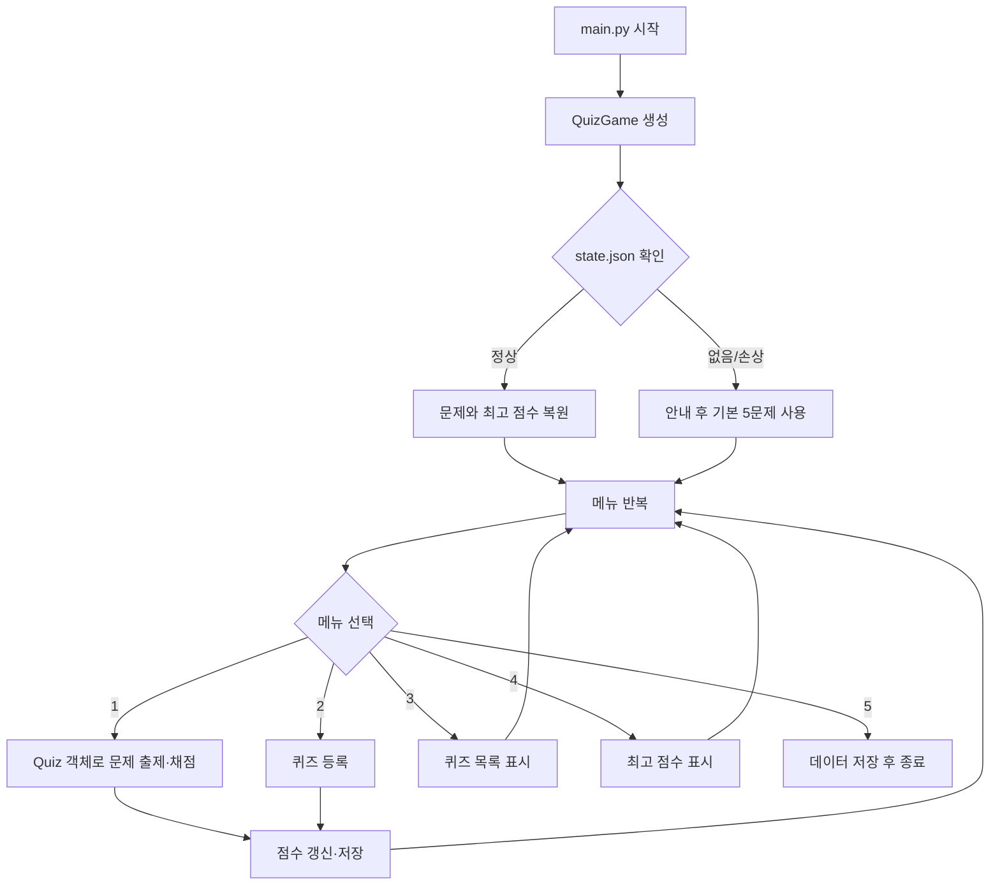

# 🧭 코디세이 기술 탐험 퀴즈 — E1-2 


## 프로젝트 개요 및 실행 환경

### 프로젝트 개요

Python으로 터미널에서 동작하는 퀴즈 게임을 만들고, 기능별 개발 이력을 Git으로 기록하는 과제입니다. 
게임의 목표 기능은 퀴즈 풀기·추가·목록·최고 점수 확인·종료입니다. `Quiz`와 `QuizGame` 두 클래스로 역할을 나누고, 문제와 최고 점수를 프로젝트 루트의 `state.json`에 UTF-8로 저장합니다. 게임 기능과 Git 병합, 다른 PC에서의 clone·pull을 진행했습니다.

### 실행 환경

| 항목 | 확인 내용 |
|---|---|
| 실습 터미널 | Windows PowerShell — 버전 미확인 |
| 작업 폴더 | `C:\all in one\e1-2` |
| Python | `3.11.9` — 사용자가 PowerShell에서 실행 확인 |
| Git | `2.55.0.windows.1` — 앞선 Codex 환경 점검에서 확인 |
| Git 브랜치 | `main` — `sky` 작업 병합 이력 확인 |
| GitHub | 원격 저장소 연결 및 `main`·`sky` push 확인 |

### 수행 항목 체크리스트

| 수행 항목 | 현재 상태 |
|---|---|
| 과제 원문 및 기존 실습 안내 검토 | 확인 |
| Python 3.10 이상 실행 확인 | 완료 — 3.11.9 |
| E1-2 작업 경로 확인 | 완료 |
| Git 저장소 초기화 | 확인 — 기존 저장소 재초기화 기록 |
| README 및 진행 로그 작성 | 작성 및 평가 보완 진행 |
| `.gitignore`·Git 작성자 정보·첫 커밋 | 기록 확인 |
| GitHub 저장소 연결 및 첫 push | 수행 기록 확인 |
| 게임 구현·JSON 저장·입력 및 파일 예외 처리 | 구현 및 일부 실행·격리 검증 확인 |
| 커밋·브랜치 병합 | 전체 커밋 18개(병합 포함), `sky`→`main` 병합 확인. 의미 있는 작업 단위는 내용별 검토 |
| clone·pull 실습 및 화면 증빙 | 다른 PC 수행 기록과 별도 임시 폴더 재검증 화면 확인 |

## 개발 환경 및 Git 실습 


### Python 실행 환경 준비


<pre style="border: 1px solid #d0d7de; border-radius: 6px; padding: 12px; background: #f6f8fa; white-space: pre-wrap; overflow-wrap: anywhere; color: #1f2328;"><code style="color: inherit;"># 작업 폴더: C:\all in one\e1-2
# 앞서 임시로 등록한 python 함수 제거
<span style="color: #0969da;">Remove-Item Function:\python -ErrorAction SilentlyContinue</span>
# 정상 설치된 Python 3.11 경로를 현재 창의 PATH 맨 앞에 추가
<span style="color: #0969da;">$env:Path = &quot;$env:LOCALAPPDATA\Programs\Python\Python311;$env:Path&quot;</span>
# 실제로 실행되는 Python 버전 확인
<span style="color: #0969da;">python --version</span></code></pre>

```text
Python 3.11.9
```

### 로컬 Git 저장소 초기화

#### 현재 작업 위치 확인

<pre style="border: 1px solid #d0d7de; border-radius: 6px; padding: 12px; background: #f6f8fa; white-space: pre-wrap; overflow-wrap: anywhere; color: #1f2328;"><code style="color: inherit;"># 현재 작업 폴더 확인, powershell 작업경로 보여줌
<span style="color: #0969da;">Get-Location</span></code></pre>

```text
Path
----
C:\all in one\e1-2
```

#### 초기화 전 Git 상태 확인

<pre style="border: 1px solid #d0d7de; border-radius: 6px; padding: 12px; background: #f6f8fa; white-space: pre-wrap; overflow-wrap: anywhere; color: #1f2328;"><code style="color: inherit;">
# Git 저장소인지 확인
<span style="color: #0969da;"> git status -sb</span></code></pre>

#### main 브랜치로 Git 저장소 초기화

<pre style="border: 1px solid #d0d7de; border-radius: 6px; padding: 12px; background: #f6f8fa; white-space: pre-wrap; overflow-wrap: anywhere; color: #1f2328;"><code style="color: inherit;"># 작업 폴더: C:\all in one\e1-2
# 현재 폴더에 Git 저장소를 만들고 첫 브랜치를 main으로 지정
<span style="color: #0969da;">git init -b main</span></code></pre>

```text
Initialized empty Git repository in C:/all in one/e1-2/.git/
```

#### 현재 브랜치와 추적되지 않은 파일 확인

<pre style="border: 1px solid #d0d7de; border-radius: 6px; padding: 12px; background: #f6f8fa; white-space: pre-wrap; overflow-wrap: anywhere; color: #1f2328;"><code style="color: inherit;">
# 한글 파일명을 그대로 표시하고 브랜치&#183;파일 상태 확인
<span style="color: #0969da;">git -c core.quotepath=false status -sb</span></code></pre>

---

# 🧭 코디세이 기술 탐험 퀴즈 

> **미션:** 컴퓨터에게 명령 내리는 말(파이썬) 처음 배우기  
> **목표:** E1-1에서 배운 Linux·Docker·Git 개념으로 **4지선다 퀴즈 5개 이상**을 만들고, Python 프로그램을 완성한 뒤 GitHub에 실제 개발 이력을 남긴다.


## 한눈에 보는 전체 흐름

```text
STEP 0. 과제 목표·퀴즈 주제·필수 요구사항 확인
   ↓
STEP 1. 환경 준비 — Python ≥3.10, Git, VS Code 설치/점검
   ↓
STEP 2. E1-2 전용 폴더 및 Git 초기 연결 — init, add, commit, push
   ↓
STEP 3. 퀴즈 게임 제작 — 아래의 7개 덩어리를 순서대로 구현
   ↓        └→ 각 기능 완료 시 기능 단위 커밋 (10개 이상)
STEP 4. Git 변경 이력·기능 브랜치·병합 검증 — checkout, merge, log
   ↓
STEP 5. README·스크린샷·테스트 및 제출 점검
   ↓
STEP 6. 별도 폴더에서 clone → 변경·push → 원본 폴더에서 pull
   ↓
최종 검증 및 GitHub 제출
```

## 목차

- [STEP 0. 프로젝트 개요·요구사항·퀴즈 기획](#step-0-프로젝트-개요요구사항퀴즈-기획)
- [STEP 1. 개발 환경 준비](#step-1-개발-환경-준비)
- [STEP 2. Git 저장소 생성·초기 연결](#step-2-git-저장소-생성초기-연결)
- [STEP 3. Python 퀴즈 게임 제작 — 7개 덩어리](#step-3-python-퀴즈-게임-제작--7개-덩어리)
  - [3.5 state.json 저장·불러오기](#state-json-save)
  - [3.11 state.json 데이터 구조와 저장 규칙](#state-json-schema)
- [STEP 4. 기능별 커밋·브랜치·병합](#step-4-기능별-커밋브랜치병합)
- [STEP 5. README·테스트·증빙](#step-5-readme테스트증빙)
- [STEP 6. Git clone·pull 실습](#step-6-git-clonepull-실습)
- [최종 제출 확인](#최종-제출-확인)

---

## STEP 0. 프로젝트 개요·요구사항·퀴즈 기획


### 0.1 프로젝트 소개

| 항목            | 내용                                                     |
| ------------- | ------------------------------------------------------ |
| 미션            | E1-2 컴퓨터에게 명령 내리는 말(파이썬) 처음 배우기                        |
| 프로젝트 이름       | 코디세이 기술 탐험 퀴즈                                          |
| 퀴즈 주제         | E1-1 개발 환경에서 접한 Ubuntu/Linux·Docker·Git 명령어와 Python 기초 |
| 개발 언어         | **Python 3.10 이상**                                     |
| 실행 방식         | 터미널 콘솔 프로그램 (`python main.py`)                         |
| 데이터 저장        | 프로젝트 최상위의 **`state.json`**, UTF-8                      |
| 버전 관리         | Git·GitHub (의미 있는 커밋 10개 이상, 브랜치 병합, clone·pull)       |
| 외부 라이브러리      | 사용하지 않음; Python 표준 라이브러리는 사용 가능                        |
| GitHub 저장소 주소 | https://github.com/modoofighting/E1-2                       |

#### 0.1.1 퀴즈 주제 선정 이유

E1-1에서 익힌 WSL/Ubuntu, Docker, Git의 명령어를 퀴즈 문제로 활용, 이전 과제를 복습하면서 E1-2의 Python 학습을 연결. **입력 → 조건 판단 → 반복 → 클래스 역할 분리 → JSON 저장 → 재실행 확인**의 프로그램 흐름을 이해를 목적으로 함.

#### 0.1.2 필수 결과물

1. 메뉴로 조작할 수 있는 Python 콘솔 퀴즈 게임 **1개**
2. 원격으로 공개된 GitHub 저장소 **1개**
3. 다음 기능: 퀴즈 풀기 / 퀴즈 추가 / 퀴즈 목록 / 최고 점수 확인 / 종료
4. 직접 만든 4지선다 문제 **5개 이상**, `Quiz`·`QuizGame` 등 클래스 **2개 이상**
5. `state.json`으로 문제와 최고 점수를 저장하고, 재실행 후 복원
6. 입력·파일 오류 처리, 기능 단위 커밋 10개 이상, 브랜치 병합, clone·pull 실습
7. README, 환경·실행 화면·Git 로그 스크린샷, 테스트 결과

### 0.2 과제 요구사항 체크리스트

#### 0.2.1 Python 및 게임 기능

- [ ] Python 3.10 이상 환경 확인
- [ ] `print()`·`input()`으로 메뉴 출력 및 선택
- [ ] 메뉴 `1. 퀴즈 풀기 / 2. 퀴즈 추가 / 3. 퀴즈 목록 / 4. 점수 확인 / 5. 종료`
- [ ] 직접 만든 4지선다 퀴즈 5개 이상 포함
- [ ] `Quiz` 클래스: question, choices(4개), answer(1~4), 문제 출력·정답 확인
- [ ] `QuizGame` 클래스: 메뉴·퀴즈 목록·점수·저장/불러오기·실행 흐름
- [ ] 여러 기능을 별도 메서드/함수로 분리
- [ ] 퀴즈 풀기: 정답/오답 안내, 최종 결과, 퀴즈 0개 예외
- [ ] 퀴즈 추가: 문제·선택지 4개·정답 입력 후 저장
- [ ] 퀴즈 목록: 데이터 출력, 퀴즈 0개 안내
- [ ] 최고 점수: 아직 풀지 않은 상태 안내, 갱신 후 저장
- [ ] `state.json`에 JSON/UTF-8로 저장·불러오기
- [ ] 파일이 없을 때 기본 퀴즈로 시작
- [ ] 파일이 손상되거나 읽기/쓰기 실패 시 안내·복구/안전한 처리
- [ ] 잘못된 입력: 공백, 문자 `abc`, 범위 밖 수, 빈 Enter 처리
- [ ] `KeyboardInterrupt`(Ctrl+C)·`EOFError`를 안전하게 처리
- [ ] 프로그램 종료 후 다시 실행해 추가한 퀴즈와 최고 점수 유지 확인

#### 0.2.2 Git 및 제출

- [ ] GitHub에 **새 E1-2 저장소** 생성; `.gitignore`, `README.md` 포함
- [ ] `git init`, `git add`, `git commit`, `git push` 실제 사용
- [ ] `git checkout`으로 기능 브랜치 생성·전환
- [ ] `git merge`로 `main`에 병합
- [ ] 의미 있는 커밋 **10개 이상** (`git log`로 확인)
- [ ] 별도 폴더에서 `git clone` 실행
- [ ] 복제본에서 변경·commit·push 후 원본에서 `git pull` 실행
- [ ] `git log --oneline --graph` 화면 증빙
- [ ] 개발 환경·메뉴·퀴즈 추가·목록·풀이·점수·재실행 화면 증빙
- [ ] README 필수 정보(개요/선정 이유/실행법/기능/파일 구조/state.json 설명) 확인
- [ ] GitHub 공개 주소 및 최종 파일 정상 확인

### 0.3 기본 퀴즈 데이터 — 5문제 확정안

> 이 표는 **문제 기획안**입니다. 실제 프로그램 데이터와 동일한지는 구현 후 확인합니다.

| # | 질문 | 선택지 1 | 선택지 2 | 선택지 3 | 선택지 4 | 정답 번호 |
|---|---|---|---|---|---|---|
| 1 | Ubuntu Bash에서 현재 디렉터리 경로를 확인하는 명령어는? | `ls` | `pwd` | `cd` | `mkdir` | **2** |
| 2 | Docker 이미지로 새 컨테이너를 생성하고 실행하는 명령어는? | `docker ps` | `docker images` | `docker run` | `docker stop` | **3** |
| 3 | Dockerfile과 빌드 컨텍스트로 새 이미지를 만드는 명령어는? | `docker build` | `docker pull` | `docker exec` | `docker logs` | **1** |
| 4 | Git에서 준비한 변경을 로컬 커밋 이력으로 기록하는 명령어는? | `git push` | `git commit` | `git add` | `git status` | **2** |
| 5 | 원격 GitHub 저장소를 새 로컬 폴더로 복제하는 명령어는? | `git fetch` | `git pull` | `git checkout` | `git clone` | **4** |


### 0.4 메뉴·출력 흐름 설계

#### 0.4.1 시작 메뉴 

```text
========================================
          코디세이 기술 탐험 퀴즈
========================================
1. 퀴즈 풀기
2. 퀴즈 추가
3. 퀴즈 목록
4. 최고 점수 확인
5. 종료
========================================
선택: 
```

| 메뉴 | 동작 | 검증 기준 |
|---|---|---|
| 1 퀴즈 풀기 | 퀴즈를 차례로 표시하고 정답 입력 및 채점 | 출제 수·정답 수·점수 확인, 최고 점수 갱신 |
| 2 퀴즈 추가 | 문제·선택지 4개·정답 번호를 입력받음 | 추가 후 목록에 반영되고 재실행 후 유지 |
| 3 퀴즈 목록 | 저장된 모든 문제 목록 표시 | 퀴즈 0개 때도 정상 안내 |
| 4 최고 점수 | 이전 플레이의 최고 기록 표시 | 첫 실행 0점 안내, 최고점 갱신 유지 |
| 5 종료 | 저장을 시도하고 프로그램 정상 종료 | 저장 오류 발생 시 안내하고 안전 종료 |

#### 0.4.2 점수 규칙 — 이 프로젝트의 설계 선택

- 각 문제의 정답은 1점으로 계산하고, 화면에는 `(정답 수 / 총 문제 수) × 100`을 정수 점수로 표시합니다.
- `best_score`는 **0~100점 범위의 최고 백분율 점수**로 저장합니다. 이 방식은 문제 수가 달라져도 비교 기준이 일정합니다.
- 퀴즈가 0개인 경우 나누기 오류를 방지하고 문제 추가를 안내합니다.

> 과제는 최고 점수 보존을 필수로 요구하지만, **100점 만점 환산 방식은 본 프로젝트의 선택 사항**입니다. 구현·테스트에서도 같은 기준을 유지합니다.

---

## STEP 1. 개발 환경 준비


### 1.1 작업 환경 및 폴더 구조

#### 1.1.1 실행 환경 기록

| 항목     | 요구 또는 계획                   | 실제 확인 결과                                                         |
| ------ | -------------------------- | ---------------------------------------------------------------- |
| OS | Windows / macOS / Linux 가능 | 조회 결과: `Windows 10 Pro`, `WindowsVersion 2009`, 빌드 `26100` |
| 터미널 | Windows PowerShell 예시 | Windows PowerShell `5.1.26100.9168` — 사용자 PowerShell에서 확인 |
| 에디터    | VS Code 권장                 | **[확인 후 기록]**                                                    |
| Python | **3.10 이상 필수**             | **3.11.9** — 사용자 PowerShell에서 확인                                 |
| Git    | 설치 후 GitHub 연결             | **2.55.0.windows.1** — Codex 환경에서 확인; 로컬 `main` 초기화, GitHub 연결 전 |
| 외부 패키지 | 필수 없음                      | **[확인 후 기록]**                                                    |

#### 운영체제 정보 확인 — 실제 실행 기록

<pre style="border: 1px solid #d0d7de; border-radius: 6px; padding: 12px; background: #f6f8fa; white-space: pre-wrap; overflow-wrap: anywhere; color: #1f2328;"><code style="color: inherit;"># Windows 제품명, 버전, 운영체제 빌드 번호 확인
<span style="color: #0969da;">Get-ComputerInfo | Select-Object WindowsProductName, WindowsVersion, OsBuildNumber</span></code></pre>

```text
WindowsProductName WindowsVersion OsBuild
                                  Number
------------------ -------------- -------
Windows 10 Pro     2009           26100
```

#### PowerShell 버전 확인 
<pre style="border: 1px solid #d0d7de; border-radius: 6px; padding: 12px; background: #f6f8fa; white-space: pre-wrap; overflow-wrap: anywhere; color: #1f2328;"><code style="color: inherit;"># PowerShell 버전 확인
<span style="color: #0969da;">$PSVersionTable.PSVersion</span></code></pre>

```text
Major  Minor  Build  Revision
-----  -----  -----  --------
5      1      26100  9168
```

#### 1.1.2 예상 파일 구조

```text
e1-2/                     ← Git 저장소의 최상위 폴더
├── .git/                 ← Git 버전 이력(자동 생성)
├── .gitignore            ← 제외할 파일·폴더
├── README.md             ← 이 문서
├── main.py               ← Python 퀴즈 게임 본체(구현 후)
├── state.json            ← 문제·최고 점수 데이터(실행 시 생성 또는 갱신)
├── docs/
│   ├── screenshots/     ← 실제 실행 스크린샷
│   └── logs/            ← 명령어와 실제 출력 기록
└── tests/               ← 선택적으로 추가하는 자동 테스트 코드
```

`state.json`은 **프로젝트 루트**에 두어야 합니다. `docs/`, `tests/` 등 증빙·테스트 폴더는 이 README의 관리 제안이며 과제 자체의 필수 폴더명은 아닙니다.

### 1.2 터미널에서 처음 실행할 명령어 (PowerShell)


```powershell
# 1. Python 버전 확인: 3.10 이상이어야 합니다.
# --version = 설치 버전 확인
python --version

# 2. Git 설치 여부 확인
# --version = Git 프로그램 버전 확인
git --version

# 3. 프로젝트 폴더가 이미 있는지 확인합니다.
# Test-Path = 해당 경로의 존재 여부(True/False) 출력
Test-Path "C:\all in one\e1-2"

# 4. 폴더가 없고 새로 생성하기로 결정한 경우에만 실행합니다.
# New-Item = 새 항목 생성, -ItemType Directory = 폴더 생성
New-Item -ItemType Directory -Path "C:\all in one\e1-2"

# 5. 해당 폴더로 이동합니다.
# Set-Location = 현재 작업 위치 변경
Set-Location "C:\all in one\e1-2"

# 6. 현재 위치와 숨김 파일까지 목록을 확인합니다.
Get-Location
Get-ChildItem -Force
```

> **실제 실행 기록:** [Python·Git 버전과 작업 폴더 확인](logs/02-environment-check.md) 

```powershell
# 실제 프로젝트 폴더를 VS Code로 엽니다.
# code . = 현재 폴더를 VS Code로 열기 (code 명령 등록된 경우)
code .

# 실제 게임 구현 후 main.py를 실행합니다.
# python = Python 실행기, main.py = 실행 파일
python main.py
```

### 1.3 설치·실행 및 확인 명령어 모음

| 터미널 명령어 | 실행 환경 | 의미 | 과제에서의 역할 |
|---|---|---|---|
| `python --version` | PowerShell/터미널 | Python 버전 조회 | 3.10 이상 확인 **필수** |
| `python main.py` | 프로젝트 루트 | 게임 실행 | 메뉴·기능 확인 **필수** |
| `python` | PowerShell/터미널 | 대화형 Python 시작 | 간단한 코드 시험(선택) |
| `exit()` | Python 대화형 창 | Python 대화형 환경 종료 | 보조 실습(선택) |
| `py --version` | Windows | Python Launcher 버전 확인 | `python` 미인식 시 대안(선택) |
| `py -3 main.py` | Windows | Python 3로 게임 실행 | 실행 대안(선택) |
| `python -m py_compile main.py` | 프로젝트 루트 | Python 문법 오류 점검 | 정적 문법 확인(선택) |
| `python -m json.tool state.json` | 프로젝트 루트 | JSON 문법 및 내용 확인 | 데이터 파일 검증(선택) |
| `python -m unittest discover -s tests -v` | 프로젝트 루트 | 표준 라이브러리 자동 테스트 실행 | `tests/` 구현한 경우(선택) |

---

## STEP 2. Git 저장소 생성·초기 연결


### 2.1 Git과 GitHub의 역할

- **Git:** 내 PC에서 파일의 변경 이력을 커밋으로 저장하는 도구.
- **GitHub:** Git 이력을 원격 저장소에 공개·공유하는 서비스.
- **commit:** 하나의 의미 있는 작업 완료 기록.
- **branch:** 독립적인 작업 흐름. 과제는 최소 한 번 별도 브랜치에서 개발하고 `main`에 병합해야 합니다.
- **push / pull:** 로컬 변경을 원격으로 올리기 / 원격 변경을 가져와 반영하기.

### 2.2 Git 작업 1단계 — 새 저장소 초기 설정


#### 2.2.1 로컬 저장소 만들기와 Git 작성자 설정 (PowerShell)

```powershell
# 프로젝트 루트로 이동합니다.
Set-Location "C:\all in one\e1-2"햣

# Git 저장소인지 먼저 확인합니다.
# .git이 없고 새 E1-2 폴더일 때만 다음 git init을 실행합니다.
Get-ChildItem -Force

# init = initialize, 이 폴더에 Git 이력 관리를 시작합니다. [필수 명령 1]
git init

# config = Git 설정, --local = 현재 E1-2 저장소에만 적용
# 이 이름은 커밋 작성자 표시용이며 GitHub 로그인 자체는 아닙니다.
git config --local user.name "본인 Git 작성자 이름"

# user.email = 커밋에 기록되는 이메일; 실제 GitHub 등록 주소나 비공개 noreply 주소로 바꿉니다.
git config --local user.email "본인의 GitHub 커밋 이메일"

# 현재 저장소에 적용된 이름·이메일 확인
git config --local --get user.name
git config --local --get user.email

# 현재 브랜치 및 파일 상태를 확인합니다.
git status -sb
```

> **실제 실행 기록:** [로컬 Git 저장소 및 작성자 설정](logs/03-git-local-config.md) 

##### Git 전역 설정과 로컬 설정

Git 작성자 정보는 적용 범위에 따라 다음처럼 구분합니다.

| 설정 | 적용 범위 | 우선순위 |
|---|---|---|
| `--local` | 현재 Git 저장소와 그 안의 하위 폴더 | 전역 설정보다 우선 |
| `--global` | 현재 Windows 사용자의 Git 저장소에서 사용하는 기본값 | 해당 저장소의 로컬 값이 없을 때 사용 |

새 폴더마다 설정할 필요는 없음. 별도 저장소를 만들었을 때 로컬 값이 없으면 전역 값을 사용할 수 있다. 
<pre style="border: 1px solid #d0d7de; border-radius: 6px; padding: 12px; background: #f6f8fa; white-space: pre-wrap; overflow-wrap: anywhere; color: #1f2328;"><code><span style="color: #0969da;">git config --global --get user.name</span>
<span style="color: #0969da;">git config --global --get user.email</span></code></pre>

```powershell
# 전역 작성자 설정 예시 — 필요할 때만 실행
git config --global user.name "작성자 이름"
git config --global user.email "작성자 이메일"
```

#### 2.2.2 `.gitignore` 작성·초기 커밋·원격 연결

##### .gitignore 파일 생성과 저장

`.gitignore`는 Git이 **추적하지 않을 파일·폴더의 규칙**을 읽는 설정 파일입니다. 아래 내용은 PowerShell 명령이 아니라 이 파일에 저장할 텍스트입니다. 규칙은 아직 Git이 추적하지 않는 항목에 적용됩니다.

**VS Code에서 수행한 순서**

1. 탐색기에서 **새 파일**을 만들기
2. 파일 이름에 `.gitignore`를 입력. 
3. 아래 규칙을 파일에 입력하고 **Ctrl+S**로 저장. 탭의 흰색 점이 사라지면 저장된 상태.
4. PowerShell에서 `git status -sb`를 실행. `?? .gitignore`가 표시되면 파일이 존재하며 아직 추적되지 않는 상태입니다. 
5. 그다음 `git add`로 README와 `.gitignore`, 필요한 로그를 커밋 대상으로 준비. Git은 이때 `.gitignore`에 적힌 규칙을 참고.

**파일에 입력하는 내용**
```gitignore
# Python 실행 후 생성되는 임시 캐시
__pycache__/
*.py[cod]
```

> **실제 실행 기록:** [.gitignore 작성과 Git 상태 확인](logs/04-gitignore.md) — 저장한 규칙과 확인 결과.


##### 1. README와 .gitignore를 커밋 대상으로 준비

<pre style="border: 1px solid #d0d7de; border-radius: 6px; padding: 12px; background: #f6f8fa;"><code>
# README와 .gitignore를 다음 커밋 대상으로 선택
<span style="color: #0969da;">git add README.md .gitignore</span></code></pre>

##### 2. 로그 파일도 준비 — 실행한 명령

README가 참조하는 작업 로그도 같은 커밋에 담기 위해 **다음 명령을 별도로 입력**했습니다.

<pre style="border: 1px solid #d0d7de; border-radius: 6px; padding: 12px; background: #f6f8fa;"><code># logs 폴더의 파일도 다음 커밋 대상으로 선택
<span style="color: #0969da;">git add logs/</span></code></pre>

**실제 출력 요약:** `02-environment-check.md`, `03-git-local-config.md`, `04-gitignore.md`, `05-git-staging.md`, `progress.md` 각각에 대해 LF가 나중에 CRLF로 바뀔 수 있다는 경고가 표시

##### 2-1. 준비된 파일 이름 확인 

<pre style="border: 1px solid #d0d7de; border-radius: 6px; padding: 12px; background: #f6f8fa;"><code># 커밋을 위해 준비된 파일 이름만 확인
<span style="color: #0969da;">git diff --cached --name-only</span></code></pre>

```text
.gitignore
README.md
logs/02-environment-check.md
logs/03-git-local-config.md
logs/04-gitignore.md
logs/05-git-staging.md
logs/progress.md
```

출력에 `.gitignore`와 `README.md`가 있으므로 앞서 실행한 `git add README.md .gitignore`로 두 파일이 준비됐음을 확인. 로그 파일들도 이후 `git add logs/`로 준비. `--cached`는 스테이징 영역을, `--name-only`는 파일 이름만 표시한다는 뜻. 이 목록은 **명령을 실행한 당시의 상태**.

```powershell
# 수정된 README와 작업 로그를 다시 커밋 대상으로 준비
git add README.md logs/
# 대상 파일 목록과 변경 내용 확인
git diff --cached --name-only
git diff --cached
```
상세 실행 기록 [첫 커밋 준비 로그](logs/05-git-staging.md).

##### 4. 첫 커밋 
<pre style="border: 1px solid #d0d7de; border-radius: 6px; padding: 12px; background: #f6f8fa;"><code># 스테이징된 파일들을 첫 번째 로컬 커밋으로 기록
<span style="color: #0969da;">git commit -m "chore: initialize E1-2 project and README"</span></code></pre>

```powershell
# PowerShell 프롬프트로 돌아온 뒤 한 줄씩 실행하도록 안내한 명령
git add README.md
git commit -m "chore: initialize E1-2 project and README"
```

```powershell
git commit -m "chore: initialize E1-2 project and README"
```

| 부분                                   | 의미                                                                                   |
| ------------------------------------ | ------------------------------------------------------------------------------------ |
| `git`                                | Git 버전 관리 프로그램을 실행합니다.                                                               |
| `commit`                             | `git add`로 스테이징 영역에 준비한 내용의 스냅샷을 현재 저장소의 이력에 기록합니다. 작업 폴더의 모든 파일이 자동으로 포함되는 것은 아닙니다. |
| `-m`                                 | 뒤에 오는 문자열을 커밋 메시지로 지정합니다.                                                            |
| `"..."`                              | 공백이 포함된 메시지 전체를 하나의 문자열로 전달합니다. 여는 따옴표와 닫는 따옴표가 모두 필요합니다.                            |
| `chore:`                             | 이 프로젝트에서 준비·설정 작업을 나타내기 위해 선택한 메시지 접두사입니다. Git이 강제하는 문법은 아닙니다.                       |
| `initialize E1-2 project and README` | “E1-2 프로젝트와 README를 초기 설정한다”는 작업 설명입니다.                                              |
##### 2. 스테이징된 파일 이름 확인

<pre style="border: 1px solid #d0d7de; border-radius: 6px; padding: 12px; background: #f6f8fa;"><code># 다음 커밋에 준비된 파일 이름만 확인
<span style="color: #0969da;">git diff --cached --name-only</span></code></pre>

```text
README.md
```

##### 3. 두 번째 커밋 생성

<pre style="border: 1px solid #d0d7de; border-radius: 6px; padding: 12px; background: #f6f8fa;"><code># 스테이징된 README 변경을 로컬 Git 이력에 기록
<span style="color: #0969da;">git commit -m "docs: record first commit"</span></code></pre>

```text
[main 15e7c36] docs: record first commit
 1 file changed, 53 insertions(+), 6 deletions(-)
```

##### 5-1. 기존 원격 연결 확인


<pre style="border: 1px solid #d0d7de; border-radius: 6px; padding: 12px; background: #f6f8fa;"><code># 현재 저장소에 연결된 원격 주소 확인
<span style="color: #0969da;">git remote -v</span></code></pre>

##### 5-2. GitHub 저장소를 origin으로 연결

<pre style="border: 1px solid #d0d7de; border-radius: 6px; padding: 12px; background: #f6f8fa;"><code># GitHub 저장소 주소를 origin이라는 이름으로 등록
<span style="color: #0969da;">git remote add origin https://github.com/modoofighting/E1-2.git</span>
# 등록된 주소 확인
<span style="color: #0969da;">git remote -v</span></code></pre>
##### 5-3. main 브랜치 push

<pre style="border: 1px solid #d0d7de; border-radius: 6px; padding: 12px; background: #f6f8fa;"><code># 로컬 main의 커밋을 origin의 main에 올리고 추적 관계 설정
<span style="color: #0969da;">git push -u origin main</span></code></pre>

---

## STEP 3. Python 퀴즈 게임 제작 — 7개 덩어리


### 3.0 처음 시작할 때: 파일 위치와 붙여 넣는 순서

1. VS Code에서 이 프로젝트 폴더 `C:\Users\skylandspace010191\E1-2`를 연다.
2. 왼쪽 파일 목록에서 `main.py`를 연다. 파일이 없다면 프로젝트 이름을 마우스 오른쪽 버튼으로 눌러 **New File**을 선택하고 이름을 `main.py`로 만든다. `docs` 폴더 안이 아니라 README와 같은 프로젝트 최상위 위치에 만든다.
3. 각 덩어리의 코드는 모두 이 **같은 `main.py` 파일**에 순서대로 작성한다. 새 Python 파일을 덩어리마다 만들지 않는다.
4. 덩어리 1의 `Quiz` 클래스 코드를 파일 맨 위에 넣는다. 덩어리 2의 `default_quizzes` 목록은 클래스가 끝난 다음, 클래스 바깥쪽(맨 왼쪽부터)에 넣는다. 덩어리 3의 `QuizGame` 클래스는 퀴즈 목록 아래에 넣는다.
5. 이후 덩어리에서 기존 클래스의 메서드를 구현할 때는 해당 `pass`가 있는 메서드 내용을 교체한다. 같은 메서드를 파일 아래에 또 붙이지 않는다. `import`문은 파일 맨 위, 게임 시작 코드는 모든 클래스와 함수가 끝난 파일 맨 아래에 둔다.
6. 코드를 붙인 뒤 `Ctrl+S`로 저장하고, 터미널에서 `python main.py`로 실행한다. 아직 게임 시작 코드가 없는 단계에서는 실행해도 화면에 아무것도 나오지 않을 수 있다.

### 3.1 덩어리 1. `Quiz` 클래스 — 문제 하나의 설계도

**필수:** `question`(질문), `choices`(선택지 4개), `answer`(1~4 정답 번호). `show()`는 문제와 선택지를 출력하고, `check()`는 사용자가 고른 번호가 정답인지 반환한다.

```python
# main.py 내부에 들어갈 클래스의 기본 형태(구현 전 설계 예시)
class Quiz:
    def __init__(self, question, choices, answer):
        self.question = question   # 문제 문장
        self.choices = choices     # 선택지 4개가 들어있는 list
        self.answer = answer       # 1~4 사이 정수

    def show(self):
        # 문제와 4개 선택지를 순서대로 보여주는 로직 작성
        pass

    def check(self, user_answer):
        return user_answer == self.answer
```

**완료 확인:** 실제 코드에서 `Quiz(...)` 객체 생성, 네 선택지 출력, 정답과 오답 반환을 각각 확인한다.

- [ ] `Quiz` 클래스·필수 속성 3개·메서드 2개 구현
- [ ] 정답 `1~4`, 선택지 4개인지 검증
- [ ] 완료 후 해당 변경만 커밋

### 3.2 덩어리 2. 기본 퀴즈 데이터 — 코디세이 기술 5문제

**필수:** STEP 0의 표에 제안한 명령어 문제 **5개 이상**을 `Quiz` 인스턴스로 만든다. 각 문제에는 질문·4개 선택지·정답 번호가 있어야 한다.

`class Quiz:` 코드는 그대로 두고, 덩어리 1에서 동작을 확인하려고 클래스 아래에 임시로 넣었던 `quiz = Quiz(...)`, `quiz.show()`, `print(...)` 코드를 지운다. 그 자리에 아래의 `default_quizzes = [...]` 목록을 붙여 넣고 저장한다. `default_quizzes`는 게임에서 사용할 기본 문제들을 담아 두는 이름이다.

```python
default_quizzes = [
    Quiz(
        "Ubuntu Bash에서 현재 디렉터리 경로를 확인하는 명령어는?",
        ["ls", "pwd", "cd", "mkdir"],
        2,
    ),
    Quiz(
        "Docker 이미지로 새 컨테이너를 생성하고 실행하는 명령어는?",
        ["docker ps", "docker images", "docker run", "docker stop"],
        3,
    ),
    Quiz(
        "Dockerfile과 빌드 컨텍스트로 새 이미지를 만드는 명령어는?",
        ["docker build", "docker pull", "docker exec", "docker logs"],
        1,
    ),
    Quiz(
        "Git에서 준비한 변경을 로컬 커밋 이력으로 기록하는 명령어는?",
        ["git push", "git commit", "git add", "git status"],
        2,
    ),
    Quiz(
        "원격 GitHub 저장소를 새 로컬 폴더로 복제하는 명령어는?",
        ["git fetch", "git pull", "git checkout", "git clone"],
        4,
    ),
]
```

### 3.3 덩어리 3. `QuizGame` 클래스 — 게임 운영자

**필수:** 전체 퀴즈 목록, 최고 점수, 메뉴·출제·추가·목록·점수·파일 입출력의 책임을 나눠 맡는다.

**붙여 넣을 위치:** 덩어리 2의 `default_quizzes` 목록이 닫히는 `]` 다음 줄에, 같은 `main.py` 파일의 왼쪽 끝부터 `class QuizGame:`을 작성한다. 클래스 안 메서드들은 클래스보다 4칸, 메서드 안 코드는 8칸 들여쓴다. 이 클래스 정의는 `default_quizzes` 아래에 한 번만 둔다.

```python
# 각 메서드는 이후 덩어리에서 실제 동작을 구현하는 자리입니다.
class QuizGame:
    def __init__(self):
        self.quizzes = default_quizzes.copy()  # 기본 Quiz 객체 목록 복사
        self.best_score = 0    # 게임 최고 점수

    def show_menu(self):
        pass  # 덩어리 4에서 구현

    def get_choice(self, minimum, maximum):
        pass  # 덩어리 6에서 공통 입력 검증 구현

    def play(self):
        pass  # 문제 출제·채점

    def add_quiz(self):
        pass  # 문제 등록

    def show_list(self):
        pass  # 저장된 문제 목록 출력

    def show_score(self):
        pass  # 최고 점수 확인

    def save(self):
        pass  # 덩어리 5에서 JSON 저장

    def load(self):
        pass  # 덩어리 5에서 JSON 읽기

    def run(self):
        pass  # 메뉴 반복·종료 관리
```

**실행하면 무엇이 보이나요?** 덩어리 3까지는 클래스를 정의만 하므로 `python main.py`를 실행해도 화면에 아무것도 나오지 않는 것이 정상이다. `pass`는 메서드가 아직 비어 있다는 표시이기도 하다. 메뉴가 실제로 나타나려면 뒤 단계에서 메서드를 구현하고, 파일 맨 아래에서 `QuizGame` 객체를 만들고 실행해야 한다.

- [ ] 두 클래스가 서로 다른 책임을 담당
- [ ] 문제 출제·추가·목록·점수 기능별 메서드 완성
- [ ] 각 기능의 실제 실행 결과 확인 및 커밋

### 3.4 덩어리 4. 메인 메뉴 및 퀴즈 풀이 흐름

**메뉴:** `1 퀴즈 풀기 / 2 퀴즈 추가 / 3 퀴즈 목록 / 4 최고 점수 / 5 종료`.

**이 덩어리에서 하는 일:** `QuizGame`에 메뉴를 보여주고, 퀴즈를 내고, 메뉴 선택을 반복하는 메서드를 작성한다. 새 파일은 만들지 않는다.

**그대로 둠:** `Quiz` 클래스, `default_quizzes`, `QuizGame.__init__()`, 그리고 `add_quiz()`, `show_list()`, `show_score()`, `save()`, `load()`는 이 덩어리에서 건드리지 않는다.

**교체 A → B:** `QuizGame` 안의 기존 `show_menu()` 메서드 전체를 아래 `show_menu()`로 바꾼다. 기존 `play()`와 `run()`도 각각 메서드 시작 줄부터 다음 메서드 시작 직전까지 전체를 지우고, 아래의 같은 이름 메서드로 바꾼다. 메서드 이름이 중복되지 않게 한다. `get_choice()`는 이 덩어리에서는 그대로 두며 덩어리 6에서 다룬다. 메서드 정의 앞에는 공백 4칸, 메서드 안 코드 앞에는 공백 8칸을 둔다.

**코드 A — `QuizGame` 안에서 아래 세 메서드 전체를 찾는다:**

```python
    def show_menu(self):
        pass  # 덩어리 4에서 구현

    def play(self):
        pass  # 문제 출제·채점

    def run(self):
        pass  # 메뉴 반복·종료 관리
```

아래 **코드 B 전체**로 코드 A를 교체한다.

```python
# 코드 B
    def show_menu(self):
        print("\n=== 코디세이 기술 탐험 퀴즈 ===")
        print("1. 퀴즈 풀기")
        print("2. 퀴즈 추가")
        print("3. 퀴즈 목록")
        print("4. 최고 점수 확인")
        print("5. 종료")

    def play(self):
        if not self.quizzes:
            print("등록된 퀴즈가 없습니다.")
            return

        score = 0
        for quiz in self.quizzes:
            quiz.show()
            answer = input("정답 번호를 입력하세요: ")
            if answer.isdigit() and quiz.check(int(answer)):
                print("정답입니다!")
                score += 1
            else:
                print(f"오답입니다. 정답은 {quiz.answer}번입니다.")

        print(f"결과: {score}/{len(self.quizzes)}개 정답")
        if score > self.best_score:
            self.best_score = score

    def run(self):
        while True:
            self.show_menu()
            choice = input("선택: ").strip()

            if choice == "1":
                self.play()
            elif choice == "2":
                self.add_quiz()       # 덩어리 6에서 구현
            elif choice == "3":
                self.show_list()      # 덩어리 6에서 구현
            elif choice == "4":
                self.show_score()     # 덩어리 6에서 구현
            elif choice == "5":
                print("게임을 종료합니다.")
                break
            else:
                print("1~5 중에서 입력해 주세요.")
```

**아직 구현하지 않는 기능:** 메뉴 2~4에 연결된 퀴즈 추가·목록·점수 메서드는 뒤 덩어리에서 구현한다. 

- [ ] 메뉴 출력 및 반복 흐름 구현
- [ ] 사용자 답과 정답을 비교하여 정답/오답 안내
- [ ] 모든 기본 문제를 풀면 맞힌 수와 총 문제 수 출력

<a id="state-json-save"></a>
### 3.5 덩어리 5. `state.json` 저장·불러오기

현재 파일: [state.json](state.json) · [main.py의 저장·불러오기 코드](main.py) · [저장과 종료 화면](docs/screenshots/19-state-first-save.png) · [데이터 구조와 저장 규칙](#state-json-schema)

**과제 원문이 요구하는 파일명은 `state.json`이며 프로젝트 루트에 둔다.** 참고 README의 `pickle`/`quizzes.pkl`은 사용하지 않는다. JSON에는 최소 `quizzes`와 `best_score`가 있어야 한다.

**이 덩어리에서 `main.py`에 넣을 코드:** 아래 독립 예시를 그대로 실행하는 것이 아니라, 게임 클래스의 저장·불러오기 메서드를 실제로 구현한다.

**그대로 둠:** `Quiz`, `default_quizzes`, `QuizGame.__init__()`, `show_menu()`, `play()`, `run()`의 나머지 코드는 유지한다.

**새로 추가:** 파일 첫 줄(다른 import가 있으면 그 import들 모음)에 `import json`을 추가한다.

**교체 A → B:** `QuizGame` 안의 기존 `save()` 메서드 전체를 아래 `save()`로 교체한다. 기존 `load()` 메서드 전체도 아래 `load()`로 교체한다. 메서드 안의 `pass`만 바꾸는 것이 아니라 `def save...` 또는 `def load...` 줄부터 메서드 본문 전체를 교체한다.

**코드 A — `QuizGame` 안에서 아래 두 메서드 전체를 찾는다:**

```python
    def save(self):
        pass  # 덩어리 5에서 JSON 저장

    def load(self):
        pass  # 덩어리 5에서 JSON 읽기
```

아래 **코드 B 전체**로 코드 A를 교체한다.

**정해진 위치에 한 줄 추가:** `play()`에서 최고 점수 갱신이 끝난 뒤 `self.save()`를 추가한다. `run()`의 5번 종료 분기에는 종료 안내문 앞에 `self.save()`를 추가한다. 기존 분기 전체를 교체하지 않는다.

**덩어리 7과 연결:** 파일 아래에 실행 코드가 이미 있다면, `game.run()` 바로 위에 `game.load()` 한 줄을 추가한다. 실행 코드가 없다면 덩어리 7에서 새로 작성한다.

```python
    def save(self):
        data = {
            "quizzes": [
                {
                    "question": quiz.question,
                    "choices": quiz.choices,
                    "answer": quiz.answer,
                }
                for quiz in self.quizzes
            ],
            "best_score": self.best_score,
        }
        with open("state.json", "w", encoding="utf-8") as file:
            json.dump(data, file, ensure_ascii=False, indent=2)
        print("진행 상황을 저장했습니다.")

    def load(self):
        try:
            with open("state.json", "r", encoding="utf-8") as file:
                data = json.load(file)
            self.quizzes = [
                Quiz(item["question"], item["choices"], item["answer"])
                for item in data["quizzes"]
            ]
            self.best_score = data["best_score"]
            print("저장된 퀴즈를 불러왔습니다.")
        except FileNotFoundError:
            self.quizzes = default_quizzes.copy()
            self.best_score = 0
            print("저장 파일이 없어 기본 퀴즈로 시작합니다.")
```

`self.save()`는 `play()`에서 최고 점수가 바뀐 뒤, `run()`에서 5번 종료를 선택했을 때 호출한다. 게임 시작 코드는 다음과 같이 수정한다.

```python
if __name__ == "__main__":
    game = QuizGame()
    game.load()
    game.run()
```

이 예시는 파일이 없는 첫 실행을 처리한다. 손상된 JSON이나 파일 접근 오류 처리는 덩어리 6에서 추가한다.

```python
import json
data = {"quizzes": [], "best_score": 0}
with open("state.json", "w", encoding="utf-8") as file:
    json.dump(data, file, ensure_ascii=False, indent=2)
```

위 짧은 코드는 JSON 형식을 이해하기 위한 참고 예시일 뿐이다. 게임 기능은 위의 `save()`와 `load()` 메서드로 구현한다.

- [ ] 최초 실행에서 기본 퀴즈로 시작
- [ ] 퀴즈 추가·최고점 변경 후 JSON에 저장
- [ ] 프로그램 종료·재시작 후 변경 내용 유지
- [ ] JSON 손상·파일 접근 오류 안내 및 복구

### 3.6 덩어리 6. 공통 입력 및 예외 처리

**필수 입력 사례:** 공백을 포함한 정상 입력, `abc`, 범위 밖 숫자, 빈 Enter. **필수 종료 사례:** `Ctrl+C`(`KeyboardInterrupt`), `EOFError`. **필수 파일 사례:** 파일 없음·손상·읽기/쓰기 실패.

**코드 A — `QuizGame` 안의 기존 입력 메서드:**

```python
    def get_choice(self, minimum, maximum):
        pass  # 덩어리 6에서 공통 입력 검증 구현
```

아래 **코드 B 전체**로 코드 A를 교체한다. `play()`와 `run()`에서 이미 `self.get_choice(...)`를 호출하므로, 그 호출 줄은 그대로 둔다.

```python
    def get_choice(self, minimum, maximum):
        while True:
            try:
                raw = input(f"{minimum}~{maximum} 중 번호를 입력하세요: ").strip()
                if raw == "":
                    print("입력값이 없습니다. 다시 입력하세요.")
                    continue
                choice = int(raw)
                if not minimum <= choice <= maximum:
                    print(f"{minimum}~{maximum} 사이 숫자를 입력하세요.")
                    continue
                return choice
            except ValueError:
                print("숫자를 입력하세요.")
```

**완료 확인:** 

- [ ] `strip()`으로 앞뒤 공백 제거
- [ ] 빈 입력/문자/범위 오류 안내 후 재입력
- [ ] Ctrl+C/EOF 오류 없이 종료
- [ ] 손상된 JSON과 저장 실패를 `try/except`로 처리

### 3.7 덩어리 7. `main.py` 시작점

**역할:** Python이 `main.py` 파일을 직접 실행할 때 게임 인스턴스를 만들고, 저장된 데이터부터 읽은 다음 게임을 시작한다.

**교체 A → B:** `main.py` 맨 아래에 실행 코드가 이미 있으면 그 실행 코드 블록만 아래 코드로 교체한다. `Quiz`와 `QuizGame` 클래스는 그대로 둔다. 아직 실행 코드가 없다면 파일 맨 마지막에 새로 추가한다. 이 코드는 한 번만 둔다.

**코드 A — 파일 맨 아래에 있는 기존 실행 코드:**

```python
if __name__ == "__main__":
    game = QuizGame()
    game.run()
```

아래 **코드 B 전체**로 코드 A를 교체한다.

```python
# 프로그램을 직접 실행했을 때만 아래 코드를 실행
if __name__ == "__main__":
    game = QuizGame()
    game.load()           # 기존 JSON 또는 기본 퀴즈 불러오기
    game.run()            # 메뉴 반복 시작
```

**검증:** 프로젝트 루트에서 `python main.py`를 실행해 메뉴가 표시되는지 확인한다. 위 구문만 작성했다고 실행되는 것은 아니며, 덩어리 1~6의 실제 메서드가 구현되어 있어야 한다.

- [ ] `python main.py` 실행
- [ ] 메뉴·퀴즈·점수·종료 기능 확인
- [ ] 최종 검증 전에 문법과 JSON 유효성 점검

### 3.8 7개 덩어리의 완료 확인표

| 단위 | 구현 산출물 | 검증 방법 | 상태 |
|---|---|---|---|
| 1. Quiz | 문제 표시·정답 확인 | 정답/오답 판정 | [ ] |
| 2. 기본 데이터 | 문제 5개 이상 | 첫 실행의 문제 수 | [ ] |
| 3. QuizGame | 메뉴·기능별 메서드 | 모든 기능 호출 | [ ] |
| 4. 메뉴 | 선택 1~5 작동 | 실행·재입력 | [ ] |
| 5. 저장 | state.json | 종료·재시작 | [ ] |
| 6. 예외 | 입력/중단/파일 오류 | 오류별 테스트 | [ ] |
| 7. 시작점 | main.py | 터미널에서 실행 | [ ] |

### 3.9 Python 문법 한눈에 보기

> 아래는 **`main.py` 안에 작성하는 Python 문법·함수**입니다. 터미널에 입력하는 `python main.py`와 구별해야 합니다.

#### 3.9.1 변수와 기본 자료형 — 필수 학습

| 코드·용어 | 영어 또는 뜻 | 과제 적용 예 |
|---|---|---|
| `=` | 대입(변수에 값을 저장) | `score = 0` |
| `int` / `int()` | integer, 정수 / 정수 변환 | 정답 번호 `1~4` |
| `str` / `str()` | string, 문자열 / 문자열 변환 | 질문 문장과 사용자 입력 |
| `bool` | boolean, 참/거짓 | 정답 여부 `True`·`False` |
| `list` | 순서 있는 목록 | 문제 목록, 4개 선택지 |
| `dict` | key와 value의 묶음 | JSON으로 옮길 퀴즈 데이터 |
| `True`, `False` | 참, 거짓 | `check()`의 반환 결과 |
| `None` | 값이 없음 | 아직 선택·결과가 없는 상태(보조) |

```python
# 숫자·문자·참/거짓은 서로 다른 자료형입니다.
score = 80                    # int: 정수
question = "Git이란?"          # str: 문자열
is_correct = True            # bool: 참/거짓
choices = ["Git", "Docker", "WSL", "Python"]  # list: 순서 있는 목록
quiz_data = {"question": question, "answer": 1}  # dict: 키와 값의 관계
```

#### 3.9.2 출력·입력·형 변환

| 문법/함수 | 역할 | 퀴즈에서 사용하는 지점 |
|---|---|---|
| `print(내용)` | 화면 출력 | 메뉴, 문제, 결과, 오류 안내 |
| `input("문구")` | 사용자 입력(문자열로 받음) | 메뉴·정답·새 문제 입력 |
| `.strip()` | 입력 앞뒤 공백 제거 | `" 1 "`을 `"1"`로 처리 |
| `int("2")` | 문자열을 정수로 변환 | 메뉴 1~5번, 답 1~4번 |
| `str(숫자)` | 숫자를 문자로 변환 | 출력문 구성(필요시) |
| `len(목록)` | 항목 개수 반환 | 총 퀴즈 개수 계산 |
| `type(값)` | 값의 자료형 확인 | 학습·디버깅용(필수 기능 아님) |

```python
# 문자열을 받아 공백을 제거합니다.
raw_answer = input("정답 번호(1~4): ").strip()

# 숫자로 변환하며, 잘못된 문자 입력에 대비한 try/except가 실제 게임에 필요합니다.
answer = int(raw_answer)
print("입력한 번호:", answer)
```

#### 3.9.3 조건문과 비교 연산 

| 문법 | 의미 | 게임의 활용 |
|---|---|---|
| `if` | 조건이 참이면 실행 | 정답일 때 점수 증가 |
| `elif` | 앞 조건이 아닐 때 다음 조건 확인 | 메뉴 2·3·4 처리 |
| `else` | 위 조건이 모두 아닐 때 실행 | 오답·잘못된 메뉴 처리 |
| `==`, `!=` | 같은지 / 다른지 비교 | 정답 번호 비교 |
| `<`, `<=`, `>`, `>=` | 크기 비교 | 정답 번호 범위·최고 점수 |
| `and`, `or`, `not` | 논리 연산 | 입력 유효성 등 |

```python
if answer == 2:
    print("정답입니다!")
elif answer in [1, 3, 4]:
    print("오답입니다.")
else:
    print("1~4 중에서 입력하세요.")
```

#### 3.9.4 반복문 

| 문법 | 의미 | 사용 위치 |
|---|---|---|
| `while` | 조건이 참인 동안 반복 | 종료 선택 전까지 메뉴 반복 |
| `for` | 목록 항목을 하나씩 순회 | 여러 퀴즈 차례로 출제 |
| `in` | 순회할 대상 또는 포함 여부 | `for quiz in quizzes` |
| `break` | 현재 반복 종료 | 메뉴 5(종료) 처리 |
| `continue` | 다음 반복으로 넘어감 | 잘못된 입력 후 재질문 |
| `range()` | 지정된 정수 범위 생성 | 선택지 번호 1~4 표시(선택) |
| `enumerate()` | 번호와 항목을 함께 반환 | 문제 번호 표시(선택) |

```python
# 메뉴를 종료할 때까지 반복하는 개념 예시입니다.
while True:
    choice = input("메뉴 선택(1~5): ").strip()
    if choice == "5":
        break
    if choice not in ["1", "2", "3", "4"]:
        print("1~5 중에서 선택하세요.")
        continue
    print("선택한 메뉴:", choice)

# 리스트를 한 문제씩 꺼내는 반복 개념 예시입니다.
for quiz in quizzes:
    print(quiz.question)
```

#### 3.9.5 함수·클래스·객체 

| 문법·용어 | 의미 | 예시/용도 |
|---|---|---|
| `def` | 함수/메서드 정의 | `def play(self):` |
| 매개변수(parameter) | 함수가 받는 입력 값의 이름 | `user_answer` |
| `return` | 결과 반환 | 정답 여부 `True`/`False` |
| `class` | 객체 설계도 정의 | `Quiz`, `QuizGame` |
| 객체(instance) | 클래스로 만든 실제 대상 | 문제 한 개 `Quiz(...)` |
| `__init__` | 객체 생성 시 속성 초기화 | 질문·선택지·정답 설정 |
| `self` | 해당 객체 자신 | `self.answer` |
| 속성(attribute) | 객체가 가지고 있는 데이터 | `self.quizzes`, `self.best_score` |
| 메서드(method) | 객체에 속한 함수 | `show()`, `check()` |

```python
# Quiz 클래스 형태를 이해하기 위한 구조 예시입니다.
class Quiz:
    def __init__(self, question, choices, answer):
        self.question = question
        self.choices = choices
        self.answer = answer

    def show(self):
        print(self.question)
        for number, choice in enumerate(self.choices, start=1):
            print(number, choice)

    def check(self, user_answer):
        return user_answer == self.answer
```

`QuizGame`은 퀴즈 한 문제가 아니라 게임 전체를 관리하는 두 번째 클래스입니다. 아래는 **구조를 보여주는 예시**입니다(전체 기능 구현 아님).

```python
class QuizGame:
    def __init__(self):
        self.quizzes = []      # Quiz 객체의 목록
        self.best_score = 0    # 현재까지 최고 점수

    def show_menu(self):
        print("1. 퀴즈 풀기 / 2. 추가 / 3. 목록 / 4. 점수 / 5. 종료")
```

#### 3.9.6 파일·JSON 

| 구문 | 의미 | 역할 |
|---|---|---|
| `import json` | Python 표준 JSON 모듈 불러오기 | 파일 저장·복원 |
| `open("state.json", "r", ...)` | 파일 읽기 모드로 열기 | 저장된 문제/점수 읽기 |
| `open("state.json", "w", ...)` | 파일 쓰기 모드로 열기 | 문제/점수 저장(기존 내용 대체) |
| `with open(...) as file:` | 파일 사용 범위를 관리 | 종료 시 파일 닫기 |
| `encoding="utf-8"` | UTF-8 텍스트 인코딩 지정 | 한글 저장·복원 |
| `file.read()` | 일반 텍스트 파일의 내용을 문자열로 읽기 | 파일 읽기 과정 이해(보조 예시) |
| `file.write(문자열)` | 문자열을 파일에 기록하기 | 파일 쓰기 과정 이해(보조 예시) |
| `json.load(file)` | JSON 파일을 Python 데이터로 변환 | `state.json` 복원 |
| `json.dump(data, file, ...)` | Python 데이터를 JSON으로 기록 | 데이터 영속성 |
| `ensure_ascii=False` | 한글을 그대로 저장 | 읽기 쉬운 JSON (권장 옵션) |
| `indent=2` | JSON 들여쓰기 | 가독성 개선 (권장 옵션) |

```python
import json

# 파일 저장 — 실제 사용 시 자료 형태를 검증하고 오류를 처리해야 합니다.
data = {"quizzes": [], "best_score": 0}
with open("state.json", "w", encoding="utf-8") as file:
    json.dump(data, file, ensure_ascii=False, indent=2)

# 파일 읽기 — 실제 사용 시 예외 처리가 필요합니다.
with open("state.json", "r", encoding="utf-8") as file:
    loaded_data = json.load(file)
```

#### 3.9.7 예외 처리

| 문법·예외 | 뜻 | 과제에서 필요한 상황 |
|---|---|---|
| `try` | 예외가 발생할 수 있는 부분 실행 | 숫자 변환·파일 열기 |
| `except` | 발생한 예외를 잡아 처리 | 재입력·복구 안내 |
| `ValueError` | 올바르지 않은 값 | `int("abc")`, 빈 정수 입력 |
| `FileNotFoundError` | 파일을 찾지 못함 | `state.json` 없는 첫 실행 |
| `json.JSONDecodeError` | JSON 형식이 잘못됨 | 손상된 `state.json` |
| `OSError` | 파일/운영체제 입출력 오류 | 읽기·쓰기 권한, 디스크 문제 |
| `KeyboardInterrupt` | Ctrl+C로 실행 중단 | 안전한 종료·저장 시도 |
| `EOFError` | 더 이상 입력을 받지 못함 | 입력 스트림 종료 시 안전 종료 |
| `isinstance()` | 값이 특정 자료형인지 검사 | 읽어온 JSON 구조 검증(구현 선택) |

```python
# 입력값 검증 — 최소 예외 처리 개념 예시입니다.
while True:
    try:
        raw = input("정답(1~4): ").strip()
        if not raw:
            print("빈 값은 입력할 수 없습니다.")
            continue
        answer = int(raw)
        if not 1 <= answer <= 4:
            print("1~4 사이 숫자를 입력하세요.")
            continue
        break
    except ValueError:
        print("숫자를 입력하세요.")
    except (KeyboardInterrupt, EOFError):
        print("\n입력이 중단되었습니다. 안전하게 종료합니다.")
        # 실제 게임에서는 저장을 시도한 뒤 안전하게 종료하도록 구현합니다.
        raise SystemExit(0)
```

> `SystemExit(0)`은 이 설명용 코드에서 종료를 표현한 것입니다. 실제 게임에서는 `QuizGame`의 안전한 저장·종료 경로를 **한곳으로 모아서 구현**합니다. 파일 쓰기 오류 때문에 또 다른 비정상 종료가 발생하지 않도록 설계합니다.

---

## 게임 구조와 JSON 저장 설계

### 3.10 클래스별 책임과 데이터 흐름

#### 3.10.1 클래스 역할

| 클래스 | 속성 | 메서드(계획) | 책임 |
|---|---|---|---|
| `Quiz` | `question`, `choices`, `answer` | `show()`, `check(user_answer)` | 문제 1개 표시와 정답 판단 |
| `QuizGame` | `quizzes`, `best_score` | `show_menu()`, `get_choice()`, `play()`, `add_quiz()`, `show_list()`, `show_score()`, `save()`, `load()`, `run()` | 전체 게임 흐름·메뉴·입력·채점·저장 |

**역할 관계:** `main.py` 시작 → `QuizGame` 생성 → `state.json` 불러오기 또는 기본 문제 준비 → 메뉴 반복 → 선택 기능 실행 → 필요할 때 저장 → 종료.

#### 3.10.2 프로그램 구조도



<a id="state-json-schema"></a>
### 3.11 state.json 저장 규칙

> **과제 원문 필수:** 파일 이름은 `state.json`, 위치는 프로젝트 루트, 내용에는 **퀴즈 목록과 최고 점수**가 있어야 합니다. 저장 포맷은 **JSON**입니다. 첨부된 별도 README 참고자료의 `pickle`·`quizzes.pkl`은 과제 필수 기준과 다르므로 사용하지 않습니다.

#### 3.11.1 데이터 예시(예시이며 실측 결과 아님)

```json
{
  "quizzes": [
    {
      "question": "Ubuntu Bash에서 현재 디렉터리 경로를 확인하는 명령어는?",
      "choices": ["ls", "pwd", "cd", "mkdir"],
      "answer": 2
    },
    {
      "question": "Docker 이미지로 새 컨테이너를 생성하고 실행하는 명령어는?",
      "choices": ["docker ps", "docker images", "docker run", "docker stop"],
      "answer": 3
    }
  ],
  "best_score": 0
}
```

| JSON 필드              | 자료형       | 의미           | 검증 조건         |
| -------------------- | --------- | ------------ | ------------- |
| `quizzes`            | list      | 저장된 퀴즈 전체 목록 | 목록(0개 허용)     |
| `quizzes[].question` | str       | 문제 텍스트       | 빈 문제 방지       |
| `quizzes[].choices`  | list[str] | 선택지          | 정확히 4개        |
| `quizzes[].answer`   | int       | 정답 번호        | 1~4 범위        |
| `best_score`         | int       | 최고 점수        | 이 설계에서는 0~100 |

#### 3.11.2 파일이 없는 경우 / 손상된 경우

1. 파일이 없다면 기본 퀴즈 5개를 준비하고 게임이 시작되도록 합니다.
2. 파일이 있으면 JSON을 읽고 `quizzes`·`best_score` 및 각 문제의 자료형과 범위를 확인합니다.
3. JSON이 손상됐거나 데이터 구조가 잘못됐다면 오류를 알리고 기본 퀴즈로 복구 또는 초기화합니다.
4. 안전한 복구를 위해 **손상 파일 백업 후 새로 저장하는 방법을 권장**합니다. 다만 백업 세부 구현은 과제 필수는 아닙니다.
5. 저장 중 오류가 나면 실패를 안내하고 원본 데이터를 무조건 지우지 않도록 주의합니다.
6. 게임 재실행 후 추가한 퀴즈와 최고점이 이전 값 그대로 있는지 실험합니다.

### 3.12 필수와 보너스 범위 구분

| 필수 구현 | 보너스(선택) |
|---|---|
| 전체 퀴즈 풀기, 퀴즈 추가·목록, 최고 점수, 종료 | 문제 순서 랜덤 출제 (`import random`, `random.shuffle`) |
| 4개 선택지와 정답·오답 안내 | 출제 문제 수 선택 |
| 최소 5개 문제, 두 클래스, JSON 저장 | 힌트와 힌트 사용 시 점수 차감 |
| 공통 입력·파일 오류 처리 | 퀴즈 삭제 및 저장 반영 |
| Git 기록과 증빙 | 날짜/시간·플레이 기록 히스토리 (`datetime` 등) |

**첫 번째 완료 목표는 필수 기능만입니다.** 보너스 기능을 먼저 넣어 `state.json`이나 입력 처리 검증이 늦어지지 않도록 합니다.

---

## Git·GitHub 작업 순서와 필수 명령어

### 실제 작업 기록 — sky를 main에 병합

`sky`에서 작업한 퀴즈 게임과 README 등을 현재 컴퓨터의 `main`에 병합했다.

```powershell
git checkout main
git merge --no-ff sky -m "merge: integrate quiz game work"
git log --oneline --graph --all --decorate
```

- 병합 결과: `Merge made by the 'ort' strategy.`
- 병합 커밋: `871c428` · `merge: integrate quiz game work`
- 병합된 `sky`의 마지막 커밋: `3ddeed7` · `docs: organize Git guide and links`
- 병합 출력: 34개 파일 변경, 5,105줄 추가, 2,153줄 삭제
- 당시 `origin/main`은 `2fe1da2`였다. 병합된 `main`을 GitHub에 푸시한 결과는 아직 확인되지 않았다.

[병합 명령·전체 출력과 커밋 그래프 보기](docs/evidence/git-merge-sky-main.txt)

[GitHub 병합 커밋 화면](docs/screenshots/22-github-merge-commit.png) · [GitHub에서 커밋 보기](https://github.com/modoofighting/E1-2/commit/871c428e90ede5ea70d459378e98b3baa1b93731)


---

## STEP 4. 기능별 커밋·브랜치·병합

**중요:** 가이드의 STEP 4는 작업 기록을 모으는 단계로 정리되어 있지만, **실제 Git 커밋은 STEP 2의 초기 설정부터 STEP 3의 기능 완성 때마다 생성**해야 한다. 기능 완료 없이 숫자만 채우는 빈 커밋은 피한다.
### 4.1 Git 작업 2단계 — 기능별 커밋과 브랜치 병합

#### 4.1.1 의미 있는 커밋 10개 이상 계획

> 표는 **추천 커밋 순서**일 뿐 실제 실행 기록이 아닙니다. 기능이 완성되고 확인한 뒤 해당 변경을 커밋합니다. 형식적으로 빈 파일을 바꾸거나 내용 없는 커밋을 늘리지 않습니다.

| 순서 | 실제 구현·검증할 작업 | 커밋 메시지 예시 | 상태 |
|---|---|---|---|
| 1 | Git 저장소·README·`.gitignore` 초기화 | `chore: initialize E1-2 project and README` | [ ] |
| 2 | `Quiz` 클래스의 문제·정답 구조 | `feat: add Quiz model and answer checker` | [ ] |
| 3 | 코디세이 기본 문제 5개 등록 | `feat: add five Codyssey questions` | [ ] |
| 4 | 메뉴·번호 입력 검증 구현 | `feat: implement menu and input validation` | [ ] |
| 5 | 기능 브랜치에서 퀴즈 출제 | `feat: implement quiz play flow` | [ ] |
| 6 | 퀴즈 결과 계산·빈 목록 검증 | `test: validate quiz scoring and empty list` | [ ] |
| 7 | 퀴즈 추가 기능 구현 | `feat: enable adding questions` | [ ] |
| 8 | 퀴즈 목록 출력 구현 | `feat: display saved quiz list` | [ ] |
| 9 | 최고 점수 관리 구현 | `feat: track and show best score` | [ ] |
| 10 | JSON 저장·불러오기 | `feat: persist quizzes and score in JSON` | [ ] |
| 11 | 손상 파일·Ctrl+C·EOF 처리 | `fix: handle input interruption and bad state` | [ ] |
| 12 | 실습 검증 및 README 기록 | `docs: add test evidence and usage guide` | [ ] |

`git merge --no-ff`를 실행하면 별도의 병합 커밋도 만들어질 수 있습니다. **커밋 수는 직접 `git log`로 확인**하고, 실제 구현 순서에 맞게 커밋 메시지를 조정.

#### 4.1.2 기능별 기본 커밋 절차

```powershell
# 어떤 파일을 수정했는지 확인합니다.
git status -sb

# 파일의 실제 차이를 확인합니다.
git diff

# 구현한 기능과 관련 있는 파일만 선택합니다.
# 아래는 main.py 하나를 수정한 경우의 예시입니다.
git add main.py

# 현재 스테이징된 파일과 내용을 확인합니다.
git diff --cached --name-only
git diff --cached

# 기능이 실제로 완성되었을 때만 커밋합니다.
git commit -m "feat: implement menu and input validation"

# 원격에 업로드합니다. (현재 브랜치 확인 후 실행)
git push
```

> `git add .`는 관계없는 파일까지 포함할 수 있어, 이 과제에서는 `git status`와 `git diff`를 확인한 뒤 **필요한 파일만 선택**.

#### 4.1.3 `checkout`으로 새 브랜치 생성·작업·`merge`로 병합

```powershell
git switch -c test/input-validation
```

```text
Switched to a new branch 'test/input-validation'
```

`test/input-validation` 브랜치에서 빈 입력 테스트 결과를 README에 기록하고 `1812455` 커밋을 만들었습니다. 이후 `main`으로 돌아가 병합하고 GitHub에 push했습니다.

```powershell
git commit -m "docs: record input validation test"
git switch main
git merge --no-ff test/input-validation -m "merge: record input validation test"
git push origin main
```

```text
[test/input-validation 1812455] docs: record input validation test
Merge made by the 'ort' strategy.
fef8673..f665025  main -> main
```

```powershell
# main에서 현재 상태 확인
git checkout main
# checkout = 지정한 브랜치로 전환 [필수 명령 5]
git status -sb

# 새 작업 브랜치 생성과 전환
# -b = 브랜치를 만들면서 이동
git checkout -b feature/quiz-play

# 현재 브랜치를 확인
git branch --show-current

# 이 브랜치에서 퀴즈 출제 기능을 실제 구현·검증한 뒤 커밋
# 아래 명령은 해당 변경이 생겼을 때만 수행
git add main.py
git commit -m "feat: implement quiz play flow"

# 브랜치의 퀴즈 기능 테스트를 실제 수행·수정한 경우 추가 커밋
git add main.py
git commit -m "test: validate quiz play and scoring"

# main으로 돌아갑니다.
git checkout main

# merge = 지정 브랜치의 변경을 현재 브랜치(main)에 병합
# --no-ff = 별도 병합 커밋을 남겨 병합 사실을 그래프에 명시
git merge --no-ff feature/quiz-play -m "merge: integrate quiz play feature"

# 전체 브랜치의 커밋 흐름을 확인합니다.
git log --oneline --graph --all --decorate

# 검증이 끝나면 main 브랜치 업로드
git push origin main
```

### 4.2 필수 Git 명령어 사전 — 7종과 병합 명령

| 중요도 | 명령어 | 단어 의미 | 언제 사용하는가 | 검증 방법 |
|---|---|---|---|---|
| **필수 1** | `git init` | initialize, 초기화 | 새 프로젝트에 Git 이력 시작 | `.git` 생성, `git status` |
| **필수 2** | `git add README.md` | add, 커밋 대상 추가 | 변경 파일을 스테이징 | `git diff --cached --name-only` |
| **필수 3** | `git commit -m "메시지"` | commit, 변경 이력 기록 | 기능 단위로 완료 시 | `git log --oneline` |
| **필수 4** | `git push` | push, 원격으로 보냄 | GitHub 업로드 | GitHub 브랜치/파일 확인 |
| **필수 5** | `git checkout -b feature/quiz-play` | checkout, 브랜치 전환 | 새 기능 브랜치 생성 | `git branch --show-current` |
| **필수 6** | `git clone URL 폴더` | clone, 저장소 복제 | 개발 완료 후 별도 폴더 복제 | 새 폴더와 `.git` 확인 |
| **필수 7** | `git pull origin main` | pull, 원격 변경 가져와 통합 | 복제본의 push를 원본에 반영 | README 차이 및 log 확인 |
| **필수 병합** | `git merge --no-ff feature/quiz-play` | merge, 브랜치 합침 | 기능 브랜치를 main에 합침 | Git 그래프 및 결과 확인 |

#### 4.2.1 자주 쓰는 보조 명령어

```powershell
# 현재 브랜치, 수정/추가된 파일 목록
# status=상태, -s=간략 표시, -b=브랜치 정보
git status -sb

# 원격 저장소 주소 확인
# remote=원격, -v=상세 표시
git remote -v

# 현재 브랜치 이름 조회
git branch --show-current

# 로컬/원격 모든 브랜치의 그래프 확인
# log=이력, --oneline=한 줄 요약, --graph=분기 그래프
git log --oneline --graph --all --decorate

# 최근 10개 커밋 메시지 확인
git log -10 --oneline

# 커밋 전체 개수 확인 (병합 커밋 포함)
git rev-list --count HEAD

# 수정 내용 차이 확인
git diff

# 커밋 대상으로 선택한 내용 확인
git diff --cached

# 특정 Git 설정 확인 (개인정보 공개 주의)
git config --local --get user.name
git config --local --get user.email
```

---

## STEP 5. README·테스트·증빙

### 5.1 스크린샷·출력 로그 관리

#### 5.1.1 권장 증빙 목록

| 항목                        | 권장 파일명(실제 촬영 후 생성)                            | 연결할 README 위치 |
| ------------------------- | --------------------------------------------- | ------------- |
| Python 버전·VS Code 실행 환경   | `docs/screenshots/01-environment.png`         | STEP 1        |
| Git 작성자와 원격 주소 확인(이메일 가림) | `docs/screenshots/02-git-setup.png`           | STEP 2           |
| 퀴즈 메뉴 표시                  | `docs/screenshots/03-menu.png`                | STEP 0·3           |
| 퀴즈 출제·채점                  | `docs/screenshots/04-quiz-play.png`           | STEP 3        |
| 퀴즈 추가                     | `docs/screenshots/05-add-quiz.png`            | STEP 3           |
| 퀴즈 목록                     | `docs/screenshots/06-quiz-list.png`           | STEP 3           |
| 최고 점수                     | `docs/screenshots/07-best-score.png`          | STEP 3           |
| 재실행 후 JSON 복원             | `docs/screenshots/08-restart-persistence.png` | STEP 3        |
| 잘못된 입력 처리                 | `docs/screenshots/09-invalid-input.png`       | STEP 3        |
| Git 브랜치 병합 그래프            | `docs/screenshots/10-git-branch-merge.png`    | STEP 4           |
| 10개 이상 커밋 이력              | `docs/screenshots/11-git-log.png`             | STEP 4        |
| clone/pull 전후 확인          | `docs/screenshots/12-clone-pull.png`          | STEP 6        |

#### 5.1.2 실제 이미지 링크 작성 방식

> 해당 파일을 `docs/screenshots/`에 **실제로 저장한 뒤에만** README의 해당 절에 링크를 삽입합니다. 지금은 미존재 이미지 링크를 만들어 깨진 그림을 표시하지 않습니다.

```markdown


[실제 입력 및 실행 로그](docs/logs/03-menu-run.txt)
```


---

## STEP 6. Git clone·pull 실습

[STEP 6. Git clone·pull 실습 상세 내용](docs/git-clone-pull.md)

---

## 평가 보완과 확인 자료

[VS Code 터미널의 Git 그래프 스크린샷](docs/screenshots/20-git-graph.png) · [별도 임시 폴더 clone·pull 재검증 화면](docs/screenshots/21-clone-pull-check.png)

평가 항목별 현재 코드 구조, 저장 오류 대응, 1,000문항 이상 규모에 대한 추정, 요구 변경 체크리스트와 Git 증빙을 [평가 보완 상세 기록](docs/evaluation-followup.md)에서 확인할 수 있다. 실제 Git 그래프는 [텍스트 증빙](docs/evidence/git-graph-current.txt)으로 연결했다.

## 최종 제출 확인

- [ ] Python 3.10 이상, 외부 라이브러리 없이 정상 실행
- [ ] `Quiz`와 `QuizGame` 2개 이상 클래스, 역할별 메서드
- [ ] 코디세이 기술 퀴즈 5개 이상, 네 선택지 및 정답 번호 1~4
- [ ] 메뉴 5개 기능 정상 작동 및 공통 입력 예외 처리
- [ ] `state.json`의 문제·최고 점수 저장과 재시작 후 복구
- [ ] JSON 파일 없음/손상/쓰기 실패와 Ctrl+C/EOF 안전 처리
- [ ] Git 7종 `init/add/commit/push/pull/checkout/clone` 실제 사용
- [ ] `git merge` 브랜치 병합, 의미 있는 커밋 10개 이상
- [ ] GitHub Public URL, 실제 화면/로그/테스트 증빙 확보
- [ ] README 내용과 실제 실행 결과·Git 파일·스크린샷 경로가 일치

### 이번 문서에 반영한 자료와 기준

- **주요 구성 참고:** 사용자 제공 「# 🎯 과제 완전 분해 가이드.txt」 — STEP 1~6 흐름과 코딩 7개 덩어리로 재구성.
- **필수 조건 우선 기준:** 사용자 제공 「e1-2 컴퓨터에게 명령 내리는 말(파이썬) 처음 배우기.txt」 — Python/JSON·예외 처리·Git 10개 이상 커밋 및 병합·clone/pull 등.
- **기존 문서 토대:** E1-2 README 전체 명령어 초안 — 상세 문법 사전·Git 사용 명령·테스트 표를 재활용하되 단계별로 재배치.
- **예시와 실제 구분:** 위 내용 중 기본 문제 5개, 점수 계산 방식, 폴더명, 메서드 이름, 커밋 메시지와 코드 조각은 **설계 제안**이며 과제 수행 결과는 아니다.

> 실제 코드를 실행하고 GitHub에 업로드한 뒤, 각 단계에 **실제 명령어 출력과 스크린샷을 추가**하면 제출용 README로 완성된다.
