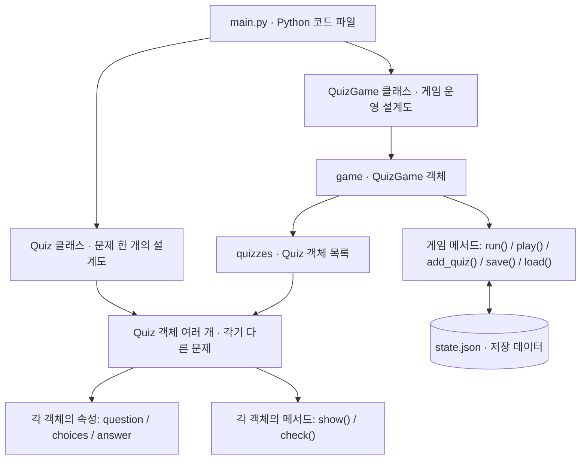
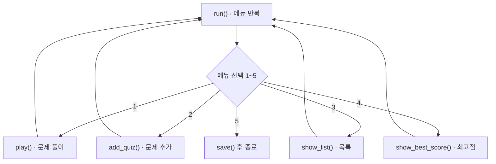
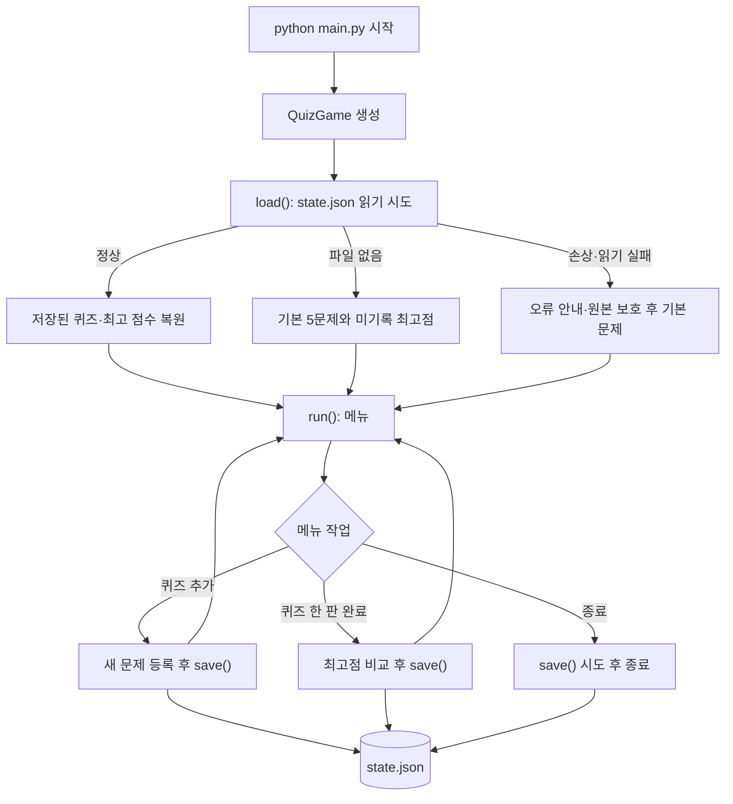
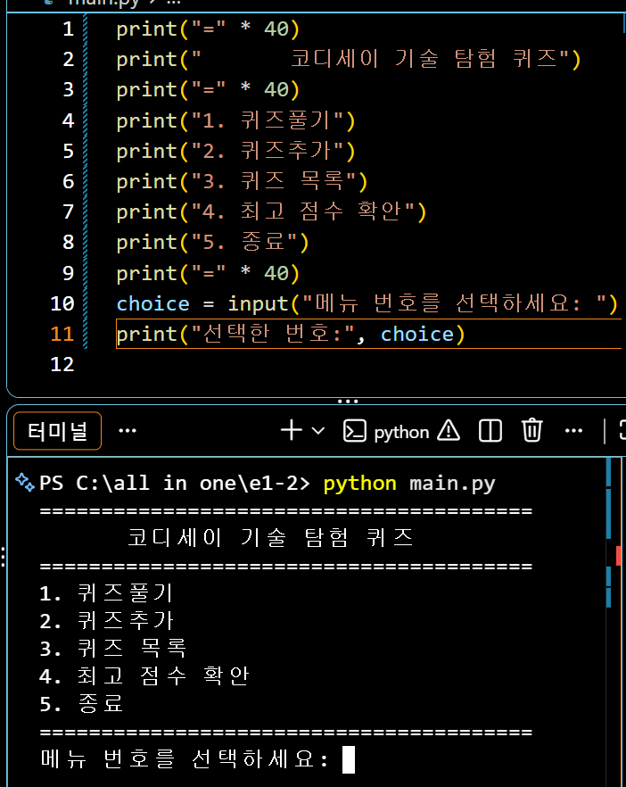
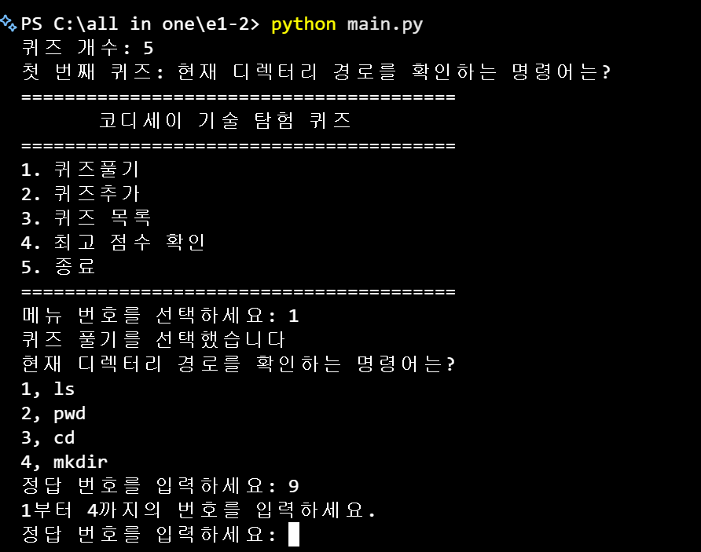
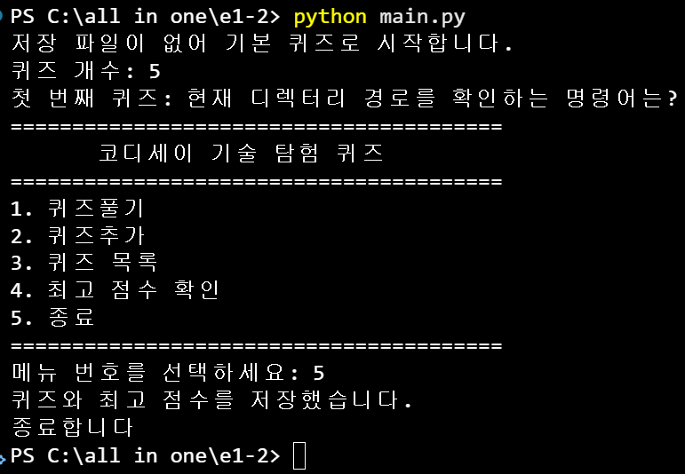

# 코디세이 기술 탐험 퀴즈 | E1-2

> **미션:** 컴퓨터에게 명령 내리는 말(파이썬) 처음 배우기  
> **목표:** Python 콘솔 퀴즈 게임을 설계·구현하고, 클래스·JSON 저장·예외 처리·Git 이력을 검증한다.  
> **제출 저장소:** https://github.com/modoofighting/E1-2  > 

## 목차

1. [프로젝트 개요](#1-프로젝트-개요)
   - [핵심 개념 설명: 자료형·조건문·반복문·클래스·파일·Git](#learning-objectives)
2. [퀴즈 주제와 선정 이유](#2-퀴즈-주제와-선정-이유)
3. [실행 방법](#3-실행-방법)
4. [기능 목록 및 Python 구현 순서](#4-기능-목록-및-python-구현-순서)
5. [파일 구조](#5-파일-구조)
6. [데이터 파일 설명: `state.json`](#6-데이터-파일-설명-statejson)
7. [Git·GitHub 작업 및 README 최종 푸시](#7-gitgithub-작업-및-readme-최종-푸시)
8. [실제 작업 기록과 화면 증빙](#8-실제-작업-기록과-화면-증빙)

---

## 1. 프로젝트 개요

### 1.1 무엇을 만드는가?

Python으로 **4지선다형 코디세이 개발 도구 퀴즈 게임**을 만든다. 사용자는 터미널 메뉴에서 퀴즈 풀이·추가·목록·최고 점수 확인·종료를 선택한다. 문제와 최고 점수는 종료 후 다시 실행해도 유지한다.

| 구분 | 필수 구현 목표 |
|---|---|
| 개발 환경 | Python **3.10 이상**, 외부 라이브러리 없이 표준 라이브러리 사용 |
| 실행 | 프로젝트 폴더에서 `python main.py` |
| 기본 문제 | 직접 작성한 퀴즈 **5개 이상**, 각 **선택지 4개** |
| 게임 기능 | 퀴즈 풀기, 추가, 목록, 최고 점수, 종료 |
| 코드 구조 | `Quiz`·`QuizGame` 등 **클래스 2개 이상**, 기능별 메서드 분리 |
| 데이터 | 프로젝트 루트 `state.json`에 **UTF-8 JSON**으로 저장·복원 |
| 안정성 | 공백·문자·범위 밖·빈 입력, `Ctrl+C`·`EOF`, 파일 없음·손상·입출력 실패 처리 |
| Git | **의미 있는 커밋 10개 이상**, `checkout`·`merge` 병합, `clone`·`pull` 실습 |
| 제출 | GitHub URL, README, 개발 환경·게임 화면·`git log --oneline --graph` 증빙 |

### 1.2 설계 순서: 코드보다 먼저 결정하는 것

과제에서 필요한 **기능은 이미 주어졌다.** 따라서 새 기능을 추측하기보다, 주어진 기능을 **데이터와 책임**으로 나누어 설계한다.

```text
① 과제 요구사항 확인
   메뉴 5개 · 문제 5개 이상 · 클래스 2개 · JSON 저장 · Git 기록
         ↓
② 필요한 데이터 정의
   문제 한 개: question / choices / answer
   게임 전체: quizzes / best_score
         ↓
③ 역할을 나누어 클래스 설계
   Quiz = 문제 한 개 관리 / QuizGame = 게임 전체 운영
         ↓
④ 클래스별 속성·메서드 결정
   Quiz.show(), Quiz.check() / QuizGame.play(), add_quiz(), save() 등
         ↓
⑤ 실행·저장 흐름 설계
   시작 → 데이터 불러오기 → 메뉴 → 기능 실행 → 저장 → 종료
         ↓
⑥ 파일 구성 결정
   main.py 하나에 Python 코드 통합 / state.json은 데이터 파일
         ↓
⑦ [실제 코드 작성 순서](#code-order)대로 구현·검증·커밋
```

**설계 순서**는 무엇을 만들고 누구에게 역할을 맡길지 정하는 순서이고, **코드 작성 순서**는 실제 파일에 어떤 내용을 먼저 작성할지 정하는 순서

<a id="class-concepts"></a>
### 1.3 클래스·객체·속성·메서드는 무엇인가?

| 용어 | 쉬운 뜻 | 이번 과제의 사례 |
|---|---|---|
| **Python 파일** | 코드를 담는 파일 | `main.py` |
| **클래스(`class`)** | 같은 종류의 객체를 만드는 공통 설계도 | `Quiz`, `QuizGame` |
| **객체(인스턴스)** | 클래스로 만든 실제 대상 | `Quiz(...)`로 만든 문제 한 개, `game = QuizGame()` |
| **속성(attribute)** | 객체에 저장된 정보 | `question`, `choices`, `answer`, `best_score` |
| **메서드(method)** | 객체가 수행하는 기능 | `show()`, `check()`, `play()`, `save()` |
| **매개변수(parameter)** | 메서드가 값을 받을 때 쓰는 이름 | `user_answer` |
| **반환값(`return`)** | 계산·판단 결과를 호출한 쪽에 돌려줌 | `check()`의 `True`/`False` |
| **`self`** | 메서드가 다루는 그 객체 자신 | `self.answer`, `self.quizzes` |
| **`__init__()`** | 객체를 만들 때 속성을 준비하는 초기화 메서드 | 질문·선택지·정답 또는 게임 상태 설정 |

**`main.py`와 `class Quiz`는 둘 중 하나를 선택하는 관계가 아니다.** 먼저 `main.py`라는 파일을 만들고, 그 안에 `class Quiz:`와 `class QuizGame:`을 모두 작성한다. 클래스가 2개여도 Python 코드 파일은 1개일 수 있다.

<a id="quiz-quizgame-roles"></a>
### 1.4 왜 `Quiz`와 `QuizGame`을 나눌까?

| 구분 | `Quiz` — 문제 한 장 | `QuizGame` — 시험 진행자 |
|---|---|---|
| 맡는 일 | 문제의 질문·선택지·정답 관리 | 전체 문제 목록·메뉴·풀이·점수·저장 관리 |
| 속성 | `question`, `choices`, `answer` | `quizzes`, `best_score` |
| 메서드 | `show()`, `check()` | `show_menu()`, `get_choice()`, `play()`, `add_quiz()`, `show_list()`, `show_best_score()`, `load()`, `save()`, `run()` |
| 구분 이유 | 한 문제의 정답 판정만 책임진다 | 여러 문제의 진행과 데이터를 통합 관리한다 |


<a id="learning-objectives"></a>
### 1.5 핵심 개념 


**Python(파이썬)을 사용하는 이유는 컴퓨터가 원하는 작업을 자동으로 수행하도록 프로그램을 만들기 위해서입니다.**

사람이 직접 하나하나 처리하던 일을 Python 코드로 작성하면, 컴퓨터가 정해진 규칙에 따라 반복하고 계산하고 결과를 저장할 수 있어 파이썬을 사용합니다.

#### 1.5.1 변수와 자료형

**변수(variable)는 값을 기억하기 위해 붙이는 이름**이다. 게임은 사용자가 입력한 번호나 현재 점수를 다음 단계에서도 사용해야 하므로 변수가 필요하다. `=`는 오른쪽 값을 왼쪽 이름에 **저장(대입)**하고, `==`는 두 값이 같은지 **비교**한다.

```python
score = 80                 # score라는 변수에 숫자 80을 저장
question = "Git이란?"       # question에 문제 문장을 저장
is_correct = True         # 정답 여부를 참/거짓으로 저장
print(score)               # 80 출력
```

**자료형(data type)은 값의 종류**다. `80`은 숫자이고 `"80"`은 문자이므로 서로 다르게 처리된다.

| 자료형 | 이름·뜻 | 실제 값 예시 | 이 퀴즈에서 사용하는 이유 |
|---|---|---|---|
| `int` | **정수(integer)**: 소수점 없는 수 | `1`, `4`, `80` | 답 번호 1~4, 맞힌 문제 수, 점수 계산 |
| `str` | **문자열(string)**: 글자나 문자로 표현된 값 | `"1"`, `"pwd"`, `"현재 경로는?"` | 문제 문장·선택지·`input()`으로 받은 입력 |
| `bool` | **불리언(boolean)**: 참 또는 거짓 | `True`, `False` | 선택한 답이 정답인지, 저장해도 되는지 판단 |
| `list` | **리스트**: 값을 순서대로 담는 목록 | `["ls", "pwd", "cd", "mkdir"]` | 문제의 선택지 네 개, 전체 퀴즈 객체 목록 |
| `dict` | **딕셔너리(dictionary)**: 이름표(키)로 값을 찾는 묶음 | `{"question": "현재 경로는?", "answer": 2}` | 퀴즈 정보를 JSON에 저장할 때 항목별로 구분 |

```python
raw = "2"                    # str: 사용자 입력처럼 문자열인 값
answer = int(raw)            # int()는 "2"를 숫자 2로 바꿈
print(raw == 2)              # False: 문자 "2"와 숫자 2는 다름
print(answer == 2)           # True: 숫자끼리 비교

choices = ["ls", "pwd", "cd", "mkdir"]
print(choices[0])             # ls: 리스트는 첫 번째 위치가 0
quiz_data = {"question": "현재 경로 확인?", "answer": 2}
print(quiz_data["answer"])   # 2: 딕셔너리는 키 이름으로 값을 찾음
```

#### 1.5.2 조건문 `if / elif / else`

```python
choice = 2                  # 입력 검증이 끝난 정수라고 가정
if choice == 1:
    print("퀴즈 풀기")
elif choice == 2:
    print("퀴즈 추가")
else:
    print("다른 메뉴")
```

- `if`: **첫 번째 조건**이 참인지 확인한다.
- `elif`: 앞의 조건이 거짓일 때 **다음 조건**을 확인한다. 필요한 만큼 여러 번 쓸 수 있다.
- `else`: 앞 조건이 모두 거짓이면 실행한다.

#### 1.5.3 반복문 `for`와 `while`

| 문법      | 어떤 경우에 사용하는가?                       | 퀴즈의 예                               |
| ------- | ----------------------------------- | ----------------------------------- |
| `for`   | **목록에서 항목을 하나씩 꺼내거나 정해진 범위를 순회**할 때 | `quizzes`의 문제를 첫 번째부터 마지막까지 출제      |
| `while` | **조건이 유지되는 동안 계속 반복**할 때            | 메뉴 5번을 선택하기 전까지 메뉴 표시, 올바른 번호까지 재입력 |
```python
# for: 목록에 들어 있는 문제 문장 2개를 차례로 출력
questions = ["Git이란?", "Docker란?"]
for question in questions:
    print(question)

# while: '5'를 입력할 때까지 같은 질문을 반복
while True:
    choice = input("종료하려면 5: ").strip()
    if choice == "5":
        break                  # break는 반복문을 끝냄
    print("다시 입력하세요.")
```

`for quiz in self.quizzes:`는 **문제를 하나씩 꺼내는 반복**이고, `while True:`는 **사용자의 선택을 계속 기다리는 반복**이다. `continue`를 쓰면 반복을 종료하지 않고 다음 반복으로 넘어가 입력을 다시 받을 수 있다.

#### 1.5.4 함수·매개변수·반환값

**함수(function)는 특정 작업을 한 번 정의해 필요할 때 다시 사용하는 코드 묶음**이다. `def`로 함수를 만들고, 함수 이름 뒤의 괄호로 호출한다.

```python
def calculate_score(correct_count, total):  # 함수를 정의
    if total == 0:
        return 0                           # 문제 0개면 0을 돌려줌
    return round(correct_count / total * 100)

score = calculate_score(4, 5)               # 호출: 4개 정답 / 총 5문제
print(score)                                # 80
```

| 용어 | 위 코드의 예 | 뜻 |
|---|---|---|
| 함수 정의 | `def calculate_score(...):` | 어떤 작업을 할지 정함 |
| 매개변수(parameter) | `correct_count`, `total` | 함수가 **받을 값에 붙인 이름** |
| 인수(argument) | `calculate_score(4, 5)`의 `4`, `5` | 호출할 때 **실제로 전달하는 값** |
| 반환값(return value) | `return 80`에 해당하는 결과 | 계산 결과를 **호출한 곳에 돌려주는 값** |

return`은 결과를 다른 코드가 활용하도록 돌려주고, `print()`는 화면에 보여 준다. 실제 게임에서는 `Quiz.check(user_answer)`가 `True/False`를 **반환**하고 `QuizGame.play()`가 그 결과로 정답 수를 계산한다. `Quiz`처럼 **클래스 안에 정의된 함수**는 특별히 **메서드(method)**라고 부른다.

#### 1.5.5 클래스와 객체 — 왜 `Quiz`·`QuizGame`이 필요한가?

**클래스(class)는 비슷한 대상의 정보와 동작을 함께 정의한 설계도**. **객체(object, 인스턴스)는 그 설계도로 실제 만들어진 대상**

```python
class Quiz:
    def __init__(self, question, choices, answer):
        self.question = question
        self.choices = choices
        self.answer = answer

    def check(self, user_answer):
        return user_answer == self.answer

quiz = Quiz("현재 경로 확인 명령은?", ["ls", "pwd", "cd", "mkdir"], 2)
print(quiz.question)     # 현재 경로 확인 명령은?
print(quiz.check(2))     # True
print(quiz.check(1))     # False
```

| 코드                 | 의미                 | 쉽게 풀면                      |
| ------------------ | ------------------ | -------------------------- |
| `class Quiz:`      | **클래스** 정의         | 문제 한 장의 공통 설계도 작성          |
| `quiz = Quiz(...)` | **객체** 생성          | 설계도로 실제 문제 한 장 만들기         |
| `__init__(...)`    | **초기화 메서드**        | 객체가 만들어질 때 질문·선택지·정답 기록    |
| `self`             | **지금 다루는 객체 자신**   | 다른 문제와 혼동하지 않고 이 문제의 정보 사용 |
| `self.question`    | **속성(attribute)**  | 이 문제 객체가 저장한 질문            |
| `quiz.check(2)`    | **메서드(method) 호출** | 이 문제의 정답과 번호 2 비교          |

`Quiz` 객체는 문제마다 여러 개 만들고, `QuizGame` 객체는 이 문제들을 **하나의 목록으로 관리**하며 메뉴·점수·저장을 담당한다. 두 클래스는 같은 `main.py` 안에 둘 수 있다.

#### 1.5.6 파일 입출력 — `open()`, 읽기·쓰기, JSON

| 구문                                | 뜻                         | 퀴즈에서 하는 일                     |
| --------------------------------- | ------------------------- | ----------------------------- |
| `open(경로, "r", encoding="utf-8")` | **읽기(read)** 모드로 파일 열기    | 저장된 `state.json` 읽기           |
| `open(경로, "w", encoding="utf-8")` | **쓰기(write)** 모드로 파일 열기   | 새 JSON 내용을 기록. 기존 파일이 있으면 덮어씀 |
| `with open(...) as file:`         | 파일을 사용하고 **자동으로 닫히도록** 관리 | 파일을 안전하게 열고 닫기                |
| `file.read()` / `file.write()`    | 텍스트 문자열 읽기 / 쓰기           | 파일 입출력의 기본 동작                 |
| `json.load(file)`                 | **JSON 파일 → Python 데이터**  | 저장된 문제와 점수를 불러오기              |
| `json.dump(data, file)`           | **Python 데이터 → JSON 파일**  | 문제와 점수를 저장하기                  |

**JSON(JavaScript Object Notation)은 이름과 값으로 정보를 기록하는 텍스트 형식**이다. Python의 `dict`, `list`, `str`, `int`, `bool`, `None` 등에 해당하는 값을 기록할 수 있고, 사람이 파일을 열어 구조를 확인하기도 쉽다. 이번 과제는 프로젝트 루트의 **`state.json`**에 퀴즈 목록과 최고 점수를 저장한다.

```python
import json

data = {"quizzes": [], "best_score": None}
with open("study_example.json", "w", encoding="utf-8") as file:
    json.dump(data, file, ensure_ascii=False, indent=2)  # Python 값을 JSON 파일에 기록

with open("study_example.json", "r", encoding="utf-8") as file:
    loaded = json.load(file)                              # JSON을 Python 값으로 복원
print(loaded["quizzes"])                                  # []
```

#### 1.5.7 예외 처리 — `try/except`가 필요한 이유

**예외(exception)는 코드를 실행하는 중 발생하는 오류 상황**이다. `try` 안에서 작업을 시도하고, 정해진 오류가 생기면 `except`로 안내·재시도·복구 등 적절한 동작을 수행한다.

```python
raw = "abc"
try:
    number = int(raw)
except ValueError:
    print("숫자를 입력해 주세요.")
```

- `ValueError`: `"abc"`를 `int()`로 바꾸려는 경우처럼 값이 맞지 않을 때 발생한다. **다시 입력**을 요청한다.
- `FileNotFoundError`: 파일이 없을 때 발생한다. `state.json`이 없다면 **기본 5문제**로 시작한다.
- `json.JSONDecodeError`: JSON 내용이 손상돼 읽을 수 없을 때 발생한다. 오류를 알리고 **기본 문제로 시작**하면서 원본 파일을 안전하게 처리한다.
- `OSError`: 파일에 접근하거나 기록하는 중 오류가 발생할 수 있다. **저장 실패를 안내**하고 기존 데이터 훼손을 피한다.
- `KeyboardInterrupt` / `EOFError`: 실행 중 `Ctrl+C` 또는 입력 종료 시 발생한다. 프로그램이 오류 화면으로 끝나지 않도록 **안내 → 가능한 저장 → 정상 종료** 순서로 처리한다.

#### 1.5.8 Git 기초 — 버전 관리와 브랜치

**Git은 파일의 변경 과정을 커밋(commit)이라는 기록으로 남기는 버전 관리 도구**다. 어느 기능을 언제 고쳤는지 확인하거나 문제가 생겼을 때 이전 변경과 비교할 수 있다. **GitHub는 Git의 커밋을 인터넷 저장소에 올려 공유하는 서비스**다.

```text
내 PC에서 파일 수정 → git add → git commit → git push → GitHub에 기록
다른 폴더에서 복제 → git clone
GitHub의 새 변경을 기존 폴더에 반영 → git pull
```

| Git 명령어 | 무엇을 하는가? | 이번 과제에서 쓰는 때 |
|---|---|---|
| `git init` | **현재 폴더에서** Git 이력 관리를 시작 | 처음 저장소를 만들 때 **한 번** |
| `git add` | 다음 커밋에 담을 변경 파일을 준비(**스테이징**) | 기능 작성 후 관련 파일 선택 |
| `git commit` | 준비한 변경을 **내 컴퓨터의 이력**에 기록 | `Quiz` 클래스, 메뉴, JSON 등 기능 단위 완료 시 |
| `git push` | 로컬 커밋을 **GitHub로 전송** | 검증한 작업을 원격 저장소에 올릴 때 |
| `git checkout` | 다른 브랜치로 이동하거나 `-b`로 새 브랜치 생성 | 퀴즈 풀이 기능용 작업 브랜치 만들 때 |
| `git clone` | 원격 저장소를 **새 폴더에 통째로 복제** | 다른 폴더에서 실습 시작할 때 |
| `git pull` | 원격 저장소의 새 커밋을 **기존 로컬 저장소에 가져와 반영** | 복제본에서 푸시한 작업을 원본에 반영할 때 |
| `git merge` | 다른 브랜치에서 만든 변경을 현재 브랜치에 합침 | 작업 브랜치의 퀴즈 풀이 기능을 `main`에 통합할 때 |

**브랜치(branch)는 같은 저장소에서 변경을 별도로 진행하는 작업 줄기**다. 퀴즈 풀이 기능을 브랜치에서 작성·커밋한 뒤 `main`으로 돌아와 `merge`하면 전체 게임에 합쳐진다. `clone`은 **새 폴더를 만드는 복제**, `pull`은 **이미 있는 폴더를 최신 상태로 갱신**한다는 점이 다르다. `commit`만 하면 GitHub에 올라가지 않으며, `push`까지 해야 원격에 반영된다.

---

## 2. 퀴즈 주제와 선정 이유

### 2.1 선정 이유

개발 환경을 준비하며 배운 명령어를 퀴즈로 다시 확인하면 E1-1 학습과 E1-2의 Python 문법을 연결할 수 있다. 문제를 직접 만들고 출제하면서 **입력 → 조건 판단 → 반복 → 객체·메서드 호출 → 점수 계산 → JSON 저장**이라는 프로그램 흐름을 익히는 것이 목적이다.
<a id="initial-questions"></a>
### 2.2 기본 퀴즈 5개 — 구현에 사용할 문제

| 번호 | 문제 | ① | ② | ③ | ④ | 정답 |
|---:|---|---|---|---|---|:---:|
| 1 | 현재 디렉터리 경로를 확인하는 명령어는? | `ls` | `pwd` | `cd` | `mkdir` | **2** |
| 2 | Docker 이미지로 새 컨테이너를 실행하는 명령어는? | `docker run` | `docker build` | `docker ps` | `docker stop` | **1** |
| 3 | Dockerfile로 이미지를 만드는 명령어는? | `docker run` | `docker build` | `docker ps` | `docker stop` | **2** |
| 4 | Git에서 준비한 변경을 로컬 이력으로 기록하는 명령어는? | `git push` | `git commit` | `git add` | `git status` | **2** |
| 5 | 현재 Git 저장소의 변경 상태를 확인하는 명령어는? | `git status` | `git push` | `git commit` | `git clone` | **1** |

---
## 3. 실행 방법

### 3.1 개발·실행 환경

```powershell
# Python 버전 확인 — 3.10 이상이어야 함
python --version

# Git 설치 확인
git --version
```

### 3.2 기존 프로젝트 폴더에서 실행

```powershell
# 실제 프로젝트 폴더로 이동. 공백이 있으므로 따옴표 사용
Set-Location "C:\all in one\e1-2"

# 작업 위치 확인
Get-Location

# 퀴즈 게임 실행
python main.py
```

### 3.3 GitHub 저장소를 새 컴퓨터에서 처음 가져올 때

```powershell
# 복제할 상위 폴더로 이동(이미 E1-2가 있는 위치를 덮어쓰지 않기)
Set-Location "C:\all in one"

# E1-2가 없는 새로운 폴더에 복제
# 예: e1-2-downloaded 폴더가 아직 없는 경우
git clone https://github.com/modoofighting/E1-2.git e1-2-downloaded

Set-Location "C:\all in one\e1-2-downloaded"
python main.py
```

### 3.4 목표 메뉴 화면

```text
========================================
       코디세이 기술 탐험 퀴즈
========================================
1. 퀴즈 풀기
2. 퀴즈 추가
3. 퀴즈 목록
4. 최고 점수 확인
5. 종료
========================================
메뉴 번호(1~5):
```

### 3.5 점검용 명령어

```powershell
# Python 문법 검사(게임 기능의 정확성을 증명하는 것은 아님)
python -m py_compile main.py

# 게임 직접 실행·확인
python main.py

# state.json이 생성된 후 JSON 문법 검사
python -m json.tool state.json
```

---

## 4. 기능 목록 및 Python 구현 순서

### 4.1 메뉴별 기능과 완료 기준

| 번호 | 기능 | 구현 목표 | 확인할 결과 |
|:---:|---|---|---|
| **1** | 퀴즈 풀기 | 문제를 순서대로 보여주고 정답 입력·판정·점수 계산 | 각 정답·오답 안내, 전체 결과, 퀴즈 0개 처리 |
| **2** | 퀴즈 추가 | 질문, 선택지 4개, 정답 번호를 입력받아 객체 생성 | 목록에 새 문제 포함, 파일 저장 후 재실행에도 유지 |
| **3** | 퀴즈 목록 | 등록된 문제를 번호와 함께 출력 | 전체 목록·문제 0개 안내 |
| **4** | 최고 점수 확인 | 한 판을 마칠 때 최고 점수 갱신·조회 | 첫 플레이 전 안내, 최고 점수 보존 |
| **5** | 종료 | 저장을 시도하고 메뉴 반복 종료 | 종료 안내, 데이터 보존, 오류 없는 종료 |

**점수 규칙(프로젝트 설계):** 정답 1개당 `correct_count`를 1 증가시키고, `score = round(correct_count / total * 100)`으로 백분율을 계산한다. `total`이 0이면 계산하지 않는다. 한 판을 **끝까지 완료한 경우에만** 최고 점수를 비교·갱신한다.
<a id="code-order"></a>
### 4.2 실제 코드 작성 순서 

파일 안에서 코드를 **어디에 배치할지**와 실제로 **무엇부터 확인할지**를 함께 안내한다. 아래 각 링크를 누르면 그 단계의 설명으로 이동한다. 모든 코드는 **`main.py` 하나**에 작성한다.

|  순서 | 작성·구현할 내용          | 주요 Python 이름                                     | 단계 설명                             |
| --: | ------------------ | ------------------------------------------------ | --------------------------------- |
|   1 | 파일 생성, 필요한 모듈 불러오기 | `main.py`, `import`, `Path`                      | [① 파일 준비](#step-python-01)        |
|   2 | 문제 한 개의 구조 정의      | `class Quiz`, `__init__`, `self`                 | [② Quiz 클래스](#step-python-02)     |
|   3 | 문제 표시·정답 확인        | `show()`, `check()`, `return`                    | [③ Quiz 메서드](#step-python-03)     |
|   4 | 기본 문제 5개 만들기       | `Quiz(...)`, `list`                              | [④ 기본 문제](#step-python-04)        |
|   5 | 게임 전체를 관리할 구조 정의   | `class QuizGame`, `quizzes`, `best_score`        | [⑤ QuizGame 클래스](#step-python-05) |
|   6 | 메뉴·공통 입력 검증        | `show_menu()`, `get_choice()`, `if/elif/else`    | [⑥ 메뉴와 입력](#step-python-06)       |
|   7 | 퀴즈 풀이·채점·결과        | `play()`, `for`, `check()`                       | [⑦ 퀴즈 풀이](#step-python-07)        |
|   8 | 문제 추가·목록·최고 점수     | `add_quiz()`, `show_list()`, `show_best_score()` | [⑧ 나머지 메뉴](#step-python-08)       |
|   9 | JSON 저장·불러오기       | `save()`, `load()`, `json.dump()`, `json.load()` | [⑨ 저장과 복원](#step-python-09)       |
|  10 | 입력 중단·파일 오류 처리     | `try/except`, `KeyboardInterrupt`, `EOFError`    | [⑩ 예외 처리](#step-python-10)        |
|  11 | 메뉴 반복과 각 기능 연결     | `run()`, `while`, `break`                        | [⑪ 연결하기](#step-python-11)         |
|  12 | 시작점 작성·최종 실행       | `if __name__ == "__main__":`                     | [⑫ 실행 시작](#step-python-12)        |
|     |                    |                                                  |                                   |
<a id="step-python-01"></a>
### 4.3 ① 파일 준비 — 어디서 시작하는가?


```python
import json
from pathlib import Path

STATE_PATH = Path(__file__).with_name("state.json")
```

`STATE_PATH`는 `main.py`와 같은 폴더의 `state.json` **위치만 지정**한다. 
<a id="step-python-02"></a>
<a id="quiz-class-writing"></a>
### 4.4 ② `Quiz` 클래스 — 문제 한 개가 기억할 것

```python
class Quiz:
    def __init__(self, question, choices, answer):
        self.question = question   # 문제 문장
        self.choices = choices     # 선택지 4개를 담은 리스트
        self.answer = answer       # 정답 번호(1~4)
```

`class`는 설계도를 정의하고, `__init__()`은 `Quiz(...)` 객체를 만들 때 속성을 설정한다. **클래스 이름과 파일 이름은 같은 것이 아니다.**
<a id="step-python-03"></a>
### 4.5 ③ `Quiz` 메서드 — 무엇을 할 수 있나?

다음 메서드는 **앞서 정의한 `Quiz` 클래스 안에 이어서 작성한다.** 새 `class Quiz`를 또 만들지 않는다.

```python
    def show(self):
        print(self.question)
        for number, choice in enumerate(self.choices, start=1):
            print(f"{number}. {choice}")

    def check(self, user_answer):
        return user_answer == self.answer
```

`show()`는 문항·선지를 출력한다. `check()`는 사용자 답과 정답을 비교해 `True` 또는 `False`를 돌려준다. 답 번호의 **입력 검증(1~4인지 확인)** 은 게임 전체의 공통 입력 메서드가 담당하도록 분리한다.

**Quiz 클래스 필수 확인:** 한 문제에는 `question`(질문), `choices`(선택지 **4개**), `answer`(정답 번호 **1~4**)가 들어간다. `show()`는 질문·선택지 네 개를 출력하고, `check()`는 선택한 답이 맞는지 확인한다. 각 문제는 `Quiz(...)`로 생성한다. 완성 후에는 선택지가 4개가 아닌 데이터나 정답 번호가 1~4 밖인 데이터를 게임에 받아들이지 않도록 검증한다.

```powershell
# 실제 기능을 작성·확인한 후 실행
python -m py_compile main.py
git status -sb
git add main.py
git diff --cached --name-only
git commit -m "feat: implement Quiz class and answer checking"
```
<a id="step-python-04"></a>
### 4.6 ④ 기본 문제를 객체로 만들기

`Quiz` 클래스 **바깥**에 기본 문제를 준비하는 함수를 둔다. 아래 코드는 [2.2절](#initial-questions)의 **기본 문제 5개를 실제 객체로 만드는 완전한 예시**다.

```python
def make_default_quizzes():
    return [
        Quiz("현재 디렉터리 경로를 확인하는 명령어는?",
             ["ls", "pwd", "cd", "mkdir"], 2),
        Quiz("Docker 이미지로 새 컨테이너를 실행하는 명령어는?",
             ["docker run", "docker build", "docker ps", "docker stop"], 1),
        Quiz("Dockerfile로 이미지를 만드는 명령어는?",
             ["docker run", "docker build", "docker ps", "docker stop"], 2),
        Quiz("Git에서 준비한 변경을 로컬 이력으로 기록하는 명령어는?",
             ["git push", "git commit", "git add", "git status"], 2),
        Quiz("현재 Git 저장소의 변경 상태를 확인하는 명령어는?",
             ["git status", "git push", "git commit", "git clone"], 1),
    ]
```

`Quiz(...)`는 **실제 문제 객체를 만드는 코드**다. 이 함수가 돌려주는 `list`에는 서로 다른 `Quiz` 객체가 5개 들어간다. `Quiz` 클래스가 먼저 정의되어 있어야 이 함수를 정상적으로 호출할 수 있다.
<a id="step-python-05"></a>
### 4.7 ⑤ `QuizGame` 클래스 — 게임 전체의 담당자

`QuizGame`은 문제 객체 여러 개와 최고 점수를 관리한다. 각 메서드는 `QuizGame` 클래스 **안**에 작성한다.

```python
class QuizGame:
    def __init__(self):
        self.quizzes = make_default_quizzes()
        self.best_score = None  # 아직 플레이하지 않은 상태
```

`self.quizzes`는 문제 객체 목록, `self.best_score`는 최고 기록이다. `None`은 아직 점수가 없다는 뜻이다. 저장 파일이 있으면 이후 `load()`를 통해 값을 복원한다.
<a id="step-python-06"></a>
### 4.8 ⑥ 메뉴 출력과 공통 입력 검증

- `show_menu()`: 다섯 메뉴를 출력한다.
- `get_choice(minimum, maximum)`: **숫자 입력이 필요한 곳의 공통 처리**를 한 번 정의한다.
- `if/elif/else`: 메뉴 번호에 따라 다른 메서드를 호출한다. 실제 분기는 `run()`에 둔다.

`get_choice(1, 5)`는 메뉴 선택, `get_choice(1, 4)`는 문제의 답과 새 문제의 정답 번호 입력에 사용한다. **함수를 한 번 정의하고 여러 곳에서 호출**하므로 같은 입력 규칙을 중복 작성하지 않는다.

| 사용자가 입력한 값      | 검사 결과                       | 다음 동작                    |
| --------------- | --------------------------- | ------------------------ |
| ` 1 ` (앞뒤 공백)   | `.strip()`으로 `1`로 정리        | 정상 범위이면 해당 선택 실행         |
| `abc`           | `int()` 변환 불가(`ValueError`) | 숫자 안내 후 **같은 입력을 다시 요청** |
| 메뉴 `9` / 정답 `0` | 허용 범위를 벗어남                  | 허용 범위 안내 후 **다시 요청**     |
| Enter만 입력       | 공백 제거 후 빈 문자열               | 값이 비었다는 안내 후 **다시 요청**   |

**`QuizGame` 클래스 안에 작성하는 공통 메서드 예시:**

```python
    def get_choice(self, minimum, maximum):
        while True:
            raw = input(f"번호({minimum}~{maximum}): ").strip()
            if not raw:
                print("번호를 입력해 주세요.")
                continue
            try:
                number = int(raw)
            except ValueError:
                print("숫자로 입력해 주세요.")
                continue
            if not minimum <= number <= maximum:
                print(f"{minimum}~{maximum} 사이의 번호를 입력해 주세요.")
                continue
            return number
```

`while True`는 올바른 번호를 받을 때까지 반복하고, `continue`는 같은 질문으로 되돌아간다. `return`은 **검증한 정수**를 `play()`·`add_quiz()`·`run()`에 전달한다. 이 메서드에서 발생하는 `Ctrl+C`·`EOFError`는 게임 종료를 담당하는 상위 코드에서 잡아 **안내 → 가능한 저장 → 안전 종료** 순서로 처리한다. <a id="step-python-07"></a>
### 4.9 ⑦ `play()` — 여러 문제를 차례로 풀기

```text
등록된 문제 0개인가? → 예: 안내하고 메뉴로 돌아감
                   → 아니오:
   정답 수(correct_count)를 0으로 준비
   → 문제 목록의 복사본을 섞고 for로 하나씩 꺼내기
   → quiz.show()로 문제·선택지 출력
   → get_answer()로 답 번호 검증
   → quiz.check(사용자 답)으로 정답 판정
   → 맞으면 correct_count를 1 증가
   → 문제를 모두 마치면 점수 계산
   → 최고 점수(best_score) 비교·갱신
   → save_if_allowed() 호출
```

**역할 구분:** `Quiz.check()`가 **문제 하나의 정답 여부**를 확인하고, `QuizGame.play()`가 **여러 문제의 진행과 전체 점수**를 계산한다.
랜덤 출제에 추가한 코드:

```python
import random

quiz_order = self.quizzes.copy()
random.shuffle(quiz_order)
for quiz in quiz_order:
    quiz.show()
```

문제 목록의 복사본을 섞어 출제한다. 등록된 목록의 순서는 유지된다.

<a id="step-python-08"></a>
### 4.10 ⑧ 나머지 메뉴 — 추가·목록·최고 점수

| 메서드 | 처리할 내용 |
|---|---|
| `add_quiz()` | 빈 문제가 아닌지 확인 → 선택지 4개 입력·검사 → 정답 번호 검증 → `Quiz(...)` 생성 → `self.quizzes.append(...)` → `save()` |
| `show_list()` | `enumerate(self.quizzes, start=1)`로 번호 붙여 목록 출력. 비어 있으면 안내 |
| `show_best_score()` | `best_score is None`이면 아직 플레이 기록이 없다고 안내. 아니면 최고 점수 표시 |

`append()`는 리스트 끝에 새 항목을 추가하는 메서드다. 문제 문장과 각 선택지도 빈 입력을 허용하지 않는다.
<a id="step-python-09"></a>
### 4.11 ⑨ `load()`·`save()` — 게임 데이터 유지

`QuizGame`의 `load()`와 `save()`를 정의한다. `load()`는 시작할 때 파일을 읽고, `save()`는 퀴즈 추가·한 판 완료·종료 시 저장한다. 정확한 JSON 필드와 오류 대응은 [6장](#6-데이터-파일-설명-statejson)을 따른다.

- **읽기:** `json.load()` → 데이터 형태 검사 → 각 문제를 `Quiz(...)` 객체로 복원
- **쓰기:** `Quiz` 객체의 속성을 딕셔너리로 바꾸기 → `json.dump(..., ensure_ascii=False, indent=2)`
- **경로:** `STATE_PATH = Path(__file__).with_name("state.json")`<a id="step-python-10"></a><a id="exception-handling-step"></a>
### 4.12 ⑩ 예외 처리 — 오류가 나도 안전하게

 `KeyboardInterrupt`와 `EOFError`를 처리하고, 데이터 파일의 문제 때문에 게임 시작 자체가 막히지 않도록 한다.

| 상황 | 구현 목표 | 검증할 결과 |
|---|---|---|
| 입력 앞뒤 공백(` 1 `) | `.strip()`으로 정리 | 정상 번호로 처리 |
| 숫자 아닌 문자(`abc`) | `ValueError` 처리 | 안내 후 같은 입력 단계 재진입 |
| 범위 밖(메뉴 `9`, 정답 `0`) | `minimum <= number <= maximum` 검사 | 범위 안내 후 재입력 |
| 빈 Enter | 빈 문자열 검사 | 빈 값 안내 후 재입력 |
| `Ctrl+C` | `KeyboardInterrupt` 처리 | 종료 안내 → 가능한 범위에서 저장 → 정상 종료 |
| 입력 스트림 종료 | `EOFError` 처리 | 종료 안내 → 가능한 범위에서 저장 → 정상 종료 |
| `state.json`이 없음 | `FileNotFoundError` 처리 | **기본 5문제**로 게임 시작 |
| JSON 내용 손상·형식 오류 | `json.JSONDecodeError` 및 구조 검증 | 오류 안내 → **기본 5문제로 복구 또는 초기화**, 기존 파일 보호/백업 |
| 파일 읽기·쓰기 실패 | `OSError` 처리 | 오류 안내·원본 보존 시도·프로그램 비정상 종료 방지 |

**안전 종료 원칙:** `get_choice()` 등에서 발생한 Ctrl+C/EOF를 `QuizGame.run()`이나 시작점에서 처리한다. 새 문제를 입력하는 중이거나 퀴즈 한 판을 끝내지 않은 경우에도 **이미 확정·저장할 수 있는 데이터에 한하여** 저장을 시도한다. 저장 자체가 실패하면 또 다른 예외로 프로그램이 중단되지 않도록 실패 사실을 안내한다.

**손상 JSON 원칙:** 파일이 손상됐을 경우 기본 문제로 **게임을 계속 실행할 수 있어야 한다.** 다만 기존 파일을 무조건 덮어쓰면 사용자 데이터가 사라질 수 있으므로, 원본을 백업·보존한 후 복구/초기화하거나 안전한 보존이 어려우면 그 실행에서 저장을 제한한다. 이 중 **한 가지 처리 방식을 코드와 테스트에서 일관되게 적용**한다.

실제 시험은 `state.json` 원본이 아니라 **테스트용 복사본/별도 폴더**에서 수행한다. README에 적힌 표는 구현·검증 기준이지 이미 통과했다는 기록이 아니다.
**실제 코드 — 중단 시 저장 처리**

```python
try:
    game.run()
except KeyboardInterrupt:
    print("\n게임을 중단했습니다.")
    game.save_if_allowed()
except EOFError:
    print("\n입력이 종료되어 게임을 마칩니다.")
    game.save_if_allowed()
```

`save_if_allowed()`는 저장이 허용되는 경우 현재 퀴즈 목록과 최고 점수를 저장한다. 저장 파일이 손상돼 보호 중이면 덮어쓰지 않는다. 입력 도중 작성하던 문제나 완료하지 않은 판의 점수는 아직 확정되지 않아 저장 대상에 포함되지 않는다.

<a id="step-python-11"></a>
### 4.13 ⑪ `run()` — 메뉴와 메서드 연결

`run()`은 메뉴를 반복 표시하고 선택값에 따라 `play()`·`add_quiz()`·`show_list()`·`show_best_score()`를 호출한다. 사용자가 5번을 선택하면 `save()`를 시도한 뒤 반복을 종료한다.


<a id="step-python-12"></a>
### 4.14 ⑫ 프로그램의 시작점

`main.py`의 **맨 아래**에 둔다. 클래스·함수 정의보다 위에 쓰지 않는다.

```python
if __name__ == "__main__":
    game = QuizGame()  # 게임 객체 1개 생성
    try:
        game.load()    # 저장된 데이터 또는 기본 문제 준비
        game.run()     # 메뉴 시작
    except (KeyboardInterrupt, EOFError):
        print("\n입력이 중단되어 안전하게 종료합니다.")
        try:
            game.save()  # 이미 확정된 퀴즈·최고 점수만 저장 시도
        except OSError:
            print("저장할 수 없지만 프로그램은 종료합니다.")
```

`if __name__ == "__main__":`은 이 Python 파일을 직접 실행했을 때 시작하도록 하는 조건이다. 이 예시는 **입력 중단 시의 제어 흐름**을 보여준다. 실제 `load()`·`save()`에서는 손상 파일을 덮어쓰지 않는 보호 규칙과 JSON 읽기·쓰기 예외 처리를 반드시 구현해야 한다. `save()` 자체가 예외를 처리하는 구조라면 시작점에서는 이를 중복 처리하지 않도록 조정한다. 코드 배치는 `import → Quiz 정의 → 기본 문제 함수 → QuizGame 정의 → 시작점`, 실행 흐름은 `game 생성 → load() → run() → 메뉴 기능 호출`이다.
<a id="python-names-reference"></a>
### 4.15 과제에 나오는 주요 이름 빠르게 찾기

| 이름 | 종류 | 뜻·사용 위치 |
|---|---|---|
| `print()`, `input()` | 내장 함수 | 화면에 표시 / 문자 입력 받기 |
| `int()`, `len()`, `enumerate()` | 내장 함수 | 정수 변환 / 개수 / 번호와 항목 함께 꺼내기 |
| `str`, `int`, `bool`, `list`, `dict` | 자료형 | 문자, 정수, 참·거짓, 순서 있는 목록, 키·값 묶음 |
| `if`, `elif`, `else` | 조건문 | 메뉴 선택·정답 여부 판단 |
| `for`, `while`, `break`, `continue` | 반복·흐름 제어 | 문제 순회·메뉴 반복·종료·재입력 |
| `class`, `def`, `return` | Python 문법 | 클래스 정의·메서드 정의·결과 반환 |
| `__init__`, `self` | 클래스 관련 | 초기 속성 준비·현재 객체 참조 |
| `Quiz`, `QuizGame` | 클래스 | 문제 한 개 / 게임 전체 |
| `question`, `choices`, `answer` | 퀴즈 데이터 | 문장·선택지·정답 번호 |
| `quizzes`, `best_score`, `correct_count`, `score` | 게임 데이터 | 문제 목록·최고 점수·정답 수·이번 점수 |
| `show()`, `check()` | Quiz 메서드 | 문제 보여주기·정답 비교 |
| `play()`, `add_quiz()`, `run()` | QuizGame 메서드 | 퀴즈 풀기·등록·메뉴 운영 |
| `show_list()`, `show_best_score()`, `get_choice()` | QuizGame 메서드 | 목록·최고점·공통 입력 |
| `load()`, `save()` | QuizGame 메서드 | JSON 복원·저장 |
| `import json`, `json.load()`, `json.dump()` | 모듈·함수 | JSON 기능 불러오기·읽기·쓰기 |
| `with`, `open()`, `encoding="utf-8"` | 파일 처리 | 파일 사용 범위·열기·문자 인코딩 |
| `.strip()`, `.append()` | 메서드 | 앞뒤 공백 제거·리스트에 항목 추가 |
| `try`, `except`, `ValueError`, `FileNotFoundError`, `OSError` | 예외 처리 | 입력·파일 오류 처리 |
| `KeyboardInterrupt`, `EOFError` | 예외 | Ctrl+C · 입력 종료 상황 |

### 4.16 기능별 테스트 계획

| 테스트 | 입력 또는 작업 | 기대 결과 |
|---|---|---|
| T01 | `python main.py` | 메뉴 1~5 출력 및 정상 종료 |
| T02 | 기본 퀴즈 확인 | 5문제 이상, 선택지 각 4개 |
| T03 | 전부 풀이, 정답·오답 입력 | 정답 판정·정답 수·점수 일치 |
| T04 | 메뉴에 ` 1 `, `abc`, `9`, 빈 Enter | 공백은 허용, 나머지는 안내 후 재입력 |
| T05 | 정답에 `0`, `5`, `abc`, 빈 Enter | 안내 후 재입력 |
| T06 | 퀴즈 추가 → 목록 확인 | 새 문제가 목록에 표시 |
| T07 | 최고 점수 획득 후 낮은 점수 기록 | 최고 점수가 줄어들지 않음 |
| T08 | 종료 → 재실행 | 추가한 문제·최고 점수 유지 |
| T09 | 별도 시험 폴더에서 `state.json` 삭제·손상 | 안내 후 기본 문제로 실행, 안전한 처리 |
| T10 | Ctrl+C·EOF | 안내와 가능한 저장 후 안전 종료 |
| T11 | 퀴즈 목록이 비어 있는 시험 데이터 | 목록·풀이 기능이 오류 없이 안내 |
| T12 | Git 커밋·브랜치·clone·pull | 7장의 증빙 기준 충족 |

이 표는 **검수 계획**이다. 테스트가 실제 통과한 뒤에만 결과와 스크린샷을 기록한다.

---

## 5. 파일 구조

### 5.1 최종 파일 배치

```text
E1-2/
├── main.py                # Python 코드: Quiz + QuizGame + 실행 시작점
├── state.json             # 게임 데이터: 퀴즈 목록·최고 점수(첫 저장 시 생성 가능)
├── README.md              # 과제 소개·설계·실행·검증·Git 제출 안내
├── .gitignore             # Git에서 제외할 임시 파일 규칙
└── docs/
    └── screenshots/      # 실제 실행 후 캡처한 과제 증빙 이미지
```

`docs/screenshots/`는 **제출 증빙 정리를 위한 폴더**로 계획하며, 외부 Python 라이브러리나 별도의 Python 코드 파일을 추가할 필요는 없다.

### 5.2 `main.py` 안에 들어갈 코드 순서

```text
main.py
│
├─ import 및 STATE_PATH 선언
├─ class Quiz
│    ├─ __init__()    문제 속성 준비
│    ├─ show()        문제·선택지 표시
│    └─ check()       정답 비교
├─ make_default_quizzes()  기본 5문제 생성
├─ class QuizGame
│    ├─ __init__()    문제 목록·최고 점수 준비
│    ├─ show_menu()  메뉴 표시
│    ├─ get_choice() 공통 숫자 입력 검증
│    ├─ play()       문제 출제·점수 계산
│    ├─ add_quiz()   퀴즈 추가
│    ├─ show_list()  퀴즈 목록
│    ├─ show_best_score() 최고 점수 확인
│    ├─ load() / save()   JSON 불러오기·저장
│    └─ run()        메뉴 선택·반복·종료
└─ if __name__ == "__main__":
     └─ game 생성 → load() → run()
```

**서로 다른 클래스라도 같은 파일에 둘 수 있다.** `Quiz`가 문제 하나를 처리하고 `QuizGame`이 게임 전체를 처리하는 **책임 분리**만 지키면 된다.

---

## 6. 데이터 파일 설명: `state.json`
<a id="state-file-role"></a>
### 6.1 경로와 역할

| 항목 | 내용 |
|---|---|
| 파일 | `E1-2/state.json` (프로젝트 루트) |
| 형식 | JSON: 문자·숫자·리스트·객체 등을 키와 값으로 기록하는 텍스트 형식 |
| 인코딩 | UTF-8 (한글 문제 문장 저장) |
| 저장 대상 | 전체 퀴즈와 최고 점수 |
| 생성 시점 | 최초 실행에 파일이 없다면 기본 문제로 시작하고, **첫 저장 성공 시** 생성 |
| 사용 이유 | 프로그램을 종료해도 추가 문제와 최고 점수를 유지하기 위해서 |
<a id="state-file-schema"></a>
### 6.2 데이터 구조(스키마)

```json
{
  "quizzes": [
    {
      "question": "현재 디렉터리 경로를 확인하는 명령어는?",
      "choices": ["ls", "pwd", "cd", "mkdir"],
      "answer": 2
    }
  ],
  "best_score": null
}
```

위 JSON은 **형식 설명용 한 문제 예시**다. 실제 기본 문제는 2장의 **5개 모두** 저장해야 한다.

| JSON 필드 | 자료형 | 의미·검증 기준 |
|---|---|---|
| `quizzes` | 배열(array) | 등록된 모든 문제. 정상 기본 데이터는 5개 이상 |
| `quizzes[].question` | 문자열(string) | 비어 있지 않은 질문 |
| `quizzes[].choices` | 문자열 배열 | 비어 있지 않은 선택지 **정확히 4개** |
| `quizzes[].answer` | 정수(number) | **1~4** 중 하나 |
| `best_score` | 정수 또는 `null` | `null`이면 아직 한 판을 완료하지 않음, 완료 후 **0~100점** |

**이번 설계에서는** 첫 플레이 여부를 `best_score: null`로 구분한다. 따라서 별도의 플레이 여부 필드를 둘 필요가 없다. `null`은 Python에서 `None`으로 읽는다. 점수가 0점이어도 **실제로 한 판을 완료했다면** `best_score: 0`으로 저장한다.
<a id="state-save-load"></a>
### 6.3 저장과 불러오기 흐름



**읽을 때:** `json.load()` → 자료형·선택지 개수·정답 범위 확인 → `Quiz(...)` 객체로 복원.  
**저장할 때:** 퀴즈 객체를 딕셔너리로 변환 → `json.dump(..., ensure_ascii=False, indent=2)`로 UTF-8 파일 기록.

안전성을 높이기 위해 **임시 파일에 먼저 기록한 뒤 성공 시 `state.json`을 교체**하는 방식을 권장한다. 손상된 파일을 발견하면 기존 파일을 보존하거나 백업한 뒤 기본 데이터로 실행한다. 손상 원본의 안전한 보존이 불가능할 때에는 원본을 임의로 덮어쓰지 않는다.

### 6.4 파일과 코드의 차이

- `main.py`는 **어떻게 동작하고 저장할지**를 작성한 Python 코드다.
- `state.json`은 게임이 저장한 **문제와 최고 점수의 실제 값**이다.
- 프로그램을 종료해도 남아야 할 값은 Python 변수만으로는 부족하므로 **JSON 파일에 기록**

---
## 7. Git·GitHub 작업 및 README 최종 푸시

현재 작업은 `sky` 브랜치에서 기록한다. 제출하기 전 변경 사항 확인, 커밋·푸시, `main` 반영과 증빙을 순서대로 확인한다. 자세한 명령과 기존 수행 기록은 아래 링크에서 볼 수 있다.

| 순서 | 작업 | 상세 내용 |
|---|---|---|
| 1 | 필수 명령어 이해 | [Git 명령어와 역할](docs/git-guide.md#git-commands) |
| 2 | 변경 확인과 커밋 | [상태 확인·스테이징·커밋·푸시](docs/git-guide.md#git-commit-flow) |
| 3 | 브랜치 작업과 병합 | [브랜치 생성과 병합 절차](docs/git-guide.md#git-branch-merge) |
| 4 | 다른 PC와 동기화 | [clone·pull 실습](docs/git-guide.md#git-clone-pull), [실제 sky 복제·pull 기록](docs/git-guide.md#git-actual-clone) |
| 5 | 제출과 증빙 | [증빙 정리](docs/git-guide.md#git-evidence), [README 최종 푸시](docs/git-guide.md#git-readme-final-push), [제출 점검표](docs/git-guide.md#git-checklist) |

실제 수행 자료는 [Git 이력 기록](docs/evidence/git-history-2026-11-16.txt), [커밋 기록](docs/evidence/git-commits-2026-11-16.txt), [상태 기록](docs/evidence/git-status-2026-11-16.txt)에서 확인한다. 이 자료는 해당 날짜에 확인한 이력이다.

---

## 8. 실제 작업 기록과 화면 증빙

다음 화면은 단계별 학습 당시의 실제 출력이다. 현재 프로그램은 이후 수정됐으므로 화면의 코드와 메뉴 동작은 당시 상태를 나타낸다.

| 단계 | 보관된 화면 |
|---|---|
| 메뉴 입력 대기 | [화면 보기](docs/screenshots/01-menu-input-wait.png) |
| 메뉴 번호 입력 결과 | [화면 보기](docs/screenshots/02-menu-input-result.png) |
| 1번 조건 선택 | [화면 보기](docs/screenshots/03-menu-if-result.png) |
| 2번 조건 선택 | [화면 보기](docs/screenshots/04-menu-elif-result.png) |
| 3번 목록 선택 | [화면 보기](docs/screenshots/05-menu-three-result.png) |
| 4번 최고 점수 선택 | [화면 보기](docs/screenshots/06-menu-four-result.png) |
| 5번 종료 선택 | [화면 보기](docs/screenshots/07-menu-five-result.png) |
| 잘못된 메뉴 번호 9 | [화면 보기](docs/screenshots/08-menu-invalid-nine.png) |
| 잘못된 번호 입력 후 메뉴 반복 | [화면 보기](docs/screenshots/09-menu-repeat-nine.png) |
| 1번 선택 후 메뉴 반복 | [화면 보기](docs/screenshots/10-menu-one-repeat.png) |
| Quiz 객체의 문제 출력 | [화면 보기](docs/screenshots/11-quiz-object-question.png) |
| 문제와 선택지 표시 | [화면 보기](docs/screenshots/12-quiz-show-choices.png) |
| 문제별 답 입력 | [화면 보기](docs/screenshots/13-quiz-answer-input.png) |
| 정답 번호 9 재입력 안내 | [화면 보기](docs/screenshots/14-answer-invalid-nine.png) |
| 새 문제 문장 입력 | [화면 보기](docs/screenshots/15-quiz-add-question.png) |
| 선택지 4개 입력 | [화면 보기](docs/screenshots/16-quiz-add-choices.png) |
| 정답 번호 입력 | [화면 보기](docs/screenshots/17-quiz-add-answer.png) |
| 정답 번호 검증 | [화면 보기](docs/screenshots/18-quiz-add-answer-validation.png) |
| 메뉴 5번 저장과 종료 | [화면 보기](docs/screenshots/19-state-first-save.png) |

메뉴 입력 대기 화면



정답 번호 범위 검사 화면



저장 파일 최초 생성 확인 화면



### 8.1 상세 작업 기록

- [단계별 작업 기록 목록](docs/history/index.md)
- [코드와 실행 결과](docs/history/code-output.md)
- [파이썬 작업 노트](docs/history/python-work-notes.md)
- [진행 기록](logs/progress.md)

연결한 기록과 화면은 해당 시점에 실제로 진행한 작업을 나타낸다. 화면의 확인 범위와 문서의 구현 계획을 구분한다.
