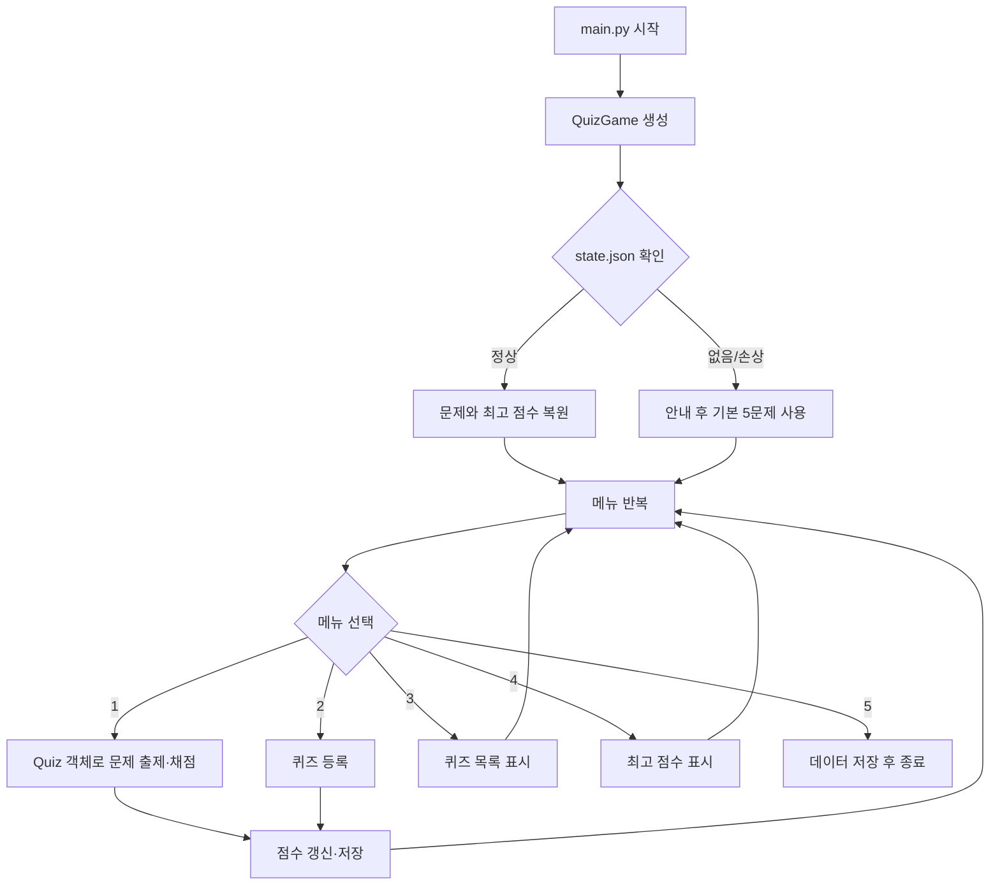

# 🧭 코디세이 기술 탐험 퀴즈 — E1-2 


## Ⅰ. 프로젝트 개요 및 실행 환경

### 프로젝트 개요

Python으로 터미널에서 동작하는 퀴즈 게임을 만들고, 기능별 개발 이력을 Git으로 기록하는 과제입니다. 주제는 E1-1에서 익힌 Linux·Docker·Git 명령어를 복습하는 기술 퀴즈로 계획했습니다.

게임의 목표 기능은 퀴즈 풀기·추가·목록·최고 점수 확인·종료입니다. `Quiz`와 `QuizGame` 두 클래스로 역할을 나누고, 문제와 최고 점수를 프로젝트 루트의 `state.json`에 UTF-8로 저장할 예정입니다. 현재는 환경 준비와 로컬 Git 초기화까지 진행했습니다.

### 1. 실행 환경

| 항목 | 확인 내용 |
|---|---|
| 실습 터미널 | Windows PowerShell — 버전 미확인 |
| 작업 폴더 | `C:\all in one\e1-2` |
| Python | `3.11.9` — 사용자가 PowerShell에서 실행 확인 |
| Git | `2.55.0.windows.1` — 앞선 Codex 환경 점검에서 확인 |
| Git 브랜치 | `main` — 저장소 초기화, 첫 커밋 전 |
| GitHub | 원격 저장소 생성·연결·push 미수행 |

### 2. 수행 항목 체크리스트

| 수행 항목 | 현재 상태 |
|---|---|
| 과제 원문 및 기존 실습 안내 검토 | 확인 |
| Python 3.10 이상 실행 확인 | 완료 — 3.11.9 |
| E1-2 작업 경로 확인 | 완료 |
| `git init -b main`으로 저장소 초기화 | 완료 |
| README 및 진행 로그 작성 | 진행 중 |
| `.gitignore`·Git 작성자 정보·첫 커밋 | 미수행 |
| GitHub 새 저장소 연결 및 첫 push | 미수행 |
| 게임 구현·JSON 저장·입력 및 파일 예외 처리 | 미수행 |
| 의미 있는 커밋 10개 이상·브랜치 병합 | 미수행 |
| clone·pull 실습 및 실제 화면 증빙 | 미수행 |

## Ⅱ. 개발 환경 및 Git 실습 기록

기록일: **2026-11-11 (KST)**. 사용자 제공 터미널 출력과 Codex의 확인 결과를 구분해 기록합니다. 명령 블록에는 실행 위치와 목적을, 바로 아래에는 실제 출력을 놓고 이어서 해설합니다.

### 3. Python 실행 환경 준비


<pre style="border: 1px solid #d0d7de; border-radius: 6px; padding: 12px; background: #f6f8fa; white-space: pre-wrap; overflow-wrap: anywhere; color: #1f2328;"><code style="color: inherit;"># PowerShell에서 실행
# 작업 폴더: C:\all in one\e1-2
# 앞서 임시로 등록한 python 함수 제거
<span style="color: #0969da;">Remove-Item Function:\python -ErrorAction SilentlyContinue</span>
# 정상 설치된 Python 3.11 경로를 현재 창의 PATH 맨 앞에 추가
<span style="color: #0969da;">$env:Path = &quot;$env:LOCALAPPDATA\Programs\Python\Python311;$env:Path&quot;</span>
# 실제로 실행되는 Python 버전 확인
<span style="color: #0969da;">python --version</span></code></pre>

```text
Python 3.11.9
```
 & Python 실행 경로 조정 및 버전 확인(python 실행 오류발생)
### 4. 로컬 Git 저장소 초기화

#### 4-1. 현재 작업 위치 확인

<pre style="border: 1px solid #d0d7de; border-radius: 6px; padding: 12px; background: #f6f8fa; white-space: pre-wrap; overflow-wrap: anywhere; color: #1f2328;"><code style="color: inherit;"># PowerShell에서 실행
# 현재 작업 폴더 확인, powershell 작업경로 보여줌
<span style="color: #0969da;">Get-Location</span></code></pre>

```text
Path
----
C:\all in one\e1-2
```

#### 4-2. 초기화 전 Git 상태 확인

<pre style="border: 1px solid #d0d7de; border-radius: 6px; padding: 12px; background: #f6f8fa; white-space: pre-wrap; overflow-wrap: anywhere; color: #1f2328;"><code style="color: inherit;"># PowerShell에서 실행
# 작업 폴더: C:\all in one\e1-2
# Git 저장소인지 확인
<span style="color: #0969da;"> git status -sb</span></code></pre>

```text
fatal: not a git repository (or any of the parent directories): .git
```

에러발생

#### 4-3. main 브랜치로 Git 저장소 초기화

<pre style="border: 1px solid #d0d7de; border-radius: 6px; padding: 12px; background: #f6f8fa; white-space: pre-wrap; overflow-wrap: anywhere; color: #1f2328;"><code style="color: inherit;"># PowerShell에서 실행
# 작업 폴더: C:\all in one\e1-2
# 현재 폴더에 Git 저장소를 만들고 첫 브랜치를 main으로 지정
<span style="color: #0969da;">git init -b main</span></code></pre>

```text
Initialized empty Git repository in C:/all in one/e1-2/.git/
```

#### 4-4. 현재 브랜치와 추적되지 않은 파일 확인

<pre style="border: 1px solid #d0d7de; border-radius: 6px; padding: 12px; background: #f6f8fa; white-space: pre-wrap; overflow-wrap: anywhere; color: #1f2328;"><code style="color: inherit;">
# 작업 폴더: C:\all in one\e1-2
# 한글 파일명을 그대로 표시하고 브랜치&#183;파일 상태 확인
<span style="color: #0969da;">git -c core.quotepath=false status -sb</span></code></pre>

```text
## No commits yet on main
?? "# 🎯 과제 완전 분해 가이드.txt"
?? "# 📄 README.md 완성본.txt"
?? README.md
?? docs/
?? "e1-2 컴퓨터에게 명령 내리는 말(파이썬) 처음 배우기.txt"
?? logs/
```

---

# 🧭 코디세이 기술 탐험 퀴즈 

> **미션:** 컴퓨터에게 명령 내리는 말(파이썬) 처음 배우기  
> **목표:** E1-1에서 배운 Linux·Docker·Git 개념으로 **4지선다 퀴즈 5개 이상**을 만들고, Python 프로그램을 완성한 뒤 GitHub에 실제 개발 이력을 남긴다.


## 한눈에 보는 전체 흐름

```text
STEP 0. 과제 목표·퀴즈 주제·필수 요구사항 확인
   ↓
STEP 1. 환경 준비 — Python ≥3.10, Git, VS Code 설치/점검
   ↓
STEP 2. E1-2 전용 폴더 및 Git 초기 연결 — init, add, commit, push
   ↓
STEP 3. 퀴즈 게임 제작 — 아래의 7개 덩어리를 순서대로 구현
   ↓        └→ 각 기능 완료 시 기능 단위 커밋 (10개 이상)
STEP 4. Git 변경 이력·기능 브랜치·병합 검증 — checkout, merge, log
   ↓
STEP 5. README·스크린샷·테스트 및 제출 점검
   ↓
STEP 6. 별도 폴더에서 clone → 변경·push → 원본 폴더에서 pull
   ↓
최종 검증 및 GitHub 제출
```

## 목차

- [STEP 0. 프로젝트 개요·요구사항·퀴즈 기획](#step-0-프로젝트-개요요구사항퀴즈-기획)
- [STEP 1. 개발 환경 준비](#step-1-개발-환경-준비)
- [STEP 2. Git 저장소 생성·초기 연결](#step-2-git-저장소-생성초기-연결)
- [STEP 3. Python 퀴즈 게임 제작 — 7개 덩어리](#step-3-python-퀴즈-게임-제작--7개-덩어리)
- [STEP 4. 기능별 커밋·브랜치·병합](#step-4-기능별-커밋브랜치병합)
- [STEP 5. README·테스트·증빙](#step-5-readme테스트증빙)
- [STEP 6. Git clone·pull 실습](#step-6-git-clonepull-실습)
- [최종 제출 확인](#최종-제출-확인)

---

## STEP 0. 프로젝트 개요·요구사항·퀴즈 기획


### 01. 프로젝트 소개

| 항목            | 내용                                                     |
| ------------- | ------------------------------------------------------ |
| 미션            | E1-2 컴퓨터에게 명령 내리는 말(파이썬) 처음 배우기                        |
| 프로젝트 이름       | 코디세이 기술 탐험 퀴즈                                          |
| 퀴즈 주제         | E1-1 개발 환경에서 접한 Ubuntu/Linux·Docker·Git 명령어와 Python 기초 |
| 개발 언어         | **Python 3.10 이상**                                     |
| 실행 방식         | 터미널 콘솔 프로그램 (`python main.py`)                         |
| 데이터 저장        | 프로젝트 최상위의 **`state.json`**, UTF-8                      |
| 버전 관리         | Git·GitHub (의미 있는 커밋 10개 이상, 브랜치 병합, clone·pull)       |
| 외부 라이브러리      | 사용하지 않음; Python 표준 라이브러리는 사용 가능                        |
| GitHub 저장소 주소 | **[생성 후 입력]**                                          |

#### 01.1 퀴즈 주제 선정 이유

E1-1에서 익힌 WSL/Ubuntu, Docker, Git의 명령어를 퀴즈 문제로 활용, 이전 과제를 복습하면서 E1-2의 Python 학습을 연결. **입력 → 조건 판단 → 반복 → 클래스 역할 분리 → JSON 저장 → 재실행 확인**의 프로그램 흐름을 이해를 목적으로 함.

#### 01.2 필수 결과물

1. 메뉴로 조작할 수 있는 Python 콘솔 퀴즈 게임 **1개**
2. 원격으로 공개된 GitHub 저장소 **1개**
3. 다음 기능: 퀴즈 풀기 / 퀴즈 추가 / 퀴즈 목록 / 최고 점수 확인 / 종료
4. 직접 만든 4지선다 문제 **5개 이상**, `Quiz`·`QuizGame` 등 클래스 **2개 이상**
5. `state.json`으로 문제와 최고 점수를 저장하고, 재실행 후 복원
6. 입력·파일 오류 처리, 기능 단위 커밋 10개 이상, 브랜치 병합, clone·pull 실습
7. README, 환경·실행 화면·Git 로그 스크린샷, 테스트 결과

### 02. 과제 요구사항 체크리스트

#### 02.1 Python 및 게임 기능

- [ ] Python 3.10 이상 환경 확인
- [ ] `print()`·`input()`으로 메뉴 출력 및 선택
- [ ] 메뉴 `1. 퀴즈 풀기 / 2. 퀴즈 추가 / 3. 퀴즈 목록 / 4. 점수 확인 / 5. 종료`
- [ ] 직접 만든 4지선다 퀴즈 5개 이상 포함
- [ ] `Quiz` 클래스: question, choices(4개), answer(1~4), 문제 출력·정답 확인
- [ ] `QuizGame` 클래스: 메뉴·퀴즈 목록·점수·저장/불러오기·실행 흐름
- [ ] 여러 기능을 별도 메서드/함수로 분리
- [ ] 퀴즈 풀기: 정답/오답 안내, 최종 결과, 퀴즈 0개 예외
- [ ] 퀴즈 추가: 문제·선택지 4개·정답 입력 후 저장
- [ ] 퀴즈 목록: 데이터 출력, 퀴즈 0개 안내
- [ ] 최고 점수: 아직 풀지 않은 상태 안내, 갱신 후 저장
- [ ] `state.json`에 JSON/UTF-8로 저장·불러오기
- [ ] 파일이 없을 때 기본 퀴즈로 시작
- [ ] 파일이 손상되거나 읽기/쓰기 실패 시 안내·복구/안전한 처리
- [ ] 잘못된 입력: 공백, 문자 `abc`, 범위 밖 수, 빈 Enter 처리
- [ ] `KeyboardInterrupt`(Ctrl+C)·`EOFError`를 안전하게 처리
- [ ] 프로그램 종료 후 다시 실행해 추가한 퀴즈와 최고 점수 유지 확인

#### 02.2 Git 및 제출

- [ ] GitHub에 **새 E1-2 저장소** 생성; `.gitignore`, `README.md` 포함
- [ ] `git init`, `git add`, `git commit`, `git push` 실제 사용
- [ ] `git checkout`으로 기능 브랜치 생성·전환
- [ ] `git merge`로 `main`에 병합
- [ ] 의미 있는 커밋 **10개 이상** (`git log`로 확인)
- [ ] 별도 폴더에서 `git clone` 실행
- [ ] 복제본에서 변경·commit·push 후 원본에서 `git pull` 실행
- [ ] `git log --oneline --graph` 화면 증빙
- [ ] 개발 환경·메뉴·퀴즈 추가·목록·풀이·점수·재실행 화면 증빙
- [ ] README 필수 정보(개요/선정 이유/실행법/기능/파일 구조/state.json 설명) 확인
- [ ] GitHub 공개 주소 및 최종 파일 정상 확인

### 03. 기본 퀴즈 데이터 — 5문제 확정안

> 이 표는 **문제 기획안**입니다. 실제 프로그램 데이터와 동일한지는 구현 후 확인합니다.

| # | 질문 | 선택지 1 | 선택지 2 | 선택지 3 | 선택지 4 | 정답 번호 |
|---|---|---|---|---|---|---|
| 1 | Ubuntu Bash에서 현재 디렉터리 경로를 확인하는 명령어는? | `ls` | `pwd` | `cd` | `mkdir` | **2** |
| 2 | Docker 이미지로 새 컨테이너를 생성하고 실행하는 명령어는? | `docker ps` | `docker images` | `docker run` | `docker stop` | **3** |
| 3 | Dockerfile과 빌드 컨텍스트로 새 이미지를 만드는 명령어는? | `docker build` | `docker pull` | `docker exec` | `docker logs` | **1** |
| 4 | Git에서 준비한 변경을 로컬 커밋 이력으로 기록하는 명령어는? | `git push` | `git commit` | `git add` | `git status` | **2** |
| 5 | 원격 GitHub 저장소를 새 로컬 폴더로 복제하는 명령어는? | `git fetch` | `git pull` | `git checkout` | `git clone` | **4** |

기본 문제는 처음 실행하거나 저장 파일이 없을 때 제공됩니다. 이후 사용자가 추가한 문제도 같은 `Quiz` 데이터 구조를 이용합니다.

### 04. 메뉴·출력 흐름 설계

#### 04.1 시작 메뉴 — 예상 화면(실제 출력 아님)

```text
========================================
          코디세이 기술 탐험 퀴즈
========================================
1. 퀴즈 풀기
2. 퀴즈 추가
3. 퀴즈 목록
4. 최고 점수 확인
5. 종료
========================================
선택: 
```

| 메뉴 | 동작 | 검증 기준 |
|---|---|---|
| 1 퀴즈 풀기 | 퀴즈를 차례로 표시하고 정답 입력 및 채점 | 출제 수·정답 수·점수 확인, 최고 점수 갱신 |
| 2 퀴즈 추가 | 문제·선택지 4개·정답 번호를 입력받음 | 추가 후 목록에 반영되고 재실행 후 유지 |
| 3 퀴즈 목록 | 저장된 모든 문제 목록 표시 | 퀴즈 0개 때도 정상 안내 |
| 4 최고 점수 | 이전 플레이의 최고 기록 표시 | 첫 실행 0점 안내, 최고점 갱신 유지 |
| 5 종료 | 저장을 시도하고 프로그램 정상 종료 | 저장 오류 발생 시 안내하고 안전 종료 |

#### 04.2 점수 규칙 — 이 프로젝트의 설계 선택

- 각 문제의 정답은 1점으로 계산하고, 화면에는 `(정답 수 / 총 문제 수) × 100`을 정수 점수로 표시합니다.
- `best_score`는 **0~100점 범위의 최고 백분율 점수**로 저장합니다. 이 방식은 문제 수가 달라져도 비교 기준이 일정합니다.
- 퀴즈가 0개인 경우 나누기 오류를 방지하고 문제 추가를 안내합니다.

> 과제는 최고 점수 보존을 필수로 요구하지만, **100점 만점 환산 방식은 본 프로젝트의 선택 사항**입니다. 구현·테스트에서도 같은 기준을 유지합니다.

---

## Ⅱ. 실행 환경과 프로젝트 준비

---

## STEP 1. 개발 환경 준비


### 05. 작업 환경 및 폴더 구조

#### 05.1 실행 환경 기록

| 항목     | 요구 또는 계획                   | 실제 확인 결과                                                         |
| ------ | -------------------------- | ---------------------------------------------------------------- |
| OS | Windows / macOS / Linux 가능 | 조회 결과: `Windows 10 Pro`, `WindowsVersion 2009`, 빌드 `26100` |
| 터미널 | Windows PowerShell 예시 | Windows PowerShell `5.1.26100.9168` — 사용자 PowerShell에서 확인 |
| 에디터    | VS Code 권장                 | **[확인 후 기록]**                                                    |
| Python | **3.10 이상 필수**             | **3.11.9** — 사용자 PowerShell에서 확인                                 |
| Git    | 설치 후 GitHub 연결             | **2.55.0.windows.1** — Codex 환경에서 확인; 로컬 `main` 초기화, GitHub 연결 전 |
| 외부 패키지 | 필수 없음                      | **[확인 후 기록]**                                                    |

#### 운영체제 정보 확인 — 실제 실행 기록

<pre style="border: 1px solid #d0d7de; border-radius: 6px; padding: 12px; background: #f6f8fa; white-space: pre-wrap; overflow-wrap: anywhere; color: #1f2328;"><code style="color: inherit;"># PowerShell에서 실행
# Windows 제품명, 버전, 운영체제 빌드 번호 확인
<span style="color: #0969da;">Get-ComputerInfo | Select-Object WindowsProductName, WindowsVersion, OsBuildNumber</span></code></pre>

```text
WindowsProductName WindowsVersion OsBuild
                                  Number
------------------ -------------- -------
Windows 10 Pro     2009           26100
```

`Get-ComputerInfo`는 컴퓨터와 운영체제 정보를 읽고, `Select-Object`는 제품명, 버전, 빌드 번호만 선택.

#### PowerShell 버전 확인 — 실제 실행 기록

<pre style="border: 1px solid #d0d7de; border-radius: 6px; padding: 12px; background: #f6f8fa; white-space: pre-wrap; overflow-wrap: anywhere; color: #1f2328;"><code style="color: inherit;"># PowerShell에서 실행
# PowerShell 버전 확인
<span style="color: #0969da;">$PSVersionTable.PSVersion</span></code></pre>

```text
Major  Minor  Build  Revision
-----  -----  -----  --------
5      1      26100  9168
```

`$PSVersionTable`은 현재 실행 중인 PowerShell의 버전 정보를 담고 있다. 그중 `.PSVersion`을 조회해 주 버전(`Major`), 부 버전(`Minor`), 빌드(`Build`), 수정 번호(`Revision`) 네 값을 합친 버전은 **5.1.26100.9168**.

#### 05.2 예상 파일 구조

```text
e1-2/                     ← Git 저장소의 최상위 폴더
├── .git/                 ← Git 버전 이력(자동 생성)
├── .gitignore            ← 제외할 파일·폴더
├── README.md             ← 이 문서
├── main.py               ← Python 퀴즈 게임 본체(구현 후)
├── state.json            ← 문제·최고 점수 데이터(실행 시 생성 또는 갱신)
├── docs/
│   ├── screenshots/     ← 실제 실행 스크린샷
│   └── logs/            ← 명령어와 실제 출력 기록
└── tests/               ← 선택적으로 추가하는 자동 테스트 코드
```

`state.json`은 **프로젝트 루트**에 두어야 합니다. `docs/`, `tests/` 등 증빙·테스트 폴더는 이 README의 관리 제안이며 과제 자체의 필수 폴더명은 아닙니다.

### 06. 터미널에서 처음 실행할 명령어 (PowerShell)


```powershell
# 1. Python 버전 확인: 3.10 이상이어야 합니다.
# --version = 설치 버전 확인
python --version

# 2. Git 설치 여부 확인
# --version = Git 프로그램 버전 확인
git --version

# 3. 프로젝트 폴더가 이미 있는지 확인합니다.
# Test-Path = 해당 경로의 존재 여부(True/False) 출력
Test-Path "C:\all in one\e1-2"

# 4. 폴더가 없고 새로 생성하기로 결정한 경우에만 실행합니다.
# New-Item = 새 항목 생성, -ItemType Directory = 폴더 생성
New-Item -ItemType Directory -Path "C:\all in one\e1-2"

# 5. 해당 폴더로 이동합니다.
# Set-Location = 현재 작업 위치 변경
Set-Location "C:\all in one\e1-2"

# 6. 현재 위치와 숨김 파일까지 목록을 확인합니다.
Get-Location
Get-ChildItem -Force
```

> **실제 실행 기록:** [Python·Git 버전과 작업 폴더 확인](logs/02-environment-check.md) 

```powershell
# 실제 프로젝트 폴더를 VS Code로 엽니다.
# code . = 현재 폴더를 VS Code로 열기 (code 명령 등록된 경우)
code .

# 실제 게임 구현 후 main.py를 실행합니다.
# python = Python 실행기, main.py = 실행 파일
python main.py
```

### 07. 설치·실행 및 확인 명령어 모음

| 터미널 명령어 | 실행 환경 | 의미 | 과제에서의 역할 |
|---|---|---|---|
| `python --version` | PowerShell/터미널 | Python 버전 조회 | 3.10 이상 확인 **필수** |
| `python main.py` | 프로젝트 루트 | 게임 실행 | 메뉴·기능 확인 **필수** |
| `python` | PowerShell/터미널 | 대화형 Python 시작 | 간단한 코드 시험(선택) |
| `exit()` | Python 대화형 창 | Python 대화형 환경 종료 | 보조 실습(선택) |
| `py --version` | Windows | Python Launcher 버전 확인 | `python` 미인식 시 대안(선택) |
| `py -3 main.py` | Windows | Python 3로 게임 실행 | 실행 대안(선택) |
| `python -m py_compile main.py` | 프로젝트 루트 | Python 문법 오류 점검 | 정적 문법 확인(선택) |
| `python -m json.tool state.json` | 프로젝트 루트 | JSON 문법 및 내용 확인 | 데이터 파일 검증(선택) |
| `python -m unittest discover -s tests -v` | 프로젝트 루트 | 표준 라이브러리 자동 테스트 실행 | `tests/` 구현한 경우(선택) |

> `python -m py_compile`은 **문법 오류 여부만** 확인하므로, 퀴즈가 올바르게 채점되거나 저장되는지는 별도 실행 테스트 필요. 외부 라이브러리 설치나 `pip install`은 필수 조건이 아님님

---

## Ⅲ. Python 필수 명령어와 문법

---

## STEP 2. Git 저장소 생성·초기 연결


### 12. Git과 GitHub의 역할

- **Git:** 내 PC에서 파일의 변경 이력을 커밋으로 저장하는 도구.
- **GitHub:** Git 이력을 원격 저장소에 공개·공유하는 서비스.
- **commit:** 하나의 의미 있는 작업 완료 기록.
- **branch:** 독립적인 작업 흐름. 과제는 최소 한 번 별도 브랜치에서 개발하고 `main`에 병합해야 합니다.
- **push / pull:** 로컬 변경을 원격으로 올리기 / 원격 변경을 가져와 반영하기.

> **이 과제는 `git init`, `git add`, `git commit`, `git push`, `git pull`, `git checkout`, `git clone` 일곱 명령을 모두 적어도 한 번 실제 사용해야 합니다.** 브랜치 병합을 위해 `git merge`도 필수입니다.

### 13. Git 작업 1단계 — 새 저장소 초기 설정


#### 13.1 GitHub 웹사이트에서 먼저 준비할 것

1. 본인 GitHub 계정에서 **새 저장소**(예: `e1-2-quiz-game`) 생성.
2. 로컬 README를 먼저 올릴 예정이면 GitHub 생성 화면에서 자동 README·`.gitignore` 생성은 선택하지 않아 **빈 원격 저장소**를 권장합니다.
3. 과제 제출 요구에 맞춰 공개(Public) 여부를 확인합니다.
4. 정확한 원격 URL을 복사합니다. **아래의 `본인아이디`는 실계정으로 바꿔야 합니다.**

#### 13.2 로컬 저장소 만들기와 Git 작성자 설정 (PowerShell)

```powershell
# 프로젝트 루트로 이동합니다.
Set-Location "C:\all in one\e1-2"햣

# Git 저장소인지 먼저 확인합니다.
# .git이 없고 새 E1-2 폴더일 때만 다음 git init을 실행합니다.
Get-ChildItem -Force

# init = initialize, 이 폴더에 Git 이력 관리를 시작합니다. [필수 명령 1]
git init

# config = Git 설정, --local = 현재 E1-2 저장소에만 적용
# 이 이름은 커밋 작성자 표시용이며 GitHub 로그인 자체는 아닙니다.
git config --local user.name "본인 Git 작성자 이름"

# user.email = 커밋에 기록되는 이메일; 실제 GitHub 등록 주소나 비공개 noreply 주소로 바꿉니다.
git config --local user.email "본인의 GitHub 커밋 이메일"

# 현재 저장소에 적용된 이름·이메일 확인
git config --local --get user.name
git config --local --get user.email

# 현재 브랜치 및 파일 상태를 확인합니다.
git status -sb
```

> **실제 실행 기록:** [로컬 Git 저장소 및 작성자 설정](logs/03-git-local-config.md) 

##### Git 전역 설정과 로컬 설정

Git 작성자 정보는 적용 범위에 따라 다음처럼 구분합니다.

| 설정 | 적용 범위 | 우선순위 |
|---|---|---|
| `--local` | 현재 Git 저장소와 그 안의 하위 폴더 | 전역 설정보다 우선 |
| `--global` | 현재 Windows 사용자의 Git 저장소에서 사용하는 기본값 | 해당 저장소의 로컬 값이 없을 때 사용 |

새 폴더마다 설정할 필요는 없음. 별도 저장소를 만들었을 때 로컬 값이 없으면 전역 값을 사용할 수 있다. 
<pre style="border: 1px solid #d0d7de; border-radius: 6px; padding: 12px; background: #f6f8fa; white-space: pre-wrap; overflow-wrap: anywhere; color: #1f2328;"><code># PowerShell에서 실행: 전역 작성자 이름과 이메일 확인
<span style="color: #0969da;">git config --global --get user.name</span>
<span style="color: #0969da;">git config --global --get user.email</span></code></pre>

전역 기본값의 경우

```powershell
# 전역 작성자 설정 예시 — 필요할 때만 실행
git config --global user.name "작성자 이름"
git config --global user.email "작성자 이메일"
```

#### 13.3 `.gitignore` 작성·초기 커밋·원격 연결

##### .gitignore 파일 생성과 저장

`.gitignore`는 Git이 **추적하지 않을 파일·폴더의 규칙**을 읽는 설정 파일입니다. 아래 내용은 PowerShell 명령이 아니라 이 파일에 저장할 텍스트입니다. 규칙은 아직 Git이 추적하지 않는 항목에 적용됩니다.

**VS Code에서 수행한 순서**

1. 탐색기에서 **새 파일**을 만들기
2. 파일 이름에 `.gitignore`를 입력. 
3. 아래 규칙을 파일에 입력하고 **Ctrl+S**로 저장. 탭의 흰색 점이 사라지면 저장된 상태.
4. PowerShell에서 `git status -sb`를 실행. `?? .gitignore`가 표시되면 파일이 존재하며 아직 추적되지 않는 상태입니다. 
5. 그다음 `git add`로 README와 `.gitignore`, 필요한 로그를 커밋 대상으로 준비. Git은 이때 `.gitignore`에 적힌 규칙을 참고.

**파일에 입력하는 내용**
```gitignore
# Python 실행 후 생성되는 임시 캐시
__pycache__/
*.py[cod]

# 가상환경(사용한 경우)
.venv/
venv/

# 에디터·운영체제 임시 파일
.DS_Store
Thumbs.db
```

> **실제 실행 기록:** [.gitignore 작성과 Git 상태 확인](logs/04-gitignore.md) — 저장한 규칙과 확인 결과.


##### 1. README와 .gitignore를 커밋 대상으로 준비 — 실행한 명령

<pre style="border: 1px solid #d0d7de; border-radius: 6px; padding: 12px; background: #f6f8fa;"><code># PowerShell에서 실행: C:\all in one\e1-2
# README와 .gitignore를 다음 커밋 대상으로 선택
<span style="color: #0969da;">git add README.md .gitignore</span></code></pre>

**실제 출력:**

```text
warning: in the working copy of 'README.md', LF will be replaced by CRLF the next time Git touches it
```

`git add`는 파일의 현재 내용을 다음 커밋에 담을 수 있도록 **스테이징 영역**에 준비합니다. 경고는 나중에 Git이 작업 폴더의 `README.md`를 다시 기록할 때 줄바꿈이 LF에서 CRLF로 바뀔 수 있다는 뜻입니다. 이 메시지만으로는 어떤 파일이 준비됐는지 목록이 나오지 않으므로, 아래에서 별도 명령으로 확인합니다. `git add` 자체가 확인 명령을 실행한 것은 아닙니다.

##### 2. 로그 파일도 준비 — 실행한 명령

README가 참조하는 작업 로그도 같은 커밋에 담기 위해 **다음 명령을 별도로 입력**했습니다.

<pre style="border: 1px solid #d0d7de; border-radius: 6px; padding: 12px; background: #f6f8fa;"><code># PowerShell에서 실행: C:\all in one\e1-2
# logs 폴더의 파일도 다음 커밋 대상으로 선택
<span style="color: #0969da;">git add logs/</span></code></pre>

**실제 출력 요약:** `02-environment-check.md`, `03-git-local-config.md`, `04-gitignore.md`, `05-git-staging.md`, `progress.md` 각각에 대해 LF가 나중에 CRLF로 바뀔 수 있다는 경고가 표시

##### 2-1. 준비된 파일 이름 확인 

<pre style="border: 1px solid #d0d7de; border-radius: 6px; padding: 12px; background: #f6f8fa;"><code># PowerShell에서 실행
# 커밋을 위해 준비된 파일 이름만 확인
<span style="color: #0969da;">git diff --cached --name-only</span></code></pre>

```text
.gitignore
README.md
logs/02-environment-check.md
logs/03-git-local-config.md
logs/04-gitignore.md
logs/05-git-staging.md
logs/progress.md
```

출력에 `.gitignore`와 `README.md`가 있으므로 앞서 실행한 `git add README.md .gitignore`로 두 파일이 준비됐음을 확인. 로그 파일들도 이후 `git add logs/`로 준비. `--cached`는 스테이징 영역을, `--name-only`는 파일 이름만 표시한다는 뜻. 이 목록은 **명령을 실행한 당시의 상태**.

```powershell
# PowerShell에서 실행 예정: C:\all in one\e1-2
# 수정된 README와 작업 로그를 다시 커밋 대상으로 준비
git add README.md logs/
# 대상 파일 목록과 변경 내용 확인
git diff --cached --name-only
git diff --cached
```
상세 실행 기록 [첫 커밋 준비 로그](logs/05-git-staging.md).

##### 4. 첫 커밋 
<pre style="border: 1px solid #d0d7de; border-radius: 6px; padding: 12px; background: #f6f8fa;"><code># 스테이징된 파일들을 첫 번째 로컬 커밋으로 기록
<span style="color: #0969da;">git commit -m "chore: initialize E1-2 project and README"</span></code></pre>

```text
[main (root-commit) 641021e] chore:initialize E1-2 project and README
 7 files changed, 1793 insertions(+)
 create mode 100644 .gitignore
 create mode 100644 README.md
 create mode 100644 logs/02-environment-check.md
 create mode 100644 logs/03-git-local-config.md
 create mode 100644 logs/04-gitignore.md
 create mode 100644 logs/05-git-staging.md
 create mode 100644 logs/progress.md
```

**결과 해설:** `main`은 커밋이 기록된 브랜치이고 `root-commit`은 이 저장소의 첫 커밋입니다. `641021e`는 커밋을 구별하는 짧은 해시입니다. 파일 7개가 새로 기록됐고 1,793줄이 추가됐습니다. `create mode 100644`는 해당 경로가 일반 파일로 새로 기록됐다는 뜻입니다. `docs/`와 참고 텍스트 파일은 위 커밋 목록에 포함되지 않았습니다.

#### 커밋 명령 입력 중 `>>` 표시

다음은 사용자가 커밋 명령을 입력하다가 공유한 내용입니다. **잘못 입력된 사례이며 그대로 실행하는 명령이 아닙니다.**

```text
PS C:\all in one\e1-2> git commit -m :chore: initialize E1-2 project and README"
>>
```

시작 따옴표가 빠지고 끝에만 큰따옴표가 있어 PowerShell이 입력이 끝나지 않았다고 판단해 `>>`에서 다음 줄을 기다렸습니다. 이때 **Ctrl+C**를 누르면 입력 중인 명령을 취소하고 `PS C:\all in one\e1-2>` 프롬프트로 돌아갈 수 있다고 안내했습니다. 사용자가 Ctrl+C를 누른 장면 자체는 제공되지 않았으므로 별도 실행 결과로 기록하지 않습니다.

당시 안내한 다음 순서는 아래와 같습니다. `git add README.md`는 수정한 README를 다시 스테이징하는 명령이고, 이어지는 `git commit`은 준비된 내용을 로컬 이력에 기록하는 명령입니다. 커밋 메시지의 앞과 뒤에는 각각 큰따옴표가 필요합니다.

```powershell
# PowerShell 프롬프트로 돌아온 뒤 한 줄씩 실행하도록 안내한 명령
git add README.md
git commit -m "chore: initialize E1-2 project and README"
```

#### 커밋 명령 자세히 보기

```powershell
git commit -m "chore: initialize E1-2 project and README"
```

| 부분 | 의미 |
|---|---|
| `git` | Git 버전 관리 프로그램을 실행합니다. |
| `commit` | `git add`로 스테이징 영역에 준비한 내용의 스냅샷을 현재 저장소의 이력에 기록합니다. 작업 폴더의 모든 파일이 자동으로 포함되는 것은 아닙니다. |
| `-m` | 뒤에 오는 문자열을 커밋 메시지로 지정합니다. |
| `"..."` | 공백이 포함된 메시지 전체를 하나의 문자열로 전달합니다. 여는 따옴표와 닫는 따옴표가 모두 필요합니다. |
| `chore:` | 이 프로젝트에서 준비·설정 작업을 나타내기 위해 선택한 메시지 접두사입니다. Git이 강제하는 문법은 아닙니다. |
| `initialize E1-2 project and README` | “E1-2 프로젝트와 README를 초기 설정한다”는 작업 설명입니다. |

 이 커밋은 **로컬 Git 이력**에만 만들어지며 GitHub에 전송하려면 이후 `push`가 필요합니다. 실행 전에 `git diff --cached --name-only`로 파일 목록을, 필요하면 `git diff --cached`로 준비된 내용을 확인할 수 있습니다.

**입력 중 `>>`가 표시될 때:** PowerShell은 닫히지 않은 따옴표처럼 명령이 아직 끝나지 않았다고 판단하면 다음 줄을 기다립니다. `Ctrl+C`를 누르면 입력 중인 명령을 취소하고 원래 `PS ...>` 프롬프트로 돌아갑니다. 이후 따옴표 두 개를 모두 포함해 명령을 다시 입력합니다.

#### 첫 커밋 이후 README 기록과 두 번째 커밋

첫 커밋 `641021e`의 결과를 README에 기록한 뒤, 변경된 README를 두 번째 커밋으로 남겼습니다. 아래는 사용자가 공유한 실제 명령과 출력입니다.

##### 1. 수정된 README를 스테이징

<pre style="border: 1px solid #d0d7de; border-radius: 6px; padding: 12px; background: #f6f8fa;"><code># PowerShell에서 실행: C:\all in one\e1-2
# 수정된 README 내용을 다음 커밋 대상으로 준비
<span style="color: #0969da;">git add README.md</span></code></pre>

```text
warning: in the working copy of 'README.md', LF will be replaced by CRLF the next time Git touches it
```

**스테이징**은 다음 커밋에 담을 파일의 현재 내용을 **스테이징 영역**에 미리 준비하는 과정입니다. `git add README.md`가 README를 스테이징하는 명령입니다. 이 명령은 준비만 하며 아직 커밋을 만들지 않습니다. 위 출력은 줄바꿈 방식에 대한 경고입니다.

##### 2. 스테이징된 파일 이름 확인

<pre style="border: 1px solid #d0d7de; border-radius: 6px; padding: 12px; background: #f6f8fa;"><code># PowerShell에서 실행
# 다음 커밋에 준비된 파일 이름만 확인
<span style="color: #0969da;">git diff --cached --name-only</span></code></pre>

```text
README.md
```

이때 다음 커밋 대상으로 준비된 파일이 README 하나임을 확인했습니다. `--cached`는 준비된 내용을, `--name-only`는 파일 이름만 표시합니다.

##### 3. 두 번째 커밋 생성

<pre style="border: 1px solid #d0d7de; border-radius: 6px; padding: 12px; background: #f6f8fa;"><code># PowerShell에서 실행
# 스테이징된 README 변경을 로컬 Git 이력에 기록
<span style="color: #0969da;">git commit -m "docs: record first commit"</span></code></pre>

```text
[main 15e7c36] docs: record first commit
 1 file changed, 53 insertions(+), 6 deletions(-)
```

`15e7c36`은 두 번째 커밋의 짧은 해시입니다. 파일 하나가 변경됐으며 53줄 추가, 6줄 삭제가 기록됐습니다. `docs:`는 문서 작업을 나타내기 위해 선택한 메시지 접두사이고, `record first commit`은 첫 커밋 결과를 기록한다는 뜻입니다. Codex가 `git log`와 `git show`로 이 커밋과 변경 통계를 확인했습니다.

**현재 상태:** 두 커밋은 로컬 `main` 브랜치에 있습니다. 이 두 번째 커밋 결과를 README에 추가한 내용은 `15e7c36` 이후의 변경이므로 다음 커밋에 담을 수 있습니다. GitHub에 push한 결과는 아직 확인되지 않았습니다.

##### 5. GitHub 연결과 push — 첫 커밋 후 수행


---
## STEP 3. Python 퀴즈 게임 제작 — 7개 덩어리

**목적:** 첨부한 「과제 완전 분해 가이드」처럼 프로그램을 한 번에 만들지 않고, 검증 가능한 7개 작업 단위로 나눠 완성한다. 아래의 `pass`나 `...`는 **설계용 자리표시자**이며, 이것만으로 게임이 완성되었다는 뜻이 아니다.

### 덩어리 1. `Quiz` 클래스 — 문제 하나의 설계도

**필수:** `question`(질문), `choices`(선택지 4개), `answer`(1~4 정답 번호). `show()`는 문제와 선택지를 출력하고, `check()`는 사용자가 고른 번호가 정답인지 반환한다.

```python
# main.py 내부에 들어갈 클래스의 기본 형태(구현 전 설계 예시)
class Quiz:
    def __init__(self, question, choices, answer):
        self.question = question   # 문제 문장
        self.choices = choices     # 선택지 4개가 들어있는 list
        self.answer = answer       # 1~4 사이 정수

    def show(self):
        # 문제와 4개 선택지를 순서대로 보여주는 로직 작성
        pass

    def check(self, user_answer):
        return user_answer == self.answer
```

**완료 확인:** 실제 코드에서 `Quiz(...)` 객체 생성, 네 선택지 출력, 정답과 오답 반환을 각각 확인한다.

- [ ] `Quiz` 클래스·필수 속성 3개·메서드 2개 구현
- [ ] 정답 `1~4`, 선택지 4개인지 검증
- [ ] 완료 후 해당 변경만 커밋

### 덩어리 2. 기본 퀴즈 데이터 — 코디세이 기술 5문제

**필수:** STEP 0의 표에 제안한 명령어 문제 **5개 이상**을 `Quiz` 인스턴스로 만든다. 각 문제에는 질문·4개 선택지·정답 번호가 있어야 한다.

```python
# 첫 번째 문제의 데이터 구성 예시 (나머지 4개도 같은 방식)
default_quizzes = [
    Quiz(
        "Ubuntu Bash에서 현재 디렉터리 경로를 확인하는 명령어는?",
        ["ls", "pwd", "cd", "mkdir"],
        2
    ),
    # TODO: 문제 2~5도 별개의 Quiz 객체로 추가
]
```

**완료 확인:** 저장 파일이 없는 첫 실행에서 5개 문제가 준비되는지 확인한다. 위 코드는 **한 문제만 예시**로 적은 것이며, 다섯 문제를 실제로 작성해야 한다.

- [ ] 직접 선정한 기본 퀴즈 5개 이상 구현
- [ ] 각 문제의 네 선택지와 정답 번호 검수
- [ ] 기능 단위 커밋

### 덩어리 3. `QuizGame` 클래스 — 게임 운영자

**필수:** 전체 퀴즈 목록, 최고 점수, 메뉴·출제·추가·목록·점수·파일 입출력의 책임을 나눠 맡는다.

```python
# 각 메서드는 이후 덩어리에서 실제 동작을 구현하는 자리입니다.
class QuizGame:
    def __init__(self):
        self.quizzes = []      # Quiz 객체 목록
        self.best_score = 0    # 게임 최고 점수

    def show_menu(self):
        pass  # 덩어리 4에서 구현

    def get_choice(self, minimum, maximum):
        pass  # 덩어리 6에서 공통 입력 검증 구현

    def play(self):
        pass  # 문제 출제·채점

    def add_quiz(self):
        pass  # 문제 등록

    def show_list(self):
        pass  # 저장된 문제 목록 출력

    def show_score(self):
        pass  # 최고 점수 확인

    def save(self):
        pass  # 덩어리 5에서 JSON 저장

    def load(self):
        pass  # 덩어리 5에서 JSON 읽기

    def run(self):
        pass  # 메뉴 반복·종료 관리
```

**중요:** 이것은 구조 설명 코드다. 메서드에 `pass`가 남아 있다면 **기능 완성으로 표시하면 안 된다.**

- [ ] 두 클래스가 서로 다른 책임을 담당
- [ ] 문제 출제·추가·목록·점수 기능별 메서드 완성
- [ ] 각 기능의 실제 실행 결과 확인 및 커밋

### 덩어리 4. 메인 메뉴 및 퀴즈 풀이 흐름

**메뉴:** `1 퀴즈 풀기 / 2 퀴즈 추가 / 3 퀴즈 목록 / 4 최고 점수 / 5 종료`.

```text
========================================
          코디세이 기술 탐험 퀴즈
========================================
1. 퀴즈 풀기
2. 퀴즈 추가
3. 퀴즈 목록
4. 최고 점수 확인
5. 종료
========================================
선택: 
```

**동작 규칙:** `while`로 메뉴를 반복하고, `if/elif/else`로 선택한 기능을 수행한다. `for`로 저장된 퀴즈를 순회한다. 퀴즈가 없거나 최고 점수가 아직 없는 경우에도 정상 안내가 필요하다.

- [ ] 메뉴 1~5번이 각각 올바른 기능으로 연결
- [ ] 사용자 답과 정답을 비교하여 정답/오답 안내
- [ ] 모든 문제를 풀면 맞힌 수·총 문제 수·점수 출력
- [ ] 퀴즈 추가 직후 목록에 보임, 최고점 갱신 가능

### 덩어리 5. `state.json` 저장·불러오기

**과제 원문이 요구하는 파일명은 `state.json`이며 프로젝트 루트에 둔다.** 참고 README의 `pickle`/`quizzes.pkl`은 사용하지 않는다. JSON에는 최소 `quizzes`와 `best_score`가 있어야 한다.

```python
import json  # 외부 패키지 설치가 필요 없는 Python 표준 모듈

# 아래는 JSON 동작을 이해하기 위한 독립 예시입니다.
data = {"quizzes": [], "best_score": 0}

# w = 쓰기, encoding = 텍스트 인코딩
with open("state.json", "w", encoding="utf-8") as file:
    json.dump(data, file, ensure_ascii=False, indent=2)

# r = 읽기, json.load = 파일에서 Python 데이터로 변환
with open("state.json", "r", encoding="utf-8") as file:
    restored = json.load(file)
```

**주의:** 이 독립 예시를 실행하면 기존 `state.json`을 덮어쓸 수 있다. **실제 저장 데이터가 있는 프로젝트에서는 실행하지 않는다.** 최종 게임은 `Quiz` 객체를 JSON 저장 가능한 `dict`로 바꿔 저장하고, 불러올 때 다시 객체로 복원해야 한다.

- [ ] 최초 실행에서 기본 퀴즈로 시작
- [ ] 퀴즈 추가·최고점 변경 후 JSON에 저장
- [ ] 프로그램 종료·재시작 후 변경 내용 유지
- [ ] JSON 손상·파일 접근 오류 안내 및 복구

### 덩어리 6. 공통 입력 및 예외 처리

**필수 입력 사례:** 공백을 포함한 정상 입력, `abc`, 범위 밖 숫자, 빈 Enter. **필수 종료 사례:** `Ctrl+C`(`KeyboardInterrupt`), `EOFError`. **필수 파일 사례:** 파일 없음·손상·읽기/쓰기 실패.

```python
# 공통 입력 함수의 아이디어(숫자 오류 처리 예시)
while True:
    try:
        raw = input("메뉴 선택(1~5): ").strip()
        if raw == "":
            print("입력값이 없습니다. 다시 입력하세요.")
            continue
        choice = int(raw)
        if not 1 <= choice <= 5:
            print("1~5 사이 숫자를 입력하세요.")
            continue
        break
    except ValueError:
        print("숫자를 입력하세요.")
    except (KeyboardInterrupt, EOFError):
        print("\n입력이 종료되었습니다. 저장을 시도한 후 종료합니다.")
        # 최종 게임에서 save() 후 안전 종료되도록 구현
        break
```

**완료 확인:** 잘못된 입력에서 오류 추적문(Traceback) 없이 재입력하고, 중단 시 가능한 범위에서 저장을 시도한 후 종료한다.

- [ ] `strip()`으로 앞뒤 공백 제거
- [ ] 빈 입력/문자/범위 오류 안내 후 재입력
- [ ] Ctrl+C/EOF 오류 없이 종료
- [ ] 손상된 JSON과 저장 실패를 `try/except`로 처리

### 덩어리 7. `main.py` 시작점

**역할:** Python이 `main.py` 파일을 직접 실행할 때 게임 인스턴스를 만들고, 저장된 데이터부터 읽은 다음 게임을 시작한다.

```python
# 프로그램을 직접 실행했을 때만 아래 코드를 실행
if __name__ == "__main__":
    game = QuizGame()
    game.load()           # 기존 JSON 또는 기본 퀴즈 불러오기
    game.run()            # 메뉴 반복 시작
```

**검증:** 프로젝트 루트에서 `python main.py`를 실행해 메뉴가 표시되는지 확인한다. 위 구문만 작성했다고 실행되는 것은 아니며, 덩어리 1~6의 실제 메서드가 구현되어 있어야 한다.

- [ ] `python main.py` 실행
- [ ] 메뉴·퀴즈·점수·종료 기능 확인
- [ ] 최종 검증 전에 문법과 JSON 유효성 점검

### 7개 덩어리의 완료 확인표

| 단위 | 구현 산출물 | 검증 방법 | 상태 |
|---|---|---|---|
| 1. Quiz | 문제 표시·정답 확인 | 정답/오답 판정 | [ ] |
| 2. 기본 데이터 | 문제 5개 이상 | 첫 실행의 문제 수 | [ ] |
| 3. QuizGame | 메뉴·기능별 메서드 | 모든 기능 호출 | [ ] |
| 4. 메뉴 | 선택 1~5 작동 | 실행·재입력 | [ ] |
| 5. 저장 | state.json | 종료·재시작 | [ ] |
| 6. 예외 | 입력/중단/파일 오류 | 오류별 테스트 | [ ] |
| 7. 시작점 | main.py | 터미널에서 실행 | [ ] |

### 08. Python 문법 한눈에 보기

> 아래는 **`main.py` 안에 작성하는 Python 문법·함수**입니다. 터미널에 입력하는 `python main.py`와 구별해야 합니다.

#### 08.1 변수와 기본 자료형 — 필수 학습

| 코드·용어 | 영어 또는 뜻 | 과제 적용 예 |
|---|---|---|
| `=` | 대입(변수에 값을 저장) | `score = 0` |
| `int` / `int()` | integer, 정수 / 정수 변환 | 정답 번호 `1~4` |
| `str` / `str()` | string, 문자열 / 문자열 변환 | 질문 문장과 사용자 입력 |
| `bool` | boolean, 참/거짓 | 정답 여부 `True`·`False` |
| `list` | 순서 있는 목록 | 문제 목록, 4개 선택지 |
| `dict` | key와 value의 묶음 | JSON으로 옮길 퀴즈 데이터 |
| `True`, `False` | 참, 거짓 | `check()`의 반환 결과 |
| `None` | 값이 없음 | 아직 선택·결과가 없는 상태(보조) |

```python
# 숫자·문자·참/거짓은 서로 다른 자료형입니다.
score = 80                    # int: 정수
question = "Git이란?"          # str: 문자열
is_correct = True            # bool: 참/거짓
choices = ["Git", "Docker", "WSL", "Python"]  # list: 순서 있는 목록
quiz_data = {"question": question, "answer": 1}  # dict: 키와 값의 관계
```

#### 08.2 출력·입력·형 변환 — 필수 학습

| 문법/함수 | 역할 | 퀴즈에서 사용하는 지점 |
|---|---|---|
| `print(내용)` | 화면 출력 | 메뉴, 문제, 결과, 오류 안내 |
| `input("문구")` | 사용자 입력(문자열로 받음) | 메뉴·정답·새 문제 입력 |
| `.strip()` | 입력 앞뒤 공백 제거 | `" 1 "`을 `"1"`로 처리 |
| `int("2")` | 문자열을 정수로 변환 | 메뉴 1~5번, 답 1~4번 |
| `str(숫자)` | 숫자를 문자로 변환 | 출력문 구성(필요시) |
| `len(목록)` | 항목 개수 반환 | 총 퀴즈 개수 계산 |
| `type(값)` | 값의 자료형 확인 | 학습·디버깅용(필수 기능 아님) |

```python
# 문자열을 받아 공백을 제거합니다.
raw_answer = input("정답 번호(1~4): ").strip()

# 숫자로 변환하며, 잘못된 문자 입력에 대비한 try/except가 실제 게임에 필요합니다.
answer = int(raw_answer)
print("입력한 번호:", answer)
```

#### 08.3 조건문과 비교 연산 — 필수 학습

| 문법 | 의미 | 게임의 활용 |
|---|---|---|
| `if` | 조건이 참이면 실행 | 정답일 때 점수 증가 |
| `elif` | 앞 조건이 아닐 때 다음 조건 확인 | 메뉴 2·3·4 처리 |
| `else` | 위 조건이 모두 아닐 때 실행 | 오답·잘못된 메뉴 처리 |
| `==`, `!=` | 같은지 / 다른지 비교 | 정답 번호 비교 |
| `<`, `<=`, `>`, `>=` | 크기 비교 | 정답 번호 범위·최고 점수 |
| `and`, `or`, `not` | 논리 연산 | 입력 유효성 등 |

```python
if answer == 2:
    print("정답입니다!")
elif answer in [1, 3, 4]:
    print("오답입니다.")
else:
    print("1~4 중에서 입력하세요.")
```

#### 08.4 반복문 — 필수 학습

| 문법 | 의미 | 사용 위치 |
|---|---|---|
| `while` | 조건이 참인 동안 반복 | 종료 선택 전까지 메뉴 반복 |
| `for` | 목록 항목을 하나씩 순회 | 여러 퀴즈 차례로 출제 |
| `in` | 순회할 대상 또는 포함 여부 | `for quiz in quizzes` |
| `break` | 현재 반복 종료 | 메뉴 5(종료) 처리 |
| `continue` | 다음 반복으로 넘어감 | 잘못된 입력 후 재질문 |
| `range()` | 지정된 정수 범위 생성 | 선택지 번호 1~4 표시(선택) |
| `enumerate()` | 번호와 항목을 함께 반환 | 문제 번호 표시(선택) |

```python
# 메뉴를 종료할 때까지 반복하는 개념 예시입니다.
while True:
    choice = input("메뉴 선택(1~5): ").strip()
    if choice == "5":
        break
    if choice not in ["1", "2", "3", "4"]:
        print("1~5 중에서 선택하세요.")
        continue
    print("선택한 메뉴:", choice)

# 리스트를 한 문제씩 꺼내는 반복 개념 예시입니다.
for quiz in quizzes:
    print(quiz.question)
```

> 두 예시는 **문법 설명용 조각**이며 전체 실행 프로그램이 아닙니다. `quizzes` 변수는 실제 게임 클래스 안에서 준비되어야 합니다.

#### 08.5 함수·클래스·객체 — 과제 필수

| 문법·용어 | 의미 | 예시/용도 |
|---|---|---|
| `def` | 함수/메서드 정의 | `def play(self):` |
| 매개변수(parameter) | 함수가 받는 입력 값의 이름 | `user_answer` |
| `return` | 결과 반환 | 정답 여부 `True`/`False` |
| `class` | 객체 설계도 정의 | `Quiz`, `QuizGame` |
| 객체(instance) | 클래스로 만든 실제 대상 | 문제 한 개 `Quiz(...)` |
| `__init__` | 객체 생성 시 속성 초기화 | 질문·선택지·정답 설정 |
| `self` | 해당 객체 자신 | `self.answer` |
| 속성(attribute) | 객체가 가지고 있는 데이터 | `self.quizzes`, `self.best_score` |
| 메서드(method) | 객체에 속한 함수 | `show()`, `check()` |

```python
# Quiz 클래스 형태를 이해하기 위한 구조 예시입니다.
class Quiz:
    def __init__(self, question, choices, answer):
        self.question = question
        self.choices = choices
        self.answer = answer

    def show(self):
        print(self.question)
        for number, choice in enumerate(self.choices, start=1):
            print(number, choice)

    def check(self, user_answer):
        return user_answer == self.answer
```

`QuizGame`은 퀴즈 한 문제가 아니라 게임 전체를 관리하는 두 번째 클래스입니다. 아래는 **구조를 보여주는 예시**입니다(전체 기능 구현 아님).

```python
class QuizGame:
    def __init__(self):
        self.quizzes = []      # Quiz 객체의 목록
        self.best_score = 0    # 현재까지 최고 점수

    def show_menu(self):
        print("1. 퀴즈 풀기 / 2. 추가 / 3. 목록 / 4. 점수 / 5. 종료")
```

> 위 예시는 두 클래스의 책임을 보여주기 위한 **설계 참고 코드**입니다. 최종 프로그램에는 `QuizGame`의 입력 검증, 출제·채점, 저장/불러오기, `run()` 등 과제 필수 기능을 실제로 구현해야 합니다.

#### 08.6 파일·JSON — 과제 필수

| 구문 | 의미 | 역할 |
|---|---|---|
| `import json` | Python 표준 JSON 모듈 불러오기 | 파일 저장·복원 |
| `open("state.json", "r", ...)` | 파일 읽기 모드로 열기 | 저장된 문제/점수 읽기 |
| `open("state.json", "w", ...)` | 파일 쓰기 모드로 열기 | 문제/점수 저장(기존 내용 대체) |
| `with open(...) as file:` | 파일 사용 범위를 관리 | 종료 시 파일 닫기 |
| `encoding="utf-8"` | UTF-8 텍스트 인코딩 지정 | 한글 저장·복원 |
| `file.read()` | 일반 텍스트 파일의 내용을 문자열로 읽기 | 파일 읽기 과정 이해(보조 예시) |
| `file.write(문자열)` | 문자열을 파일에 기록하기 | 파일 쓰기 과정 이해(보조 예시) |
| `json.load(file)` | JSON 파일을 Python 데이터로 변환 | `state.json` 복원 |
| `json.dump(data, file, ...)` | Python 데이터를 JSON으로 기록 | 데이터 영속성 |
| `ensure_ascii=False` | 한글을 그대로 저장 | 읽기 쉬운 JSON (권장 옵션) |
| `indent=2` | JSON 들여쓰기 | 가독성 개선 (권장 옵션) |

```python
import json

# 파일 저장 — 실제 사용 시 자료 형태를 검증하고 오류를 처리해야 합니다.
data = {"quizzes": [], "best_score": 0}
with open("state.json", "w", encoding="utf-8") as file:
    json.dump(data, file, ensure_ascii=False, indent=2)

# 파일 읽기 — 실제 사용 시 예외 처리가 필요합니다.
with open("state.json", "r", encoding="utf-8") as file:
    loaded_data = json.load(file)
```

#### 08.7 예외 처리 — 과제 필수

| 문법·예외 | 뜻 | 과제에서 필요한 상황 |
|---|---|---|
| `try` | 예외가 발생할 수 있는 부분 실행 | 숫자 변환·파일 열기 |
| `except` | 발생한 예외를 잡아 처리 | 재입력·복구 안내 |
| `ValueError` | 올바르지 않은 값 | `int("abc")`, 빈 정수 입력 |
| `FileNotFoundError` | 파일을 찾지 못함 | `state.json` 없는 첫 실행 |
| `json.JSONDecodeError` | JSON 형식이 잘못됨 | 손상된 `state.json` |
| `OSError` | 파일/운영체제 입출력 오류 | 읽기·쓰기 권한, 디스크 문제 |
| `KeyboardInterrupt` | Ctrl+C로 실행 중단 | 안전한 종료·저장 시도 |
| `EOFError` | 더 이상 입력을 받지 못함 | 입력 스트림 종료 시 안전 종료 |
| `isinstance()` | 값이 특정 자료형인지 검사 | 읽어온 JSON 구조 검증(구현 선택) |

```python
# 입력값 검증 — 최소 예외 처리 개념 예시입니다.
while True:
    try:
        raw = input("정답(1~4): ").strip()
        if not raw:
            print("빈 값은 입력할 수 없습니다.")
            continue
        answer = int(raw)
        if not 1 <= answer <= 4:
            print("1~4 사이 숫자를 입력하세요.")
            continue
        break
    except ValueError:
        print("숫자를 입력하세요.")
    except (KeyboardInterrupt, EOFError):
        print("\n입력이 중단되었습니다. 안전하게 종료합니다.")
        # 실제 게임에서는 저장을 시도한 뒤 안전하게 종료하도록 구현합니다.
        raise SystemExit(0)
```

> `SystemExit(0)`은 이 설명용 코드에서 종료를 표현한 것입니다. 실제 게임에서는 `QuizGame`의 안전한 저장·종료 경로를 **한곳으로 모아서 구현**합니다. 파일 쓰기 오류 때문에 또 다른 비정상 종료가 발생하지 않도록 설계합니다.

---

## Ⅳ. 게임 구조와 JSON 저장 설계

### 09. 클래스별 책임과 데이터 흐름

#### 09.1 클래스 역할

| 클래스 | 속성 | 메서드(계획) | 책임 |
|---|---|---|---|
| `Quiz` | `question`, `choices`, `answer` | `show()`, `check(user_answer)` | 문제 1개 표시와 정답 판단 |
| `QuizGame` | `quizzes`, `best_score` | `show_menu()`, `get_choice()`, `play()`, `add_quiz()`, `show_list()`, `show_score()`, `save()`, `load()`, `run()` | 전체 게임 흐름·메뉴·입력·채점·저장 |

**역할 관계:** `main.py` 시작 → `QuizGame` 생성 → `state.json` 불러오기 또는 기본 문제 준비 → 메뉴 반복 → 선택 기능 실행 → 필요할 때 저장 → 종료.

#### 09.2 프로그램 구조도



### 10. state.json 저장 규칙

> **과제 원문 필수:** 파일 이름은 `state.json`, 위치는 프로젝트 루트, 내용에는 **퀴즈 목록과 최고 점수**가 있어야 합니다. 저장 포맷은 **JSON**입니다. 첨부된 별도 README 참고자료의 `pickle`·`quizzes.pkl`은 과제 필수 기준과 다르므로 사용하지 않습니다.

#### 10.1 데이터 예시(예시이며 실측 결과 아님)

```json
{
  "quizzes": [
    {
      "question": "Ubuntu Bash에서 현재 디렉터리 경로를 확인하는 명령어는?",
      "choices": ["ls", "pwd", "cd", "mkdir"],
      "answer": 2
    },
    {
      "question": "Docker 이미지로 새 컨테이너를 생성하고 실행하는 명령어는?",
      "choices": ["docker ps", "docker images", "docker run", "docker stop"],
      "answer": 3
    }
  ],
  "best_score": 0
}
```

위는 **구조 설명을 위해 2개 문제만 표시한 예시**입니다. 실제 기본 데이터는 앞서 정한 **5개 이상**을 포함해야 합니다.

| JSON 필드 | 자료형 | 의미 | 검증 조건 |
|---|---|---|---|
| `quizzes` | list | 저장된 퀴즈 전체 목록 | 목록(0개 허용) |
| `quizzes[].question` | str | 문제 텍스트 | 빈 문제 방지 |
| `quizzes[].choices` | list[str] | 선택지 | 정확히 4개 |
| `quizzes[].answer` | int | 정답 번호 | 1~4 범위 |
| `best_score` | int | 최고 점수 | 이 설계에서는 0~100 |

#### 10.2 파일이 없는 경우 / 손상된 경우

1. 파일이 없다면 기본 퀴즈 5개를 준비하고 게임이 시작되도록 합니다.
2. 파일이 있으면 JSON을 읽고 `quizzes`·`best_score` 및 각 문제의 자료형과 범위를 확인합니다.
3. JSON이 손상됐거나 데이터 구조가 잘못됐다면 오류를 알리고 기본 퀴즈로 복구 또는 초기화합니다.
4. 안전한 복구를 위해 **손상 파일 백업 후 새로 저장하는 방법을 권장**합니다. 다만 백업 세부 구현은 과제 필수는 아닙니다.
5. 저장 중 오류가 나면 실패를 안내하고 원본 데이터를 무조건 지우지 않도록 주의합니다.
6. 게임 재실행 후 추가한 퀴즈와 최고점이 이전 값 그대로 있는지 실험합니다.

### 11. 필수와 보너스 범위 구분

| 필수 구현 | 보너스(선택) |
|---|---|
| 전체 퀴즈 풀기, 퀴즈 추가·목록, 최고 점수, 종료 | 문제 순서 랜덤 출제 (`import random`, `random.shuffle`) |
| 4개 선택지와 정답·오답 안내 | 출제 문제 수 선택 |
| 최소 5개 문제, 두 클래스, JSON 저장 | 힌트와 힌트 사용 시 점수 차감 |
| 공통 입력·파일 오류 처리 | 퀴즈 삭제 및 저장 반영 |
| Git 기록과 증빙 | 날짜/시간·플레이 기록 히스토리 (`datetime` 등) |

**첫 번째 완료 목표는 필수 기능만입니다.** 보너스 기능을 먼저 넣어 `state.json`이나 입력 처리 검증이 늦어지지 않도록 합니다.

---

## Ⅴ. Git·GitHub 작업 순서와 필수 명령어

---

## STEP 4. 기능별 커밋·브랜치·병합

**중요:** 가이드의 STEP 4는 작업 기록을 모으는 단계로 정리되어 있지만, **실제 Git 커밋은 STEP 2의 초기 설정부터 STEP 3의 기능 완성 때마다 생성**해야 한다. 기능 완료 없이 숫자만 채우는 빈 커밋은 피한다.
### 14. Git 작업 2단계 — 기능별 커밋과 브랜치 병합

#### 14.1 의미 있는 커밋 10개 이상 계획

> 표는 **추천 커밋 순서**일 뿐 실제 실행 기록이 아닙니다. 기능이 완성되고 확인한 뒤 해당 변경을 커밋합니다. 형식적으로 빈 파일을 바꾸거나 내용 없는 커밋을 늘리지 않습니다.

| 순서 | 실제 구현·검증할 작업 | 커밋 메시지 예시 | 상태 |
|---|---|---|---|
| 1 | Git 저장소·README·`.gitignore` 초기화 | `chore: initialize E1-2 project and README` | [ ] |
| 2 | `Quiz` 클래스의 문제·정답 구조 | `feat: add Quiz model and answer checker` | [ ] |
| 3 | 코디세이 기본 문제 5개 등록 | `feat: add five Codyssey questions` | [ ] |
| 4 | 메뉴·번호 입력 검증 구현 | `feat: implement menu and input validation` | [ ] |
| 5 | 기능 브랜치에서 퀴즈 출제 | `feat: implement quiz play flow` | [ ] |
| 6 | 퀴즈 결과 계산·빈 목록 검증 | `test: validate quiz scoring and empty list` | [ ] |
| 7 | 퀴즈 추가 기능 구현 | `feat: enable adding questions` | [ ] |
| 8 | 퀴즈 목록 출력 구현 | `feat: display saved quiz list` | [ ] |
| 9 | 최고 점수 관리 구현 | `feat: track and show best score` | [ ] |
| 10 | JSON 저장·불러오기 | `feat: persist quizzes and score in JSON` | [ ] |
| 11 | 손상 파일·Ctrl+C·EOF 처리 | `fix: handle input interruption and bad state` | [ ] |
| 12 | 실습 검증 및 README 기록 | `docs: add test evidence and usage guide` | [ ] |

`git merge --no-ff`를 실행하면 별도의 병합 커밋도 만들어질 수 있습니다. **커밋 수는 직접 `git log`로 확인**하고, 실제 구현 순서에 맞게 커밋 메시지를 조정합니다.

#### 14.2 기능별 기본 커밋 절차

```powershell
# 어떤 파일을 수정했는지 확인합니다.
git status -sb

# 파일의 실제 차이를 확인합니다.
git diff

# 구현한 기능과 관련 있는 파일만 선택합니다.
# 아래는 main.py 하나를 수정한 경우의 예시입니다.
git add main.py

# 현재 스테이징된 파일과 내용을 확인합니다.
git diff --cached --name-only
git diff --cached

# 기능이 실제로 완성되었을 때만 커밋합니다.
git commit -m "feat: implement menu and input validation"

# 원격에 업로드합니다. (현재 브랜치 확인 후 실행)
git push
```

> `git add .`는 관계없는 파일까지 포함할 수 있어, 이 과제에서는 `git status`와 `git diff`를 확인한 뒤 **필요한 파일만 선택**하는 방식을 권장합니다.

#### 14.3 `checkout`으로 새 브랜치 생성·작업·`merge`로 병합

```powershell
# main에서 현재 상태 확인
git checkout main
# checkout = 지정한 브랜치로 전환 [필수 명령 5]
git status -sb

# 새 작업 브랜치 생성과 전환
# -b = 브랜치를 만들면서 이동
git checkout -b feature/quiz-play

# 현재 브랜치를 확인
git branch --show-current

# 이 브랜치에서 퀴즈 출제 기능을 실제 구현·검증한 뒤 커밋
# 아래 명령은 해당 변경이 생겼을 때만 수행
git add main.py
git commit -m "feat: implement quiz play flow"

# 브랜치의 퀴즈 기능 테스트를 실제 수행·수정한 경우 추가 커밋
git add main.py
git commit -m "test: validate quiz play and scoring"

# main으로 돌아갑니다.
git checkout main

# merge = 지정 브랜치의 변경을 현재 브랜치(main)에 병합
# --no-ff = 별도 병합 커밋을 남겨 병합 사실을 그래프에 명시
git merge --no-ff feature/quiz-play -m "merge: integrate quiz play feature"

# 전체 브랜치의 커밋 흐름을 확인합니다.
git log --oneline --graph --all --decorate

# 검증이 끝나면 main 브랜치 업로드
git push origin main
```

> **주의:** 위 두 `git commit`은 서로 다른 실제 변경이 있어야 실행 가능합니다. 변경이 없다면 커밋이 생성되지 않으며, 빈 커밋으로 수를 채우지 않습니다. 충돌이 발생하면 관련 파일을 검토한 뒤 해결하고 임의로 덮어쓰지 않습니다.

### 16. 필수 Git 명령어 사전 — 7종과 병합 명령

| 중요도 | 명령어 | 단어 의미 | 언제 사용하는가 | 검증 방법 |
|---|---|---|---|---|
| **필수 1** | `git init` | initialize, 초기화 | 새 프로젝트에 Git 이력 시작 | `.git` 생성, `git status` |
| **필수 2** | `git add README.md` | add, 커밋 대상 추가 | 변경 파일을 스테이징 | `git diff --cached --name-only` |
| **필수 3** | `git commit -m "메시지"` | commit, 변경 이력 기록 | 기능 단위로 완료 시 | `git log --oneline` |
| **필수 4** | `git push` | push, 원격으로 보냄 | GitHub 업로드 | GitHub 브랜치/파일 확인 |
| **필수 5** | `git checkout -b feature/quiz-play` | checkout, 브랜치 전환 | 새 기능 브랜치 생성 | `git branch --show-current` |
| **필수 6** | `git clone URL 폴더` | clone, 저장소 복제 | 개발 완료 후 별도 폴더 복제 | 새 폴더와 `.git` 확인 |
| **필수 7** | `git pull origin main` | pull, 원격 변경 가져와 통합 | 복제본의 push를 원본에 반영 | README 차이 및 log 확인 |
| **필수 병합** | `git merge --no-ff feature/quiz-play` | merge, 브랜치 합침 | 기능 브랜치를 main에 합침 | Git 그래프 및 결과 확인 |

#### 16.1 자주 쓰는 보조 명령어

```powershell
# 현재 브랜치, 수정/추가된 파일 목록
# status=상태, -s=간략 표시, -b=브랜치 정보
git status -sb

# 원격 저장소 주소 확인
# remote=원격, -v=상세 표시
git remote -v

# 현재 브랜치 이름 조회
git branch --show-current

# 로컬/원격 모든 브랜치의 그래프 확인
# log=이력, --oneline=한 줄 요약, --graph=분기 그래프
git log --oneline --graph --all --decorate

# 최근 10개 커밋 메시지 확인
git log -10 --oneline

# 커밋 전체 개수 확인 (병합 커밋 포함)
git rev-list --count HEAD

# 수정 내용 차이 확인
git diff

# 커밋 대상으로 선택한 내용 확인
git diff --cached

# 특정 Git 설정 확인 (개인정보 공개 주의)
git config --local --get user.name
git config --local --get user.email
```

---

## Ⅵ. 테스트·증빙·제출 점검

---

## STEP 5. README·테스트·증빙

**목적:** 제출 기준인 개요·주제 선정 이유·실행 방법·기능·파일 구조·`state.json` 설명을 실제 코드와 대조하고, 테스트의 기대 결과와 **실제 결과를 분리**해 남긴다.

### README에 실제 완료 후 채울 내용

- **GitHub 저장소 URL:** [실제 URL]
- **Python 버전:** [python --version 실제 출력]
- **정상 실행 화면:** [실제 스크린샷 경로]
- **퀴즈 추가·풀이·목록·점수 화면:** [실제 캡처 경로]
- **저장·재시작 검증:** [실제 실행 로그]
- **브랜치·병합:** [git log --oneline --graph 실제 출력]
- **최종 커밋 개수:** [git rev-list --count HEAD 및 내용 검토]

### 17. 필수 테스트 시나리오(Test Case)

> 상태는 **실제 실행한 후** 작성합니다. `실제 결과`와 `증빙 파일`은 아직 비워둡니다.

| 번호 | 테스트 방법 | 기대 결과 | 실제 결과 | 상태 |
|---|---|---|---|---|
| TC-01 | `python --version` | 3.10 이상 출력 | [기록] | [ ] |
| TC-02 | `python main.py` | 메뉴 1~5 표시 | [기록] | [ ] |
| TC-03 | 메뉴에 ` 1 ` 입력 | 공백 제거 후 퀴즈 시작 | [기록] | [ ] |
| TC-04 | 메뉴에 `abc` 입력 | 안내 후 재입력 | [기록] | [ ] |
| TC-05 | 메뉴에 `9` 입력 | 범위 안내 후 재입력 | [기록] | [ ] |
| TC-06 | 메뉴에 Enter만 입력 | 빈 값 안내 후 재입력 | [기록] | [ ] |
| TC-07 | 정답 번호에 `0`, `5`, `abc` 입력 | 안내 후 재입력 | [기록] | [ ] |
| TC-08 | 기본 5문제를 모두 풀기 | 정답·오답·최종 점수 출력 | [기록] | [ ] |
| TC-09 | 메뉴에서 새 퀴즈 추가 | 4개 선택지와 정답이 저장됨 | [기록] | [ ] |
| TC-10 | 퀴즈 목록 확인 | 추가된 문제 표시 | [기록] | [ ] |
| TC-11 | 최고 점수 확인 | 최고 점수 표시·갱신 | [기록] | [ ] |
| TC-12 | 종료 후 재시작 | 추가 문제 및 최고 점수 유지 | [기록] | [ ] |
| TC-13 | `state.json`이 없는 별도 테스트 환경에서 실행 | 기본 문제로 실행 가능 | [기록] | [ ] |
| TC-14 | 손상 JSON을 **복사본**에서 시험 | 안내 및 기본 데이터 복구, 안전 실행 | [기록] | [ ] |
| TC-15 | 파일 저장 실패 상황 시험 | 오류 안내, 프로그램 비정상 종료 방지 | [기록] | [ ] |
| TC-16 | 실행 중 Ctrl+C | 안내·가능한 저장·안전 종료 | [기록] | [ ] |
| TC-17 | 입력 스트림 종료(EOF) | 안내·가능한 저장·안전 종료 | [기록] | [ ] |
| TC-18 | 저장된 퀴즈 목록이 0개인 데이터 시험 | 출제·목록에서 적절한 안내 | [기록] | [ ] |
| TC-19 | 브랜치에서 구현 후 병합 | `git log --graph`에 병합 이력 | [기록] | [ ] |
| TC-20 | 별도 clone → commit/push → 원본 pull | 같은 변경이 원본에 반영 | [기록] | [ ] |
| TC-21 | `git rev-list --count HEAD` | 의미 있는 커밋 10개 이상 | [기록] | [ ] |

> **안전 원칙:** 저장 파일 손상 시험은 `state.json`의 **별도 복사본이나 테스트용 폴더**에서만 수행합니다. 실제 학습 데이터를 임의로 훼손·삭제하지 않습니다. `EOFError` 같은 상황은 수동 조작이 어려울 수 있으므로 표준 라이브러리 테스트 등을 활용해 재현할 수 있습니다.

### 18. 스크린샷·출력 로그 관리

#### 18.1 권장 증빙 목록

| 항목 | 권장 파일명(실제 촬영 후 생성) | 연결할 README 위치 |
|---|---|---|
| Python 버전·VS Code 실행 환경 | `docs/screenshots/01-environment.png` | 06·07장 |
| Git 작성자와 원격 주소 확인(이메일 가림) | `docs/screenshots/02-git-setup.png` | 13장 |
| 퀴즈 메뉴 표시 | `docs/screenshots/03-menu.png` | 04장 |
| 퀴즈 출제·채점 | `docs/screenshots/04-quiz-play.png` | 04·17장 |
| 퀴즈 추가 | `docs/screenshots/05-add-quiz.png` | 17장 |
| 퀴즈 목록 | `docs/screenshots/06-quiz-list.png` | 17장 |
| 최고 점수 | `docs/screenshots/07-best-score.png` | 17장 |
| 재실행 후 JSON 복원 | `docs/screenshots/08-restart-persistence.png` | 10·17장 |
| 잘못된 입력 처리 | `docs/screenshots/09-invalid-input.png` | 08·17장 |
| Git 브랜치 병합 그래프 | `docs/screenshots/10-git-branch-merge.png` | 14장 |
| 10개 이상 커밋 이력 | `docs/screenshots/11-git-log.png` | 14·16장 |
| clone/pull 전후 확인 | `docs/screenshots/12-clone-pull.png` | 15장 |

#### 18.2 실제 이미지 링크 작성 방식

> 해당 파일을 `docs/screenshots/`에 **실제로 저장한 뒤에만** README의 해당 절에 링크를 삽입합니다. 지금은 미존재 이미지 링크를 만들어 깨진 그림을 표시하지 않습니다.

```markdown


[실제 입력 및 실행 로그](docs/logs/03-menu-run.txt)
```

#### 18.3 명령어 출력 정리 기준

- **실습 목적:** 무엇을 확인하려는 명령인지 적습니다.
- **실행 위치:** PowerShell / Python 대화형 창 / Python 소스 파일을 구분합니다.
- **실행 명령어:** 사용자에게 실제로 실행한 명령을 기록합니다.
- **실제 출력:** 제공된 텍스트 또는 캡처에 보이는 내용만 기록합니다.
- **검증 결과:** 무엇이 성공했고 무엇은 아직 확인이 필요한지 분리합니다.
- **증빙:** 실제 존재하는 로그와 이미지의 상대 경로를 연결합니다.

### 19. 과제 제출에 앞서 확인할 항목

#### 19.1 Python·자료형·코드 구조

- [ ] 변수 및 `int`·`str`·`bool`·`list`·`dict`의 역할을 설명할 수 있다.
- [ ] `if`·`elif`·`else`, `for`·`while`의 사용 이유를 설명할 수 있다.
- [ ] `def`의 매개변수와 `return`의 역할을 설명할 수 있다.
- [ ] `class`, `__init__`, `self`, 속성, 메서드의 역할을 설명할 수 있다.
- [ ] `Quiz`와 `QuizGame`이 어떤 역할을 나눠 맡는지 설명할 수 있다.
- [ ] JSON 파일의 읽기·쓰기와 `try/except` 예외 처리를 설명할 수 있다.

#### 19.2 게임 기능·데이터

- [ ] 실행 가능하고 최소 5개의 실제 문제를 제공한다.
- [ ] 메뉴, 퀴즈 풀기/추가/목록/점수/종료가 정상 동작한다.
- [ ] `state.json`이 프로젝트 루트에 있고 UTF-8로 저장된다.
- [ ] 프로그램 재시작 후 퀴즈와 최고 점수가 복원된다.
- [ ] 부적절한 입력, Ctrl+C/EOF, 저장 파일 오류를 처리한다.

#### 19.3 GitHub·README·증빙

- [ ] Git 필수 7종(`init/add/commit/push/pull/checkout/clone`)이 실제 기록에 있다.
- [ ] `merge`로 브랜치 병합한 이력이 확인된다.
- [ ] 의미 있는 커밋 **10개 이상**이 확인된다.
- [ ] GitHub 원격 저장소가 공개되어 있으며 제출 URL이 유효하다.
- [ ] 환경/실행 결과/`git log --oneline --graph` 스크린샷이 있다.
- [ ] README의 기능 설명과 실제 코드·데이터·출력이 일치한다.
- [ ] 토큰·비밀번호·개인키 등 비밀정보가 파일·로그·스크린샷에 없다.

### 20. 개발 일지 및 검증 결과(실제 작업 시 채우기)

| 날짜 | 수행한 작업 | 실행 결과·검증 | 관련 커밋 | 증빙 |
|---|---|---|---|---|
| [날짜] | [수행 내용] | [실제 결과] | [커밋 해시] | [실제 파일 경로] |

#### 20.1 트러블슈팅 기록

| 발생 상황 | 오류 메시지 | 원인(확인 사실/가설 구분) | 해결 및 재검증 | 증빙 |
|---|---|---|---|---|
| [실제 발생 시 작성] | [원문] | [확인한 사실] | [실제 결과] | [파일 경로] |

#### 20.2 최종 제출 정보

- **GitHub URL:** [실제 URL 입력]
- **최종 구현 완료일:** [실제 날짜 입력]
- **Python 버전:** [실제 출력 입력]
- **전체 커밋 개수:** [실제 `git rev-list --count HEAD` 결과 입력]
- **추가 브랜치 및 병합 기록:** [실제 브랜치·커밋 해시 입력]
- **clone/pull 증빙:** [실제 실행 로그·스크린샷 경로 입력]
- **프로그램 실행 방법:** 프로젝트 루트에서 `python main.py`
- **최종 테스트:** [실제 통과 항목/남은 문제 입력]

---

## 참고 자료 및 범위 구분

- **과제 원문:** 사용자 제공 「e1-2 컴퓨터에게 명령 내리는 말(파이썬) 처음 배우기.txt」 — **필수 요구사항의 기준**
- **참고 README:** 사용자 제공 「# 📄 README.md 완성본.txt」 — 게임 화면·문서 구성의 참고자료
- 참고 README에 포함된 `pickle`, `quizzes.pkl`, 필수처럼 기술된 난이도별 퀴즈·삭제 기능은 **이번 과제 원문의 필수 조건이 아니므로 채택하지 않았습니다.**
- 퀴즈 주제, 문제 5개, 최고점 계산 방식, 폴더명, 클래스 메서드명, 커밋 메시지는 **이번 프로젝트의 설계 제안**입니다. 과제 원문이 지정한 필수값과 구분합니다.
- Python·Git 공식 문서는 구현 시 명령어 사용법을 확인하는 참고자료입니다.

**완료의 기준은 ‘README의 체크박스가 채워지는 것’이 아니라, 실제 프로그램·Git 이력·증빙 파일이 문서와 일치하는 것입니다.**

---

## STEP 6. Git clone·pull 실습

**목적:** 개발 완료된 원격 저장소를 별도 디렉터리에 복제하고, 복제본에서 수정한 사항을 GitHub에 올린 뒤, **원래 폴더에서 pull로 받는 과정**을 실제 증명한다. 과제에서 clone과 pull은 **둘 다 필수**다.
### 15. Git 작업 3단계 — `clone`과 `pull` 실습 (과제 필수)

> **중요:** 이 실습은 게임 개발 완료 후 진행합니다. 원래 E1-2 작업 폴더와 **별개의 폴더**를 사용합니다. 원본 `C:\all in one\e1-2`를 덮어쓰지 않습니다.

#### 15.1 별도 폴더에 GitHub 저장소 복제

```powershell
# 원본이 아닌 상위 폴더로 이동합니다.
Set-Location "C:\all in one"

# 복제본이 이미 있는지 확인합니다.
Test-Path "C:\all in one\e1-2-clone-check"

# clone = 원격 저장소를 새 로컬 폴더로 복사 [필수 명령 6]
# 복제 대상 e1-2-clone-check가 아직 없을 때만 실행합니다.
# URL은 실제 E1-2 GitHub 저장소로 바꿉니다.
git clone https://github.com/본인아이디/e1-2-quiz-game.git "e1-2-clone-check"

# 복제본 폴더에서 작업 시작
Set-Location "C:\all in one\e1-2-clone-check"
git status -sb
git remote -v
```

#### 15.2 복제본의 README에 변경 1건 추가하고 push

1. VS Code에서 **복제본** `C:\all in one\e1-2-clone-check\README.md`를 엽니다.
2. `## 복제·동기화 확인`이라는 짧은 단락과 실제 실습 날짜를 추가해 저장합니다.
3. 복제본에서 변경을 확인하고 커밋·푸시합니다.

```powershell
# 현재 폴더가 복제본인지 확인합니다.
Get-Location

# README 변경이 생겼는지 확인
git status -sb
git diff -- README.md

# 복제본 README 변경만 커밋·push
git add README.md
git commit -m "docs: verify clone and remote sync"
git push origin main
```

#### 15.3 원본 폴더에서 `pull`로 변경 가져오기

```powershell
# 원래 프로젝트 폴더로 돌아옵니다.
Set-Location "C:\all in one\e1-2"

# pull 전에 작업 중인 변경이 없는지 확인합니다.
git status -sb

# pull = 원격 변경을 가져와 현재 브랜치와 통합 [필수 명령 7]
# 원본이 main 브랜치이고 미커밋 변경이 없을 때 실행합니다.
git checkout main
git pull origin main

# clone 폴더에서 추가한 README 단락이 반영됐는지 확인합니다.
git log -3 --oneline
git status -sb
```

**증빙 기준:** 복제본에서 발생한 커밋이 원본의 `git log`에서도 확인되고, 수정한 README 단락이 원본에서 보이면 `clone → commit → push → pull` 과정을 완료한 것입니다.

---

## 최종 제출 확인

- [ ] Python 3.10 이상, 외부 라이브러리 없이 정상 실행
- [ ] `Quiz`와 `QuizGame` 2개 이상 클래스, 역할별 메서드
- [ ] 코디세이 기술 퀴즈 5개 이상, 네 선택지 및 정답 번호 1~4
- [ ] 메뉴 5개 기능 정상 작동 및 공통 입력 예외 처리
- [ ] `state.json`의 문제·최고 점수 저장과 재시작 후 복구
- [ ] JSON 파일 없음/손상/쓰기 실패와 Ctrl+C/EOF 안전 처리
- [ ] Git 7종 `init/add/commit/push/pull/checkout/clone` 실제 사용
- [ ] `git merge` 브랜치 병합, 의미 있는 커밋 10개 이상
- [ ] GitHub Public URL, 실제 화면/로그/테스트 증빙 확보
- [ ] README 내용과 실제 실행 결과·Git 파일·스크린샷 경로가 일치

### 이번 문서에 반영한 자료와 기준

- **주요 구성 참고:** 사용자 제공 「# 🎯 과제 완전 분해 가이드.txt」 — STEP 1~6 흐름과 코딩 7개 덩어리로 재구성.
- **필수 조건 우선 기준:** 사용자 제공 「e1-2 컴퓨터에게 명령 내리는 말(파이썬) 처음 배우기.txt」 — Python/JSON·예외 처리·Git 10개 이상 커밋 및 병합·clone/pull 등.
- **기존 문서 토대:** E1-2 README 전체 명령어 초안 — 상세 문법 사전·Git 사용 명령·테스트 표를 재활용하되 단계별로 재배치.
- **예시와 실제 구분:** 위 내용 중 기본 문제 5개, 점수 계산 방식, 폴더명, 메서드 이름, 커밋 메시지와 코드 조각은 **설계 제안**이며 과제 수행 결과는 아니다.

> 실제 코드를 실행하고 GitHub에 업로드한 뒤, 각 단계에 **실제 명령어 출력과 스크린샷을 추가**하면 제출용 README로 완성된다.
