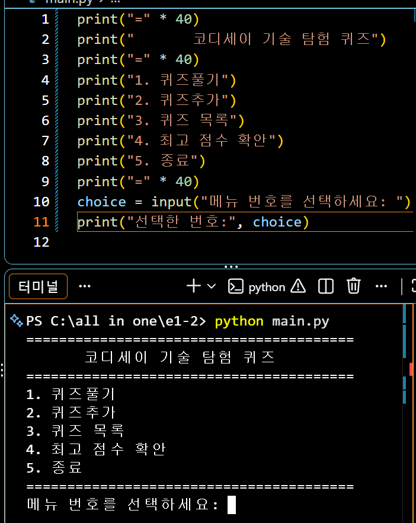
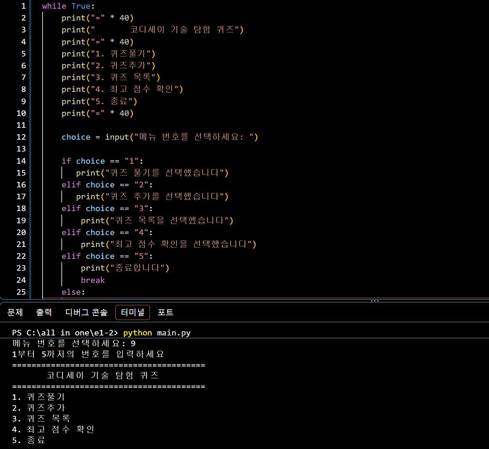
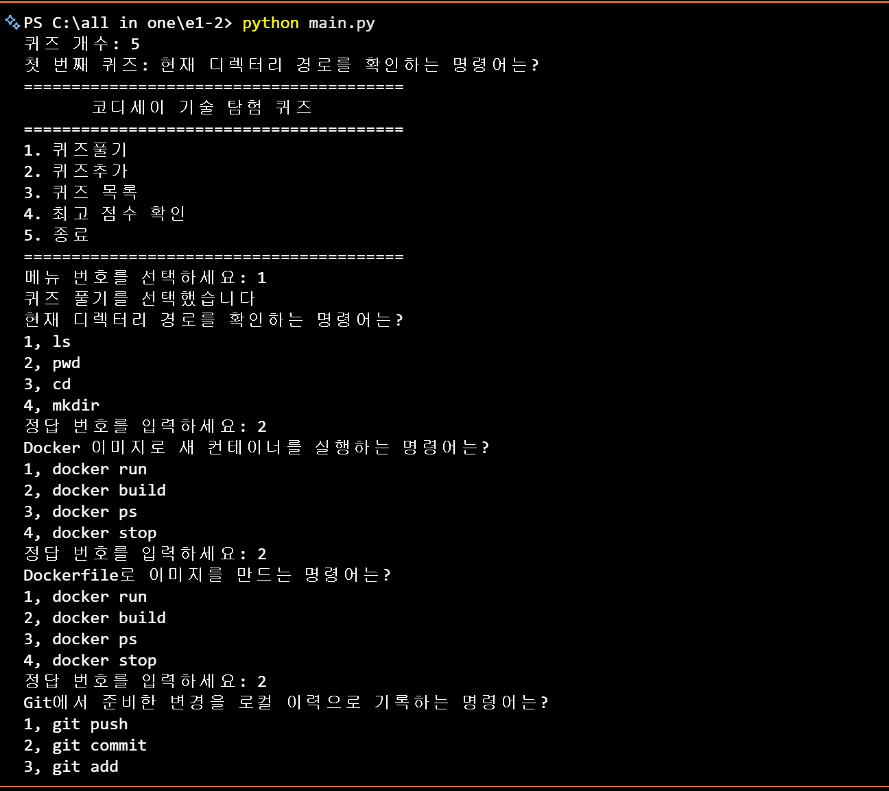

# 작업별 코드 수정과 확인 결과

<a id="step-01"></a>
## 1. main.py를 생성하고 print로 메뉴 5개 출력

**작업 코드**

```powershell
New-Item main.py
code main.py
```

**확인한 출력 — 파일 생성**

```text
디렉터리: C:\all in one\e1-2

Mode                 LastWriteTime    Length
----                 -------------    ------
-a----      2026-11-15   오후 9:08         0
```

**메뉴 코드 — main.py**

```python
print("=" * 40)
print("       코디세이 기술 탐험 퀴즈")
print("=" * 40)
print("1. 퀴즈풀기")
print("2. 퀴즈추가")
print("3. 퀴즈 목록")
print("4. 최고 점수 확인")
print("5. 종료")
print("=" * 40)
```

**실행 — PowerShell, C:\all in one\e1-2**

```powershell
python main.py
```

**메뉴 출력 결과**



<a id="step-02"></a>
## 2. input으로 메뉴 번호를 받고 if·elif·else로 선택 처리

**작업 코드**

```python
choice = input("메뉴 번호를 선택하세요: ")

if choice == "1":
    print("퀴즈 풀기를 선택했습니다")
elif choice == "2":
    print("퀴즈 추가를 선택했습니다")
elif choice == "3":
    print("퀴즈 목록을 선택했습니다")
elif choice == "4":
    print("최고 점수 확인을 선택했습니다")
elif choice == "5":
    print("종료합니다")
else:
    print("1부터 5까지의 번호를 입력하세요")
```

**실행 — PowerShell, C:\all in one\e1-2**

```powershell
python main.py
```

**확인한 출력**

```text
메뉴 번호를 선택하세요: 1
퀴즈 풀기를 선택했습니다

메뉴 번호를 선택하세요: 9
1부터 5까지의 번호를 입력하세요
```

출력은 각각 1과 9를 입력한 별도 실행의 발췌다. 메뉴 2~5의 선택 화면도 보관돼 있다.

<a id="step-03"></a>
## 3. while로 메뉴를 반복하고 5번에서 break로 종료

**작업 코드**

```python
while True:
    print("=" * 40)
    print("       코디세이 기술 탐험 퀴즈")
    print("=" * 40)
    print("1. 퀴즈풀기")
    print("2. 퀴즈추가")
    print("3. 퀴즈 목록")
    print("4. 최고 점수 확인")
    print("5. 종료")
    print("=" * 40)

    choice = input("메뉴 번호를 선택하세요: ").strip()

    if choice == "1":
        print("퀴즈 풀기를 선택했습니다")
    elif choice == "2":
        print("퀴즈 추가를 선택했습니다")
    elif choice == "3":
        print("퀴즈 목록을 선택했습니다")
    elif choice == "4":
        print("최고 점수 확인을 선택했습니다")
    elif choice == "5":
        print("종료합니다")
        break
    else:
        print("1부터 5까지의 번호를 입력하세요")
```

**실행 — PowerShell, C:\all in one\e1-2**

```powershell
python main.py
```

**확인한 출력**

```text
메뉴 번호를 선택하세요: 9
1부터 5까지의 번호를 입력하세요
```

9 입력 후 메뉴 재표시는 보관 화면으로 확인했다. 반복 메뉴의 5번 종료는 대화에서 확인했으며 해당 종료 화면은 별도로 보관되지 않았다.



<a id="step-04"></a>
## 4. Quiz 클래스에 질문·선택지·정답을 저장하고 첫 객체 생성

**작업 코드**

```python
class Quiz:
    def __init__(self, question, choices, answer):
        self.question = question
        self.choices = choices
        self.answer = answer

quiz1 = Quiz(
    "현재 디렉터리 경로를 확인하는 명령어는?",
    ["ls", "pwd", "cd", "mkdir"],
    2,
)

print(quiz1.question)
```

**실행 — PowerShell, C:\all in one\e1-2**

```powershell
python main.py
```

**확인한 출력**

```text
현재 디렉터리 경로를 확인하는 명령어는?
```

<a id="step-05"></a>
## 5. Quiz.show에 질문과 선택지 번호를 출력하는 메서드 작성

**작업 코드**

```python
# Quiz 클래스 안에 추가
def show(self):
    print(self.question)
    for number, choice in enumerate(self.choices, start=1):
        print(f"{number}, {choice}")

# 클래스 밖에서 호출
quiz1.show()
```

**실행 — PowerShell, C:\all in one\e1-2**

```powershell
python main.py
```

**확인한 출력**

```text
현재 디렉터리 경로를 확인하는 명령어는?
1, ls
2, pwd
3, cd
4, mkdir
```

별도의 print(quiz1.question)을 제거한 뒤 질문과 선택지가 한 번씩 나왔다.

<a id="step-06"></a>
## 6. Quiz.check를 작성하고 정답·오답 반환값 확인

**작업 코드**

```python
# Quiz 클래스 안에 추가
def check(self, user_answer):
    return user_answer == self.answer

# 클래스 밖에서 판정 결과 확인
print("2번", quiz1.check(2))
print("1번", quiz1.check(1))
```

**실행 — PowerShell, C:\all in one\e1-2**

```powershell
python main.py
```

**확인한 출력**

```text
2번 True
1번 False
```

<a id="step-07"></a>
## 7. Docker 실행·이미지 빌드 문제를 두 번째·세 번째 객체로 추가

**작업 코드**

```python
quiz2 = Quiz(
    "Docker 이미지로 새 컨테이너를 실행하는 명령어는?",
    ["docker run", "docker build", "docker ps", "docker stop"],
    1,
)
quiz3 = Quiz(
    "Dockerfile로 이미지를 만드는 명령어는?",
    ["docker run", "docker build", "docker ps", "docker stop"],
    2,
)

quiz2.show()
quiz3.show()
```

**실행 — PowerShell, C:\all in one\e1-2**

```powershell
python main.py
```

**확인한 출력**

```text
Docker 이미지로 새 컨테이너를 실행하는 명령어는?
1, docker run
2, docker build
3, docker ps
4, docker stop

Dockerfile로 이미지를 만드는 명령어는?
1, docker run
2, docker build
3, docker ps
4, docker stop
```

<a id="step-08"></a>
## 8. Git commit 문제를 네 번째 객체로 추가

**작업 코드**

```python
quiz4 = Quiz(
    "Git에서 준비한 변경을 로컬 이력으로 기록하는 명령어는?",
    ["git push", "git commit", "git add", "git status"],
    2,
)

quiz4.show()
```

**실행 — PowerShell, C:\all in one\e1-2**

```powershell
python main.py
```

**확인한 출력**

```text
Git에서 준비한 변경을 로컬 이력으로 기록하는 명령어는?
1, git push
2, git commit
3, git add
4, git status
```

<a id="step-09"></a>
## 9. Git status 문제를 다섯 번째 객체로 추가

**작업 코드**

```python
quiz5 = Quiz(
    "현재 Git 저장소의 변경 상태를 확인하는 명령어는?",
    ["git status", "git push", "git commit", "git clone"],
    1,
)

quiz5.show()
```

**실행 — PowerShell, C:\all in one\e1-2**

```powershell
python main.py
```

**확인한 출력**

```text
현재 Git 저장소의 변경 상태를 확인하는 명령어는?
1, git status
2, git push
3, git commit
4, git clone
```

<a id="step-10"></a>
## 10. 퀴즈 객체 5개를 quizzes 리스트에 담고 개수 확인

**작업 코드**

```python
quizzes = [quiz1, quiz2, quiz3, quiz4, quiz5]
print("퀴즈 개수:", len(quizzes))
```

**실행 — PowerShell, C:\all in one\e1-2**

```powershell
python main.py
```

**확인한 출력**

```text
퀴즈 개수: 5
```

<a id="step-11"></a>
## 11. quizzes[0].question으로 리스트의 첫 질문 출력

**작업 코드**

```python
print("첫 번째 퀴즈:", quizzes[0].question)
```

**실행 — PowerShell, C:\all in one\e1-2**

```powershell
python main.py
```

**확인한 출력**

```text
첫 번째 퀴즈: 현재 디렉터리 경로를 확인하는 명령어는?
```

<a id="step-12"></a>
## 12. for 반복문으로 리스트의 질문 5개를 순서대로 출력

**작업 코드**

```python
for quiz in quizzes:
    print(quiz.question)
```

**실행 — PowerShell, C:\all in one\e1-2**

```powershell
python main.py
```

**확인한 출력**

```text
현재 디렉터리 경로를 확인하는 명령어는?
Docker 이미지로 새 컨테이너를 실행하는 명령어는?
Dockerfile로 이미지를 만드는 명령어는?
Git에서 준비한 변경을 로컬 이력으로 기록하는 명령어는?
현재 Git 저장소의 변경 상태를 확인하는 명령어는?
```

<a id="step-13"></a>
## 13. 반복문의 print를 show 호출로 바꿔 선택지도 출력

**작업 코드**

```python
for quiz in quizzes:
    quiz.show()
```

**실행 — PowerShell, C:\all in one\e1-2**

```powershell
python main.py
```

**확인한 출력**

```text
현재 디렉터리 경로를 확인하는 명령어는?
1, ls
2, pwd
3, cd
4, mkdir
```

실제 출력 중 첫 번째 문제를 발췌했다. 같은 반복문에서 다섯 문제와 선택지가 모두 출력됐다.

<a id="step-14"></a>
## 14. 반복문을 남기고 개별 show·임시 check 출력 중복 제거

**삭제한 코드**

```python
quiz1.show()
print("2번", quiz1.check(2))
print("1번", quiz1.check(1))
quiz2.show()
quiz3.show()
quiz4.show()
quiz5.show()
```


**작업 코드**

```python
# 남긴 코드
for quiz in quizzes:
    quiz.show()
```

**실행 — PowerShell, C:\all in one\e1-2**

```powershell
python main.py
```

**확인한 출력**

```text
퀴즈 개수: 5
첫 번째 퀴즈: 현재 디렉터리 경로를 확인하는 명령어는?
현재 디렉터리 경로를 확인하는 명령어는?
1, ls
2, pwd
3, cd
4, mkdir
```

정리 후 다섯 문제와 선택지가 한 번씩 나왔다. 첫 질문 안내는 별도 print 때문에 남아 있었다.

<a id="step-15"></a>
## 15. 문제 출력 반복문을 메뉴 1번 조건 안으로 이동

**작업 코드**

```python
# while True 안에서 번호를 받은 뒤
choice = input("메뉴 번호를 선택하세요: ").strip()

if choice == "1":
    print("퀴즈 풀기를 선택했습니다")
    for quiz in quizzes:
        quiz.show()
```

**실행 — PowerShell, C:\all in one\e1-2**

```powershell
python main.py
```

**확인한 출력**

```text
메뉴 번호를 선택하세요: 1
퀴즈 풀기를 선택했습니다
현재 디렉터리 경로를 확인하는 명령어는?
1, ls
2, pwd
3, cd
4, mkdir
```

1번 선택 후 다섯 문제가 출력되고 메뉴로 돌아왔다. 출력은 첫 번째 문제 부분이다.

<a id="step-16"></a>
## 16. 문제를 보여 준 다음 input으로 답 번호 받기

**작업 코드**

```python
# while True 안의 기존 1번 분기 수정
if choice == "1":
    print("퀴즈 풀기를 선택했습니다")
    for quiz in quizzes:
        quiz.show()
        user_answer = input("정답 번호를 입력하세요: ")
```

**실행 — PowerShell, C:\all in one\e1-2**

```powershell
python main.py
```

**확인한 출력**

```text
메뉴 번호를 선택하세요: 1
퀴즈 풀기를 선택했습니다
현재 디렉터리 경로를 확인하는 명령어는?
1, ls
2, pwd
3, cd
4, mkdir
정답 번호를 입력하세요: 2
Docker 이미지로 새 컨테이너를 실행하는 명령어는?
1, docker run
2, docker build
3, docker ps
4, docker stop
정답 번호를 입력하세요: 2
```

답 입력 후 다음 문제로 이동했다. 답을 비교하는 코드는 이 단계에 없으므로 정답·오답 안내는 나오지 않았다.



<a id="step-17"></a>
## 17. git push로 최초 업로드하고 fetch·pull로 변경 반영

**작업 코드**

```powershell
# PowerShell: C:\all in one\e1-2
git push -u origin main
git fetch origin
git status -sb
git pull --ff-only origin main
```

**확인한 출력**

```text
* [new branch]      main -> main
branch 'main' set up to track 'origin/main'.

8704b8e..2fe1da2  main -> origin/main
## main...origin/main [behind 5]

Updating 8704b8e..2fe1da2
Fast-forward
README.md  | 330 +++++++++++++++++++++++++++++++++++++++++++++++++------------
main.py    | 233 +++++++++++++++++++++++++++++++++++++++++++
state.json |  66 +++++++++++++
3 files changed, 564 insertions(+), 65 deletions(-)
create mode 100644 main.py
create mode 100644 state.json
```

출력은 순서대로 첫 push, fetch·status, pull의 결과다. 새 게임 완료가 아닌 저장소 동기화 기록이다.

