[전체 기록 찾아보기](index.md)

---

<a id="record-001"></a>
# 🧭 코디세이 기술 탐험 퀴즈 — E1-2 


<a id="record-002"></a>
## 개발 과정과 문서 정리 방향

[두 퀴즈 프로젝트와 개발 과정 비교](../../docs/development-comparison.md)에 실제 커밋 순서, 현재 학습 방식의 장단점, 앞으로의 구현·문서 정리 방향을 기록했습니다. 앞으로는 한 기능씩 구현·확인하고, README에는 현재 기능 상태를 요약하며 상세 실습 기록은 별도 문서로 연결하는 방향으로 정리합니다.

<a id="record-003"></a>
## 현재 작업: 게임 처음부터 다시 만들기

**현재 진행:** `main.py`를 처음부터 다시 작성하고 있습니다. 아래 게임 작업 기록과 테스트 상태는 새로 작성한 프로그램을 기준으로 정리합니다.

<a id="record-004"></a>
### 새 Python 파일 준비 — 실제 실행 기록

<pre style="border: 1px solid #d0d7de; border-radius: 6px; padding: 12px; background: #f6f8fa;"><code># main.py 파일 준비
<span style="color: #0969da;">New-Item main.py</span></code></pre>

**제공된 출력:**

```text
    디렉터리: C:\all in one\e1-2

Mode                 LastWriteTime    Length
----                 -------------    ------
-a----      2026-11-15   오후 9:08         0
```

`New-Item`은 새 항목을 만드는 PowerShell 명령입니다. 제공된 출력에서는 크기가 `0`으로 표시됐고, 이후 Codex가 현재 `main.py`도 0바이트인 것을 확인했습니다. 이는 당시 파일이 비어 있던 것을 나타내며, 이후 작성한 메뉴 코드는 아래에 따로 기록합니다.

<pre style="border: 1px solid #d0d7de; border-radius: 6px; padding: 12px; background: #f6f8fa;"><code># VS Code에서 main.py 열기
<span style="color: #0969da;">code main.py</span></code></pre>

명령을 입력했고 터미널에 별도 출력은 표시되지 않았습니다. 새 게임의 실행 결과는 아직 확인하지 않았습니다.

<a id="record-005"></a>
### 메뉴 출력 작성 

작성한 메뉴 코드입니다. 아래는 **대화에서 제공한 코드**이며, 실제 실행 출력은 아직 제공되지 않았습니다.

```python
print("=" * 40)
print("       코디세이 기술 탐험 퀴즈")
print("=" * 40)
print("1. 퀴즈풀기")
print("2. 퀴즈추가")
print("3. 퀴즈 목록")
print("4. 최고 점수 확안")
print("5. 종료")
print("=" * 40)
```

`print()`는 내용을 화면에 출력하며, `"=" * 40`은 등호를 40번 반복합니다. `확안`은 메뉴에서 보여 줄 문구이므로 `확인`으로 고치면 됩니다.

**확인 상태:** 실행 스크린샷에서 메뉴 출력과 번호 `1` 입력 후 `선택한 번호: 1` 출력을 확인했습니다. 다른 입력의 처리와 메뉴 반복·종료 기능은 아직 확인하지 않았습니다.

**다음 학습 단계 — 번호 입력 계획:** 메뉴 출력 코드 아래에 `choice = input("메뉴 번호를 선택하세요: ")`와 `print("선택한 번호:", choice)`를 추가해 입력한 사람의 입력을 받아 출력합니다. `input()`은 문자열을 반환합니다. 이후 선택에 따른 동작과 종료를 추가합니다. 이 내용은 실행 전 계획입니다.

<a id="record-006"></a>
### 메뉴 실행 화면

<pre style="border: 1px solid #d0d7de; border-radius: 6px; padding: 12px; background: #f6f8fa;"><code># 메뉴가 표시되는지 실행
<span style="color: #0969da;">python main.py</span></code></pre>

**실제 화면:** 제공된 스크린샷에는 퀴즈 메뉴 다섯 항목과 `메뉴 번호를 선택하세요:` 입력 대기 화면이 표시됩니다. `print()`로 메뉴를 출력한 뒤 `input()`에서 입력한 사람의 번호 입력을 기다리는 상태입니다.

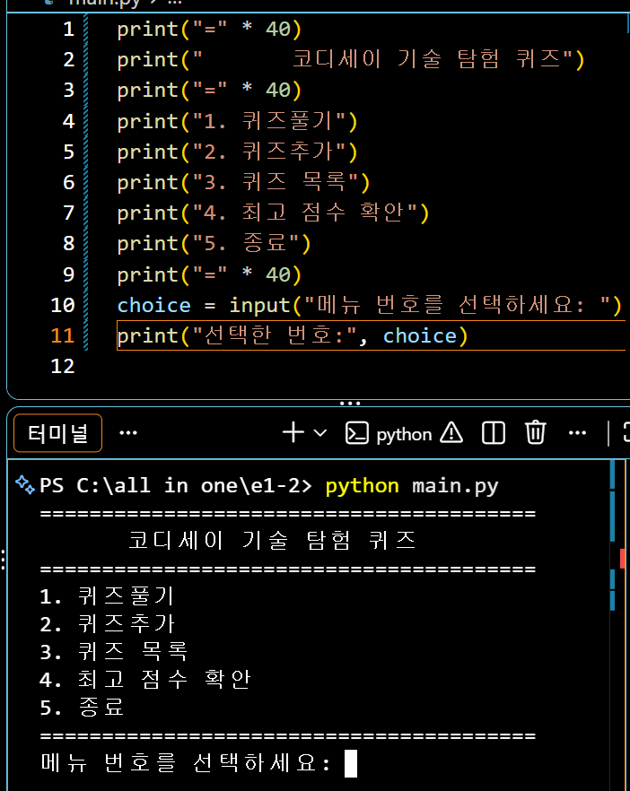

**확인 범위:** 메뉴 출력과 입력 대기 화면을 확인했습니다. 스크린샷에는 번호를 입력한 뒤 `선택한 번호`가 출력되는 결과가 없으므로 그 동작은 아직 확인하지 않았습니다. 화면에 보이는 `최고 점수 확안` 문구는 `최고 점수 확인`으로 수정할 수 있습니다.

<a id="record-007"></a>
### 메뉴 번호 입력 결과

<pre style="border: 1px solid #d0d7de; border-radius: 6px; padding: 12px; background: #f6f8fa;"><code># 메뉴를 출력하고 번호 입력 확인
<span style="color: #0969da;">python main.py</span></code></pre>

**실제 출력 중 입력 결과:**

```text
메뉴 번호를 선택하세요: 1
선택한 번호: 1
```

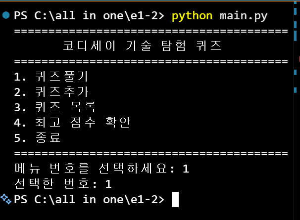

`input()`으로 입력받은 `1`을 `choice`에 저장하고, `print()`로 다시 표시한 결과입니다. 화면에는 출력 후 PowerShell 프롬프트로 돌아온 것도 보입니다. **이번에 확인한 것은 1번 입력과 표시뿐**이며, 퀴즈 실행·입력 검증·메뉴 반복·종료 기능은 아직 확인하지 않았습니다. 화면의 `최고 점수 확안` 문구는 수정이 필요합니다.

<a id="record-008"></a>
### 메뉴 1번 조건 분기

제공된 코드에서 `input()`으로 입력받은 값은 `choice`에 저장하고, 다음 조건문으로 `"1"`인지 비교합니다.

```python
if choice == "1":
    print("퀴즈 풀기를 선택했습니다")
else:
    print("다른 번호를 선택했습니다")
```

<pre style="border: 1px solid #d0d7de; border-radius: 6px; padding: 12px; background: #f6f8fa;"><code># 메뉴 번호에 따른 조건 분기 확인
<span style="color: #0969da;">python main.py</span></code></pre>

**실제 출력 중 입력과 선택 결과:**

```text
메뉴 번호를 선택하세요: 1
퀴즈 풀기를 선택했습니다
```

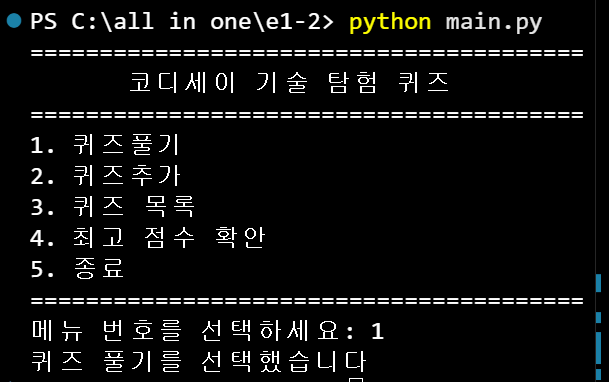

`input()`은 입력한 번호를 문자열로 받으므로 `choice == "1"`로 비교했습니다. 조건이 맞으면 `if` 아래의 문장이 실행됩니다. 맞지 않으면 `else` 아래 문장이 실행되도록 작성했지만, 이번 스크린샷은 **1번 입력 결과만 확인**합니다. 실제 퀴즈 출제 기능, 다른 번호 처리·반복·종료와 예외 처리는 아직 확인하거나 완성하지 않았습니다. 화면의 `최고 점수 확안`은 `최고 점수 확인`으로 수정할 수 있습니다.

<a id="record-009"></a>
### 메뉴 2번 조건 분기

기존 `if`와 `else` 사이에 `elif choice == "2":`를 넣어 2번을 별도로 구분했습니다. `elif`는 앞의 `if` 조건이 맞지 않을 때 다음 조건을 확인합니다.

```python
if choice == "1":
    print("퀴즈 풀기를 선택했습니다")
elif choice == "2":
    print("퀴즈 추가를 선택했습니다")
else:
    print("다른 번호를 선택했습니다")
```

<pre style="border: 1px solid #d0d7de; border-radius: 6px; padding: 12px; background: #f6f8fa;"><code># 메뉴 번호 2 선택 결과 확인
<span style="color: #0969da;">python main.py</span></code></pre>


```text
메뉴 번호를 선택하세요: 2
퀴즈 추가를 선택했습니다
```

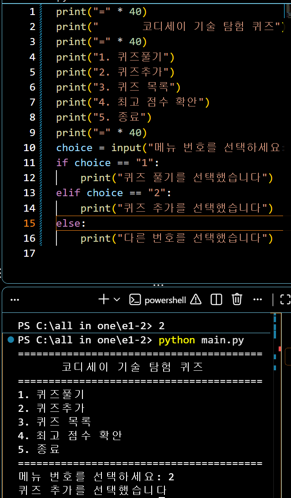

이번 확인은 2번을 골랐을 때 선택 문장이 표시되는지에 관한 것입니다. 아직 실제 퀴즈 추가, 3~5번 구분, 반복·입력 오류 처리는 완성하거나 확인하지 않았습니다.

<a id="record-010"></a>
### 메뉴 3번 조건 분기

`elif choice == "3":`을 추가해 퀴즈 목록 선택을 구분했습니다.

<pre style="border: 1px solid #d0d7de; border-radius: 6px; padding: 12px; background: #f6f8fa;"><code># 메뉴 번호 3 선택 결과 확인
<span style="color: #0969da;">python main.py</span></code></pre>


```text
메뉴 번호를 선택하세요: 3
퀴즈 목록을 선택했습니다
```

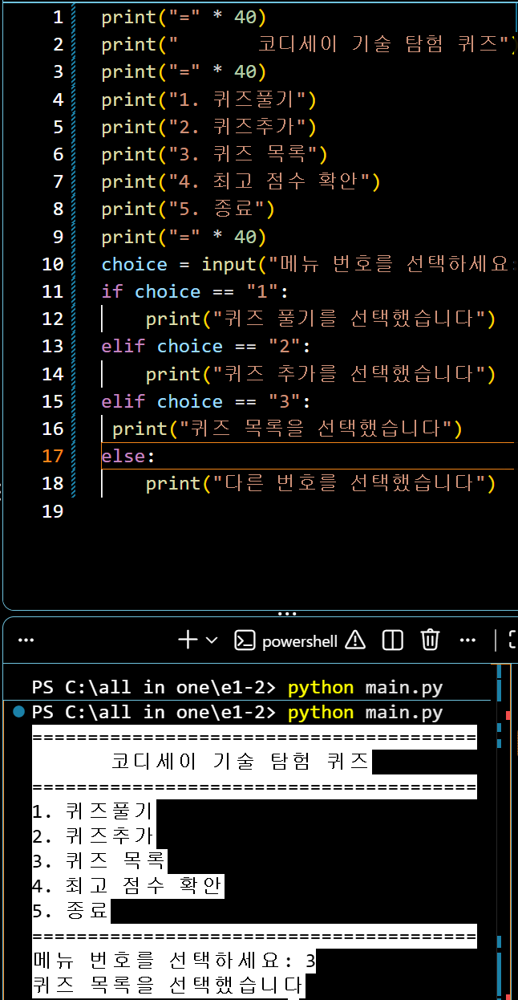

입력값이 문자열 `"3"`과 같아 해당 `elif` 아래의 문장이 실행됐습니다. 이 화면은 **선택 문장 표시만 확인**하며, 실제 퀴즈 목록 기능이 완성됐다는 의미는 아닙니다. 4·5번 구분, 반복 및 예외 처리도 아직 확인되지 않았습니다.

<a id="record-011"></a>
### 메뉴 4번 조건 분기

`elif choice == "4":`을 추가해 최고 점수 확인 선택을 구분했습니다.

<pre style="border: 1px solid #d0d7de; border-radius: 6px; padding: 12px; background: #f6f8fa;"><code># 메뉴 번호 4 선택 결과 확인
<span style="color: #0969da;">python main.py</span></code></pre>


```text
메뉴 번호를 선택하세요: 4
최고 점수 확인을 선택했습니다
```

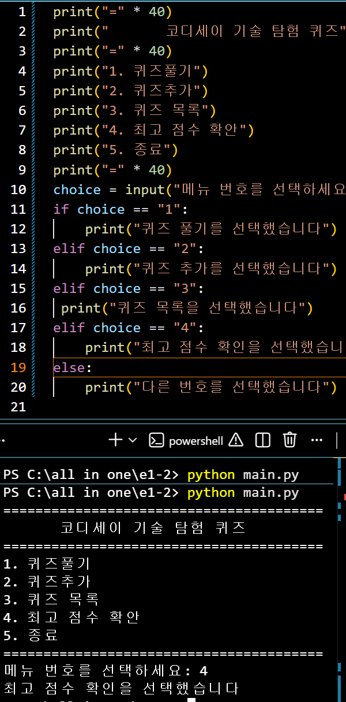

입력값이 문자열 `"4"`와 같아 해당 `elif` 아래 문장이 실행됐습니다. 현재는 **선택 문장 표시**를 확인한 단계이며 최고 점수 계산·저장·표시는 아직 구현 또는 검증되지 않았습니다. 메뉴에서 `최고 점수 확안`으로 표시되는 문구는 `최고 점수 확인`으로 고칠 수 있습니다.

<a id="record-012"></a>
### 메뉴 5번 조건 분기

`elif choice == "5":`을 추가해 종료 선택을 구분했습니다.

<pre style="border: 1px solid #d0d7de; border-radius: 6px; padding: 12px; background: #f6f8fa;"><code># 메뉴 번호 5 선택 결과 확인
<span style="color: #0969da;">python main.py</span></code></pre>


```text
메뉴 번호를 선택하세요: 5
종료합니다
```

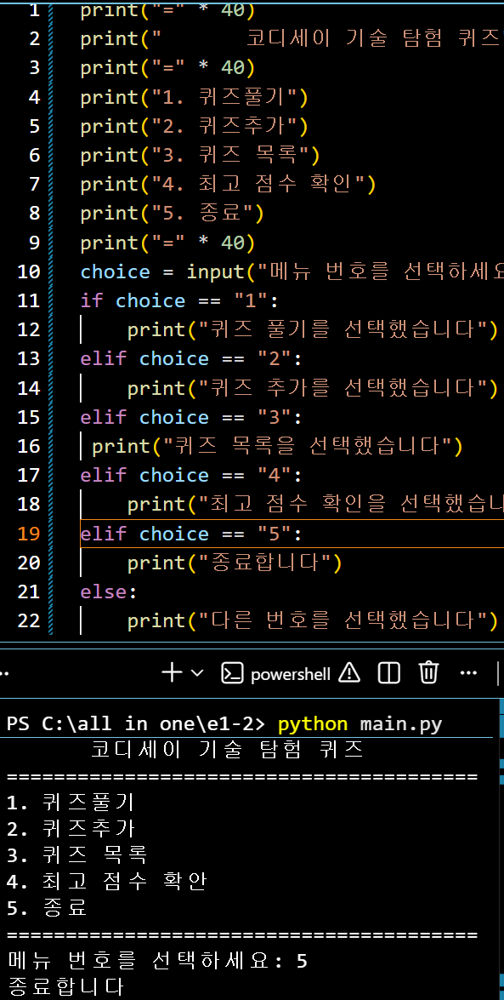

`choice`가 문자열 `"5"`일 때 해당 `elif` 아래 문장이 출력됐습니다. 화면에서 종료 문구까지 확인했으며, 스크린샷에 PowerShell 프롬프트가 다시 보이지 않으므로 프롬프트 복귀는 별도로 확인하지 않았습니다. 현재 코드는 반복문 없이 선택을 한 번 처리하는 형태여서 다른 메뉴도 문장 출력 후 끝날 수 있습니다. 반복·잘못된 입력 재입력 및 실제 게임 기능은 아직 완성되지 않았습니다.

<a id="record-013"></a>
### 메뉴 범위 밖 입력 안내

`else` 아래 안내 문장을 작성했습니다. 선택한 값이 앞서 작성한 `"1"`부터 `"5"`까지의 조건에 해당하지 않으면 이 문장이 실행됩니다.

```python
else:
    print("1부터 5까지의 번호를 입력하세요")
```

<pre style="border: 1px solid #d0d7de; border-radius: 6px; padding: 12px; background: #f6f8fa;"><code># 메뉴 범위 밖 숫자 9를 입력해 안내 확인
<span style="color: #0969da;">python main.py</span></code></pre>


```text
메뉴 번호를 선택하세요: 9
1부터 5까지의 번호를 입력하세요
```

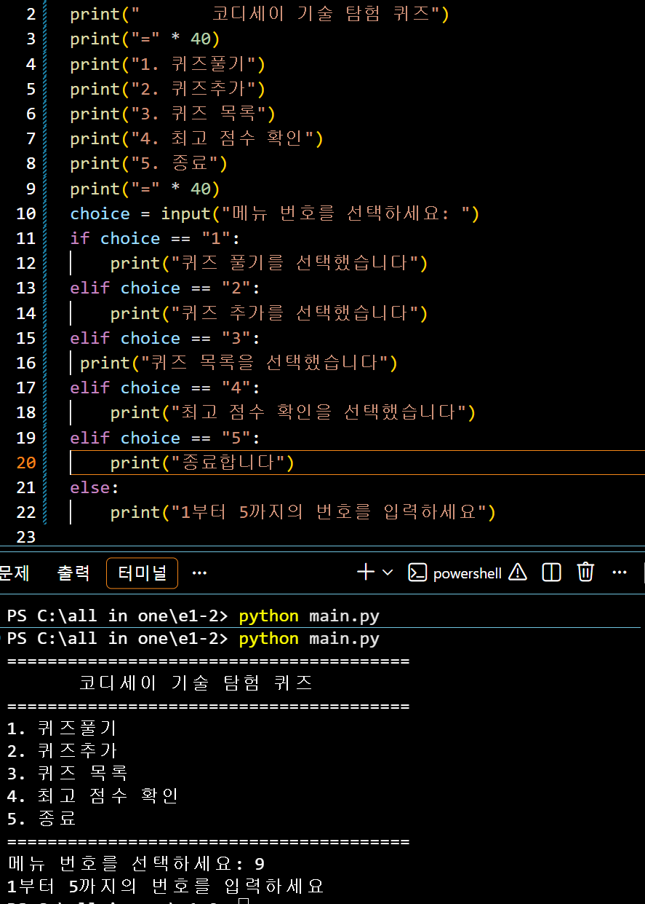

이번 화면에서는 `9` 입력 시 안내 문장만 확인했습니다. 반복문을 추가해 다시 입력받는 동작, 빈 입력·문자 입력 처리 및 Ctrl+C·EOF 처리는 아직 완성하거나 확인하지 않았습니다.

<a id="record-014"></a>
### 메뉴 반복

`while True:` 안에 메뉴 출력·입력·조건문을 넣고, `5`를 선택하면 `break`를 실행하도록 작성했습니다. `while True`는 내부 코드를 반복하고, `break`는 해당 반복문을 빠져나갑니다.

<pre style="border: 1px solid #d0d7de; border-radius: 6px; padding: 12px; background: #f6f8fa;"><code># 범위 밖 번호를 입력한 뒤 메뉴가 다시 표시되는지 확인
<span style="color: #0969da;">python main.py</span></code></pre>


```text
메뉴 번호를 선택하세요: 9
1부터 5까지의 번호를 입력하세요
```

이후 메뉴가 다시 표시된 화면을 확인했습니다.

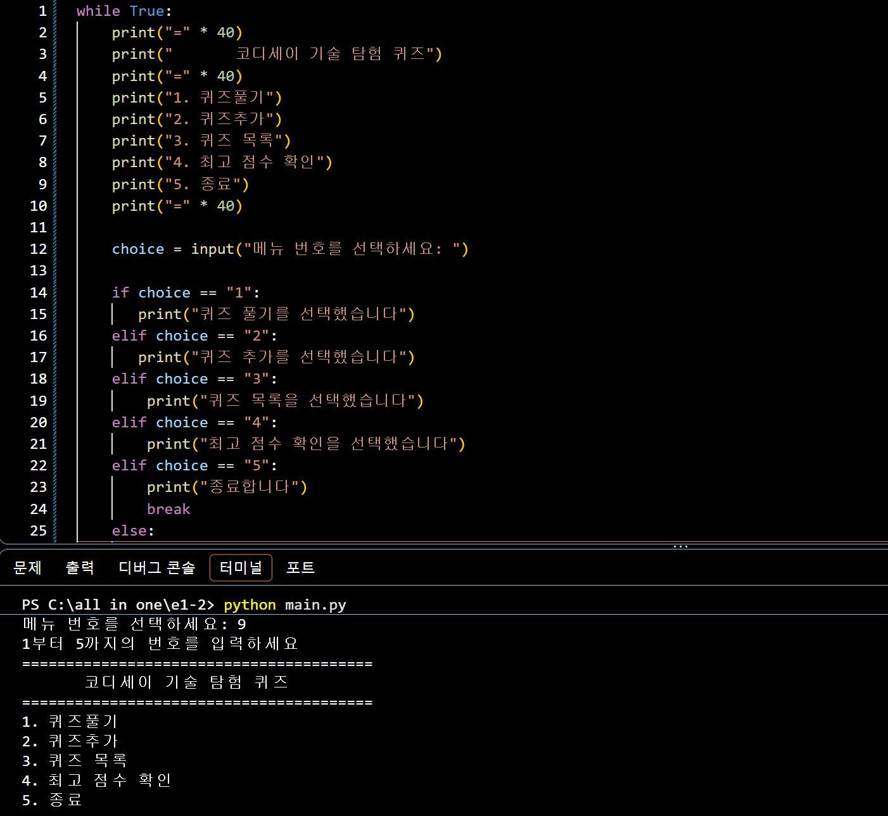

**확인 범위:** `9`에 대한 안내 후 메뉴가 다시 표시된 것까지 확인했습니다. 이 화면에는 `5`를 입력해 `break`로 종료하는 결과가 보이지 않습니다. 이후 종료를 확인했다고 알려주었으며, 해당 결과 화면은 제공되지 않았습니다. 빈 입력·문자 입력·공백 처리와 실제 게임 기능도 별도로 확인해야 합니다.

<a id="record-015"></a>
### 현재까지 작성한 메뉴 코드 — 2026-11-16

아래 내용은 공유된 코드와 저장된 `main.py`를 확인해 기록했습니다. 현재는 실제 퀴즈 기능을 호출하지 않고 선택한 메뉴의 안내 문장을 출력합니다.

```python
while True:
    print("=" * 40)
    print("       코디세이 기술 탐험 퀴즈")
    print("=" * 40)
    print("1. 퀴즈풀기")
    print("2. 퀴즈추가")
    print("3. 퀴즈 목록")
    print("4. 최고 점수 확인")
    print("5. 종료")
    print("=" * 40)

    choice = input("메뉴 번호를 선택하세요: ")

    if choice == "1":
       print("퀴즈 풀기를 선택했습니다")
    elif choice == "2":
       print("퀴즈 추가를 선택했습니다")
    elif choice == "3":
        print("퀴즈 목록을 선택했습니다")
    elif choice == "4":
        print("최고 점수 확인을 선택했습니다")
    elif choice == "5":
        print("종료합니다")
        break
    else:
        print("1부터 5까지의 번호를 입력하세요")
```

**코드 해설**

- `while True:`는 메뉴 출력과 선택 처리를 반복합니다.
- `print("=" * 40)`은 등호를 40개 출력합니다.
- `input()`은 메뉴 번호를 문자열로 받아 `choice`에 저장합니다. 예를 들어 `1`을 입력하면 `choice`는 `"1"`입니다.
- `if`, `elif`, `else`는 입력한 번호에 따라 다른 문장을 출력합니다.
- `break`는 `choice`가 `"5"`일 때 반복문을 끝냅니다.

**실제 확인 범위:** 앞선 실행 화면에서 반복문 추가 전 메뉴 1~5 중 선택 문장을 순서대로 확인했고, 반복문을 추가한 뒤에는 `9` 입력 후 안내 문장과 메뉴 재표시를 확인했습니다. **반복문 안에서 `5`번 종료는 이후 구두로 확인했습니다.** 해당 결과 화면은 별도로 제공되지 않았습니다. 퀴즈 풀기·추가·목록·최고 점수의 실제 기능과 빈 입력·앞뒤 공백·Ctrl+C·EOF 처리는 아직 완성하거나 확인하지 않았습니다.

**들여쓰기:** 현재 1번과 2번의 `print` 앞 공백 수는 3~5번의 `print`와 다릅니다. 각각 별도의 조건 블록이라 동작할 수 있지만, 읽기 쉽게 각 조건문 아래의 `print`를 모두 동일하게 네 칸 더 들여쓰는 방식이 권장됩니다. 이 기록 단계에서는 코드를 수정하지 않았습니다.

<a id="record-016"></a>
### 반복 메뉴의 5번 종료 확인 

`while True` 반복 메뉴에서 `5`번 종료를 확인했다고 알려주었습니다. `choice == "5"`일 때 종료 문장을 출력하고 `break`로 반복문을 빠져나오는 동작을 확인한 단계입니다. 실행 화면이나 터미널 전체 출력은 별도로 제공되지 않아 이미지나 실제 출력 블록은 추가하지 않았습니다.

**이후 진행:** 저장된 메뉴 입력 코드에 `.strip()`이 추가됐습니다. 공백을 포함한 입력의 결과는 화면만으로 정확히 확인되지 않아 별도 확인이 필요합니다. 빈 입력·문자 입력·Ctrl+C·EOF도 이후 확인합니다.

<a id="record-017"></a>
### 메뉴 1번 선택 후 반복

공유된 실행 화면에서 메뉴 번호 `1` 선택 뒤 퀴즈 풀기 선택 문장이 출력되고 메뉴가 다시 표시됐습니다.

**실제 화면의 입력과 결과:**

```text
메뉴 번호를 선택하세요: 1
퀴즈 풀기를 선택했습니다
```

이후 메뉴가 다시 표시되어 다음 입력을 기다리는 상태입니다.

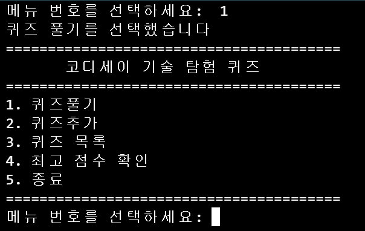

**확인 범위:** 1번 선택 문장과 메뉴 반복을 확인했습니다. 화면만으로 입력한 공백의 정확한 개수를 단정할 수 없으므로 앞뒤 공백 제거를 별도로 통과했다고 기록하지 않습니다. 실제 퀴즈 풀이 기능은 아직 확인되지 않았습니다.

<a id="record-018"></a>
### Quiz 객체의 문제 문장 출력

`Quiz` 클래스의 `__init__`에 `question`, `choices`, `answer` 속성을 작성하고 `quiz1 = Quiz(...)`로 퀴즈 객체를 만들었습니다. 이어 `print(quiz1.question)`으로 객체에 저장한 질문을 확인했습니다.

<pre style="border: 1px solid #d0d7de; border-radius: 6px; padding: 12px; background: #f6f8fa;"><code># 객체의 질문과 기존 메뉴 출력 확인
<span style="color: #0969da;">python main.py</span></code></pre>

**실행 화면의 실제 출력 중 문제 문장:**

```text
현재 디렉터리 경로를 확인하는 명령어는?
```

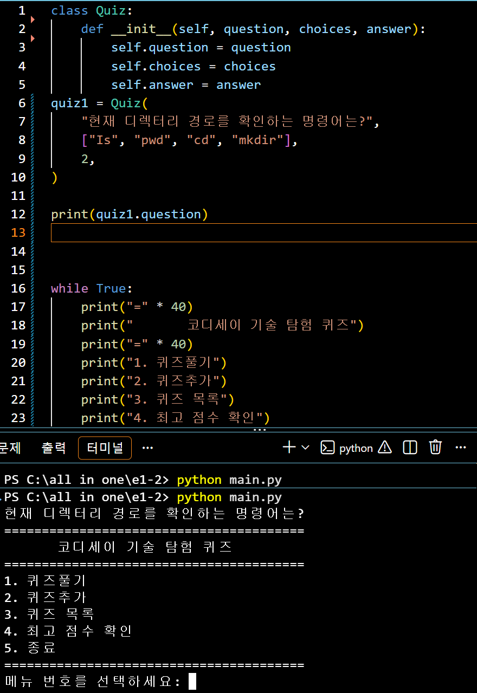

질문 문장이 출력된 뒤 메뉴가 표시되고 입력을 기다리는 화면을 확인했습니다. `self.question`, `self.choices`, `self.answer`는 각 퀴즈 객체에 문제·선택지·정답을 보관하는 속성입니다. 이번 화면에서는 선택지 값이나 정답 판정은 출력·검증되지 않았습니다. 스크린샷의 첫 선택지는 `Is`로 보이며, Linux 목록 명령을 의도했다면 소문자 엘(`l`)로 시작하는 `ls`로 수정해야 합니다. 문제 출력·정답 확인 메서드는 이후 구현합니다.

<a id="record-019"></a>
### Quiz.show() 문제와 선택지 출력

`Quiz` 클래스에 `show()` 메서드를 추가하고 `quiz1.show()`로 호출하는 연습을 했습니다. 메서드는 질문을 출력한 뒤 `enumerate(..., start=1)`로 선택지 번호를 붙입니다.

<pre style="border: 1px solid #d0d7de; border-radius: 6px; padding: 12px; background: #f6f8fa;"><code># Quiz.show()의 출력과 메뉴 확인
<span style="color: #0969da;">python main.py</span></code></pre>

**실행 화면의 실제 출력 중 일부:**

```text
현재 디렉터리 경로를 확인하는 명령어는?
1, ls
2, pwd
3, cd
4, mkdir
현재 디렉터리 경로를 확인하는 명령어는?
```

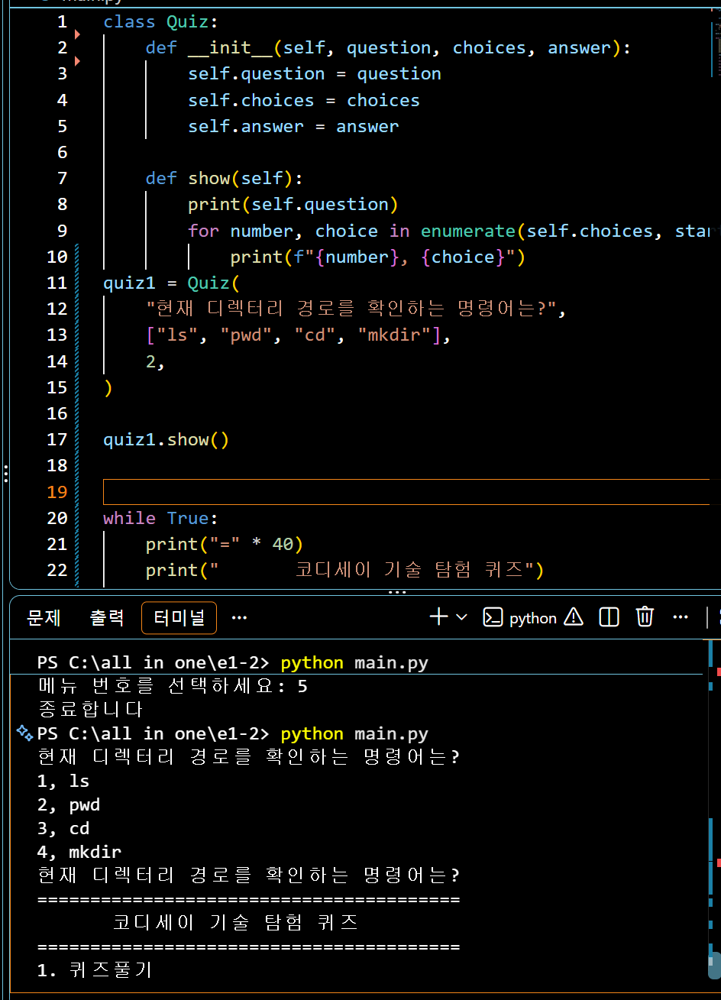

`quiz1.show()`가 문제와 선택지 네 개를 출력한 것을 확인했습니다. 질문 문장이 한 번 더 출력된 이유를 확인하기 위해 저장된 파일을 읽었을 때 `quiz1.show()` 아래에 `print(quiz1.question)`도 있었습니다. 이 추가 출력 줄은 제거하고 저장하면 됩니다. 스크린샷의 편집기에는 해당 줄이 보이지 않아, 편집 중인 내용과 저장된 파일이 달랐을 가능성이 있습니다. 실제 정답 입력·판정은 아직 구현하거나 확인하지 않았습니다.

<a id="record-020"></a>
### Quiz.show() 중복 출력 수정 후 확인 

`print(quiz1.question)`을 정리한 뒤 실행한 결과를 공유했습니다.

<pre style="border: 1px solid #d0d7de; border-radius: 6px; padding: 12px; background: #f6f8fa;"><code># 질문과 선택지 출력 확인
<span style="color: #0969da;">python main.py</span></code></pre>

**실제 출력:**

```text
현재 디렉터리 경로를 확인하는 명령어는?
1, ls
2, pwd
3, cd
4, mkdir
========================================
       코디세이 기술 탐험 퀴즈
========================================
1. 퀴즈풀기
2. 퀴즈추가
3. 퀴즈 목록
4. 최고 점수 확인
5. 종료
========================================
메뉴 번호를 선택하세요:
```

질문이 한 번 표시되고, 선택지 네 개가 번호와 함께 출력된 뒤 기존 메뉴가 입력을 기다립니다. 이번 출력으로 `show()`의 질문·선택지 출력을 확인했습니다. 이용자 답을 입력받아 정답을 판정하는 기능은 아직 확인 전입니다.

<a id="record-021"></a>
### Quiz.check() 정답 확인 실행 

`Quiz` 클래스에 입력한 번호와 저장된 정답을 비교하는 `check()` 메서드를 작성했습니다.

```python
def check(self, user_answer):
    return user_answer == self.answer
```

`user_answer`는 비교할 번호이고 `self.answer`는 퀴즈에 저장된 정답입니다. `==`는 두 값이 같은지 비교하며 `return`은 그 결과를 돌려줍니다.

<pre style="border: 1px solid #d0d7de; border-radius: 6px; padding: 12px; background: #f6f8fa;"><code># 문제 출력과 임시 정답 판정 확인
<span style="color: #0969da;">python main.py</span></code></pre>

**제공된 실제 출력 중 문제와 판정 결과:**

```text
현재 디렉터리 경로를 확인하는 명령어는?
1, ls
2, pwd
3, cd
4, mkdir
2번 True
1번 False
```

현재 문제의 정답 번호는 `2`입니다. `quiz1.check(2)`는 `True`, `quiz1.check(1)`은 `False`를 반환했습니다. 문제와 선택지 출력 후 기존 메뉴가 표시된 것까지 알려주었습니다. 두 `print` 호출은 기능 확인을 위한 임시 코드이며, 메뉴에서 입력한 사람의 답을 받아 처리하는 기능은 아직 확인되지 않았습니다.

<a id="record-022"></a>
### 두 번째 퀴즈 작성과 출력 

`Quiz` 클래스로 Docker 명령어에 관한 두 번째 퀴즈를 만들었습니다. 저장된 `main.py`에서 `docker run`이 첫 번째 선택지이며 정답 번호가 `1`인 것을 확인했습니다.

```python
quiz2 = Quiz(
    "Docker 이미지로 새 컨테이너를 실행하는 명령어는?",
    ["docker run", "docker build", "docker ps", "docker stop"],
    1,
)

quiz2.show()
```

<pre style="border: 1px solid #d0d7de; border-radius: 6px; padding: 12px; background: #f6f8fa;"><code># 두 문제와 선택지 출력 확인
<span style="color: #0969da;">python main.py</span></code></pre>

**제공된 실제 출력 중 두 번째 문제:**

```text
Docker 이미지로 새 컨테이너를 실행하는 명령어는?
1, docker run
2, docker build
3, docker ps
4, docker stop
```

첫 번째 퀴즈와 두 번째 퀴즈가 순서대로 표시되고 메뉴가 이어서 표시됐습니다. 화면 출력으로 문제와 선택지를 확인했고, 정답 번호는 저장된 코드를 읽어 확인했습니다. `quiz2.check()`의 실행 결과와 메뉴에서 퀴즈를 푸는 기능은 아직 확인되지 않았습니다.

<a id="record-023"></a>
### 세 번째 퀴즈 작성과 출력

`Quiz` 클래스로 Dockerfile에서 이미지를 만드는 명령을 묻는 퀴즈를 작성했습니다. 저장된 `main.py`에서 `docker build`가 두 번째 선택지이고 정답 번호가 `2`인 것을 확인했습니다.

```python
quiz3 = Quiz(
    "Dockerfile로 이미지를 만드는 명령어는?",
    ["docker run", "docker build", "docker ps", "docker stop"],
    2,
)

quiz3.show()
```

공유된 실행 화면에는 다음 문제가 두 번째 퀴즈 뒤에 표시됐습니다.

```text
Dockerfile로 이미지를 만드는 명령어는?
1, docker run
2, docker build
3, docker ps
4, docker stop
```

문제와 선택지 출력을 확인했고, 정답 번호는 저장된 코드를 읽어 확인했습니다. `quiz3.check()` 실행 결과나 메뉴에서의 퀴즈 풀이 기능은 아직 확인되지 않았습니다.

<a id="record-024"></a>
### 실제 GitHub 첫 push와 노트북 동기화

이 기록은 **다시 만들기 전의 Git 이력**에 관한 것입니다. 현재 새 프로그램의 기능이 완성됐다는 뜻은 아닙니다.

<a id="record-025"></a>
#### GitHub에 첫 push

`origin`을 `https://github.com/modoofighting/E1-2.git`으로 연결한 후 PowerShell에서 다음 명령을 실행했습니다.

<pre style="border: 1px solid #d0d7de; border-radius: 6px; padding: 12px; background: #f6f8fa;"><code># 로컬 main을 GitHub에 올리고 추적 관계 설정
<span style="color: #0969da;">git push -u origin main</span></code></pre>

**실제 출력 중 결과 부분:**

```text
* [new branch]      main -> main
branch 'main' set up to track 'origin/main'.
```

로컬 `main`의 커밋을 GitHub에 올리고 `origin/main`을 추적하도록 설정했습니다. 이후 공용 컴퓨터에서 이 저장소를 clone해 사용했습니다. 당시 clone 명령의 터미널 출력은 제공되지 않았습니다.

<a id="record-026"></a>
#### 노트북에서 GitHub 변경 정보 확인

공용 컴퓨터 작업 후 노트북에서 원격 정보를 가져왔습니다.

<pre style="border: 1px solid #d0d7de; border-radius: 6px; padding: 12px; background: #f6f8fa;"><code># GitHub의 최신 브랜치 정보 가져오기
<span style="color: #0969da;">git fetch origin</span>
# 로컬과 원격 브랜치 상태 확인
<span style="color: #0969da;">git status -sb</span></code></pre>

**실제 출력 중 핵심 부분:**

```text
8704b8e..2fe1da2  main -> origin/main
## main...origin/main [behind 5]
```

`fetch`는 GitHub의 브랜치 정보를 가져오지만 작업 파일에 즉시 적용하지 않습니다. `[behind 5]`는 당시 노트북의 `main`이 가져온 원격 브랜치 정보보다 5개 커밋 뒤에 있었다는 뜻입니다.

<a id="record-027"></a>
#### 노트북에 변경 반영

<pre style="border: 1px solid #d0d7de; border-radius: 6px; padding: 12px; background: #f6f8fa;"><code># 이력을 단순히 앞으로 이동할 수 있을 때만 원격 변경 반영
<span style="color: #0969da;">git pull --ff-only origin main</span></code></pre>

**실제 출력 중 핵심 부분:**

```text
Updating 8704b8e..2fe1da2
Fast-forward
README.md  | 330 +++++++++++++++++++++++++++++++++++++++++++++++++------------
main.py    | 233 +++++++++++++++++++++++++++++++++++++++++++
state.json |  66 +++++++++++++
3 files changed, 564 insertions(+), 65 deletions(-)
create mode 100644 main.py
create mode 100644 state.json
```

그 시점에 README가 갱신되고 기존 `main.py`, `state.json`이 내려왔습니다. 이후 해당 게임을 복원하지 않고 **새로 만들기로 선택**해 현재 작업 파일은 당시 커밋과 달라졌습니다.

<a id="record-028"></a>
### 현재까지의 재시작 작업 검토

| 항목 | 확인된 내용 | 남은 확인 |
|---|---|---|
| 메뉴 출력과 번호 선택 | 1~5번 선택 안내, `9`번 안내, `9` 입력 후 메뉴 반복을 각 실행 화면으로 확인 | 실제 퀴즈 기능 연결 및 빈 입력·문자·Ctrl+C·EOF 처리 |
| 반복문 종료 | 반복 메뉴에서 5번 종료를 확인했다고 구두로 전달됨 | 해당 종료 화면은 제공되지 않음 |
| 입력 공백 | 저장된 코드에 `input(...).strip()`이 있음 | 앞뒤 공백 입력 결과는 화면만으로 확정할 수 없어 별도 확인 필요 |
| `Quiz` 클래스 | `__init__`, `show`, `check` 작성; 첫 문제 출력과 2번 `True`·1번 `False` 확인 | 다른 문제의 판정과 전체 게임 연결 |
| 기본 문제 | `quiz1`~`quiz5`의 문제·선택지 출력 확인; 저장된 답 번호는 각각 2·1·2·2·1 | 나머지 문제의 정답 판정과 게임 연결 확인 |
| `state.json` | 이전 이력에는 있으나 현재 작업 폴더에서는 삭제 상태 | 새 프로그램의 저장·불러오기 구현 시 처리 방침 확인 |
| Git 이력 | 2026-11-16 Codex 확인: `HEAD`는 `2fe1da2`; 이 커밋에는 일반 커밋 8개와 병합 커밋 1개가 도달 가능 | 과제에서 요구하는 의미 있는 커밋 10개 이상은 내용별로 검토 필요 |

`git ls-remote`로 확인한 GitHub `main`의 커밋도 당시 `2fe1da2`였습니다. 다만 **커밋이 같다는 것과 작업 폴더가 같다는 것은 다릅니다.** 확인 당시 `README.md`·`main.py`는 수정, `state.json`은 삭제, 스크린샷 폴더는 아직 추적되지 않은 상태였습니다. 이 변경은 아직 GitHub에 올라가지 않았습니다.

README에 연결된 실습 스크린샷 12개가 로컬에 있는 것을 확인했습니다. 안내문 속 `docs/screenshots/03-menu.png`는 링크 작성법을 보여주는 코드 예시이며, 실제 증빙 파일로 연결된 항목이 아닙니다.

<a id="record-029"></a>
#### 현재 단계에서 주의할 점

- 새 게임의 메뉴·클래스는 작성 중이며, 테스트 결과는 새 코드로 직접 확인한 것만 기록합니다.
- `git add -A`는 현재 `state.json`의 삭제도 커밋 대상으로 준비할 수 있습니다. 기록할 파일을 선택하고 `git diff --cached`로 내용을 확인합니다.
- 기본 퀴즈 5개를 메뉴 1번에서 출력하고 각 문제의 답을 입력받습니다. 화면에서 세 문제의 답 입력을 확인했으며 채점은 다음 단계입니다.

<a id="record-030"></a>
### 네 번째 퀴즈 작성과 출력

`Quiz` 클래스로 Git에서 준비한 변경을 로컬 이력에 기록하는 명령을 묻는 문제를 만들었습니다. `quiz3` 다음에 다음 코드를 작성했습니다.

```python
quiz4 = Quiz(
    "Git에서 준비한 변경을 로컬 이력으로 기록하는 명령어는?",
    ["git push", "git commit", "git add", "git status"],
    2,
)
```

`2`는 두 번째 선택지 `git commit`이 정답이라는 뜻입니다. `git add`는 변경을 커밋할 대상으로 준비하고, `git commit`은 준비한 내용을 로컬 이력에 기록합니다.

기존 출력 확인 코드 아래에 다음을 추가했습니다.

```python
quiz4.show()
```

```powershell
# 실행 위치: C:\all in one\e1-2 (VS Code PowerShell 터미널)
# 저장한 프로그램을 실행해 문제와 선택지 확인
python main.py
```

실행 화면에 표시된 네 번째 문제와 이어지는 메뉴:

```text
Git에서 준비한 변경을 로컬 이력으로 기록하는 명령어는?
1, git push
2, git commit
3, git add
4, git status
========================================
       코디세이 기술 탐험 퀴즈
========================================
1. 퀴즈풀기
2. 퀴즈추가
3. 퀴즈 목록
4. 최고 점수 확인
5. 종료
========================================
메뉴 번호를 선택하세요:
```

문제와 네 선택지가 출력된 후 메뉴가 입력을 기다리는 것까지 확인했습니다. `quiz4.check()` 실행과 메뉴를 통한 문제 풀이는 아직 확인하지 않았습니다. 지금의 `quiz4.show()`는 메뉴를 선택하기 전에 문제를 보여 주는 확인용 코드입니다.

<a id="record-031"></a>
### 다섯 번째 퀴즈 작성과 출력

`quiz4` 다음에 Git 저장소의 변경 상태를 확인하는 문제를 추가했습니다.

```python
quiz5 = Quiz(
    "현재 Git 저장소의 변경 상태를 확인하는 명령어는?",
    ["git status", "git push", "git commit", "git clone"],
    1,
)
```

`1`은 첫 번째 선택지 `git status`가 정답이라는 뜻입니다. 현재 변경된 파일과 추적 상태를 확인할 때 사용합니다. 기존 출력 확인 부분에서 `quiz4.show()` 다음에 `quiz5.show()`를 추가했습니다.

```powershell
# 실행 위치: C:\all in one\e1-2 (VS Code PowerShell 터미널)
# 저장한 프로그램의 퀴즈와 메뉴 출력 확인
python main.py
```

실행 화면에서 확인한 다섯 번째 문제와 메뉴:

```text
현재 Git 저장소의 변경 상태를 확인하는 명령어는?
1, git status
2, git push
3, git commit
4, git clone
========================================
       코디세이 기술 탐험 퀴즈
========================================
1. 퀴즈풀기
2. 퀴즈추가
3. 퀴즈 목록
4. 최고 점수 확인
5. 종료
========================================
```

다섯 번째 문제와 선택지, 그 뒤의 메뉴 출력까지 확인했습니다. `quiz5.check()` 실행이나 메뉴에서 답을 입력해 채점하는 기능은 아직 확인하지 않았습니다. 현재 `show()` 호출은 메뉴 선택 전에 출력을 살펴보기 위한 코드입니다.

<a id="record-032"></a>
### 다섯 문제를 리스트에 담고 개수 확인

다섯 퀴즈 객체를 만든 다음, 기존 `quiz1.show()` 앞에 다음 코드를 작성했습니다.

```python
quizzes = [quiz1, quiz2, quiz3, quiz4, quiz5]
print("퀴즈 개수:", len(quizzes))
```

`quizzes`는 다섯 퀴즈 객체를 담은 리스트이며, `len(quizzes)`는 그 안에 들어 있는 항목 수를 알려줍니다.

```powershell
# 실행 위치: C:\all in one\e1-2 (VS Code PowerShell 터미널)
# 저장된 프로그램을 실행해 리스트의 문제 수 확인
python main.py
```

실제 출력 중 앞부분:

```text
퀴즈 개수: 5
현재 디렉터리 경로를 확인하는 명령어는?
1, ls
2, pwd
3, cd
4, mkdir
2번 True
1번 False
```

이어 두 번째부터 다섯 번째 문제와 메뉴가 출력됐습니다. `퀴즈 개수: 5`를 통해 리스트에 항목이 다섯 개임을 확인했습니다. 문제 출력은 아직 각각의 `quiz1.show()` 등으로 실행되고 있으며, 리스트를 순회하는 기능은 확인 전입니다.

<a id="record-033"></a>
### 리스트에서 첫 번째 문제 꺼내기

퀴즈 개수 출력 아래에 첫 번째 퀴즈의 질문을 표시하는 코드를 추가했습니다.

```python
print("첫 번째 퀴즈:", quizzes[0].question)
```

`quizzes[0]`은 리스트의 첫 번째 퀴즈 객체입니다. 파이썬은 리스트의 위치를 0부터 세며, `.question`은 그 객체의 질문을 꺼냅니다.

```powershell
# 실행 위치: C:\all in one\e1-2 (VS Code PowerShell 터미널)
# 첫 번째 퀴즈 질문을 꺼내 표시하는지 확인
python main.py
```

실제 출력 중 앞부분:

```text
퀴즈 개수: 5
첫 번째 퀴즈: 현재 디렉터리 경로를 확인하는 명령어는?
현재 디렉터리 경로를 확인하는 명령어는?
1, ls
2, pwd
3, cd
4, mkdir
2번 True
1번 False
```

리스트의 첫 번째 퀴즈에서 질문을 꺼낸 것을 확인했습니다. 그 아래에 같은 질문이 다시 나오는 이유는 기존 `quiz1.show()`가 질문과 선택지를 출력하기 때문입니다.

<a id="record-034"></a>
### 반복문으로 다섯 퀴즈 질문 출력

첫 번째 퀴즈 출력 코드 아래에 다음 반복문을 작성했습니다.

```python
for quiz in quizzes:
    print(quiz.question)
```

`for quiz in quizzes:`는 리스트에서 퀴즈를 하나씩 꺼내 `quiz`에 담고, 들여 쓴 `print(quiz.question)`을 각 퀴즈마다 실행합니다.

```powershell
# 실행 위치: C:\all in one\e1-2 (VS Code PowerShell 터미널)
# 리스트의 질문이 순서대로 출력되는지 확인
python main.py
```

실제 출력 중 반복문 부분:

```text
현재 디렉터리 경로를 확인하는 명령어는?
Docker 이미지로 새 컨테이너를 실행하는 명령어는?
Dockerfile로 이미지를 만드는 명령어는?
Git에서 준비한 변경을 로컬 이력으로 기록하는 명령어는?
현재 Git 저장소의 변경 상태를 확인하는 명령어는?
```

다섯 질문이 리스트 순서대로 출력됐습니다. 이어지는 문제와 선택지의 재출력은 기존의 개별 `show()` 호출 때문입니다. 반복문 안에서 선택지 출력은 아직 확인하지 않았습니다.

<a id="record-035"></a>
### 반복문에서 문제와 선택지 출력

반복문의 질문 출력 부분을 `quiz.show()`로 바꾸었습니다.

```python
for quiz in quizzes:
    quiz.show()
```

`for`가 리스트에서 퀴즈를 하나씩 꺼내고, `show()`가 해당 퀴즈의 질문과 선택지를 표시합니다.

```powershell
# 실행 위치: C:\all in one\e1-2 (VS Code PowerShell 터미널)
# 반복문에서 문제와 선택지가 출력되는지 확인
python main.py
```

실제 출력 중 반복문의 첫 번째와 마지막 퀴즈:

```text
현재 디렉터리 경로를 확인하는 명령어는?
1, ls
2, pwd
3, cd
4, mkdir
```

```text
현재 Git 저장소의 변경 상태를 확인하는 명령어는?
1, git status
2, git push
3, git commit
4, git clone
```

다섯 문제 모두 질문과 선택지 네 개가 순서대로 출력됐습니다. 이어서 이전의 개별 `show()` 호출과 정답 판정 확인 코드가 실행돼 문제가 다시 출력됐고, 그 뒤 메뉴가 표시됐습니다. 메뉴 1번으로 문제를 풀고 채점하는 기능은 아직 확인 전입니다.

<a id="record-036"></a>
### 중복 확인 코드 정리와 두 가지 출력 방법 비교

반복문은 그대로 두고, 아래에 별도로 적었던 `quiz1.show()`부터 `quiz5.show()`까지와 첫 번째 문제의 임시 정답 확인 출력 두 줄을 삭제했습니다.

| 남겨 둔 코드: 반복문 | 삭제한 코드: 개별 호출 |
|---|---|
| `for quiz in quizzes:`<br>&nbsp;&nbsp;&nbsp;&nbsp;`quiz.show()` | `quiz1.show()`<br>`quiz2.show()`<br>`quiz3.show()`<br>`quiz4.show()`<br>`quiz5.show()` |
| `quizzes` 리스트에서 퀴즈를 하나씩 꺼내 출력합니다. | 각 퀴즈의 이름을 직접 적어 하나씩 출력했습니다. |
| 리스트에 퀴즈를 추가하면 반복문이 추가된 퀴즈도 출력합니다. | 퀴즈를 추가할 때마다 `quiz6.show()` 같은 호출도 추가해야 합니다. |
| 문제와 선택지를 순서대로 출력합니다. | 문제와 선택지를 순서대로 출력했습니다. |

두 코드를 함께 두면 같은 문제와 선택지가 두 번 출력됩니다. 반복문만 남겨 중복을 줄였습니다.

삭제한 다음 두 줄은 첫 번째 퀴즈의 정답 확인을 시험하기 위한 출력 코드였습니다.

```python
print("2번", quiz1.check(2))
print("1번", quiz1.check(1))
```

출력문을 지워도 `Quiz` 클래스 안의 `check()` 메서드는 그대로 남아 있습니다.

```powershell
# 실행 위치: C:\all in one\e1-2 (VS Code PowerShell 터미널)
# 중복 출력 코드를 정리한 뒤 실행
python main.py
```

실제 출력 중 앞부분:

```text
퀴즈 개수: 5
첫 번째 퀴즈: 현재 디렉터리 경로를 확인하는 명령어는?
현재 디렉터리 경로를 확인하는 명령어는?
1, ls
2, pwd
3, cd
4, mkdir
```

이어지는 네 문제와 각각의 선택지도 한 번씩 출력되고 메뉴가 나타났습니다. 첫 번째 질문은 `print("첫 번째 퀴즈:", quizzes[0].question)`으로 한 번, 반복문 안의 `quiz.show()`로 한 번 더 표시됩니다. 첫 번째 줄은 리스트의 첫 항목을 꺼내는 연습용입니다.

<a id="record-037"></a>
### 메뉴 1번에 퀴즈 출력 연결

메뉴 전에 실행하던 반복문을 메뉴의 `1`번 처리 부분으로 옮겼습니다. 번호를 입력받은 다음 조건이 맞을 때 반복문이 실행됩니다.

```python
    choice = input("메뉴 번호를 선택하세요: ").strip()

    if choice == "1":
        print("퀴즈 풀기를 선택했습니다")
        for quiz in quizzes:
            quiz.show()
```

`choice`와 `if`는 `while True:` 안에 놓습니다. `for`는 `if` 안에, `quiz.show()`는 다시 `for` 안에 들여 씁니다.

```powershell
# 실행 위치: C:\all in one\e1-2 (VS Code PowerShell 터미널)
# 프로그램을 실행한 뒤 메뉴에서 1 입력
python main.py
```

실제 출력 중 메뉴 선택과 첫 번째 퀴즈:

```text
메뉴 번호를 선택하세요: 1
퀴즈 풀기를 선택했습니다
현재 디렉터리 경로를 확인하는 명령어는?
1, ls
2, pwd
3, cd
4, mkdir
```

이어 두 번째부터 다섯 번째 퀴즈의 질문과 선택지가 출력되고 메뉴가 다시 나타났습니다. 메뉴 1번과 문제 출력이 연결된 것을 확인했습니다. 각 문제의 정답 입력과 채점은 아직 구현·확인 전입니다.

<a id="record-038"></a>
### 퀴즈마다 답 입력받기

메뉴 1번의 반복문에서 문제를 보여 준 다음 답 번호를 입력받도록 한 줄을 추가했습니다.

```python
    if choice == "1":
        print("퀴즈 풀기를 선택했습니다")
        for quiz in quizzes:
            quiz.show()
            user_answer = input("정답 번호를 입력하세요: ")
```

`input()`은 입력한 내용을 문자열로 받아 `user_answer`에 저장합니다. 이 단계에서는 답을 저장하기만 하고 정답과 비교하지 않습니다.

```powershell
# 실행 위치: C:\all in one\e1-2 (VS Code PowerShell 터미널)
# 프로그램을 실행하고 메뉴에서 1을 선택해 답 입력
python main.py
```

화면에 보인 실제 실행 중 앞부분:

```text
메뉴 번호를 선택하세요: 1
퀴즈 풀기를 선택했습니다
현재 디렉터리 경로를 확인하는 명령어는?
1, ls
2, pwd
3, cd
4, mkdir
정답 번호를 입력하세요: 2
Docker 이미지로 새 컨테이너를 실행하는 명령어는?
1, docker run
2, docker build
3, docker ps
4, docker stop
정답 번호를 입력하세요: 2
```

화면에서는 세 번째 문제에도 `2`를 입력한 뒤 네 번째 문제가 표시된 것까지 확인했습니다. 다섯 문제를 모두 마친 결과와 메뉴 복귀는 이 화면에서 확인되지 않았습니다. 두 번째 문제의 정답은 `1`이지만, 아직 채점하지 않으므로 입력한 `2`에 대한 오답 안내는 나오지 않습니다.


